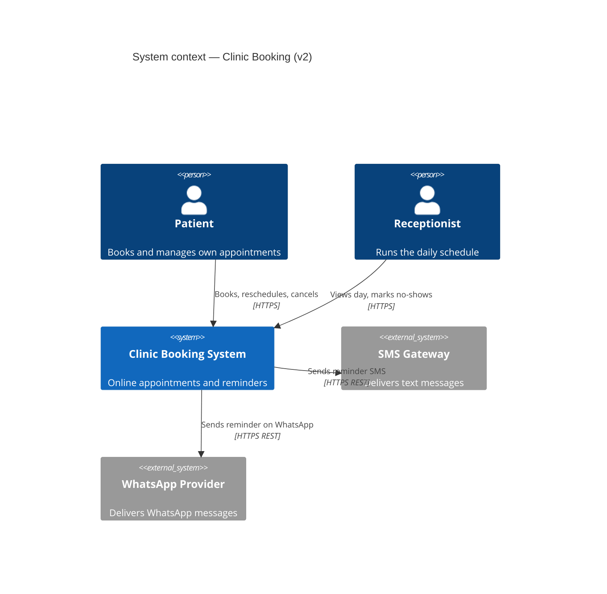
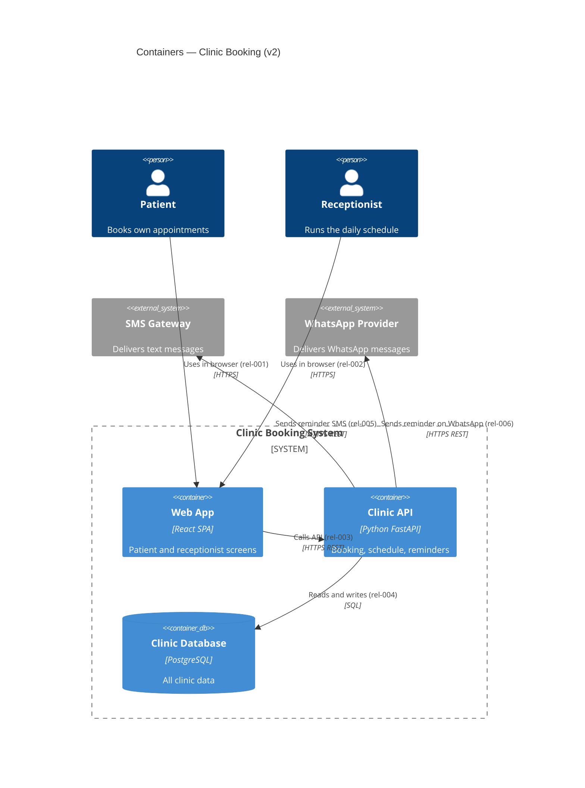
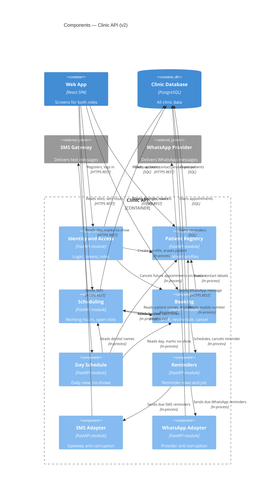
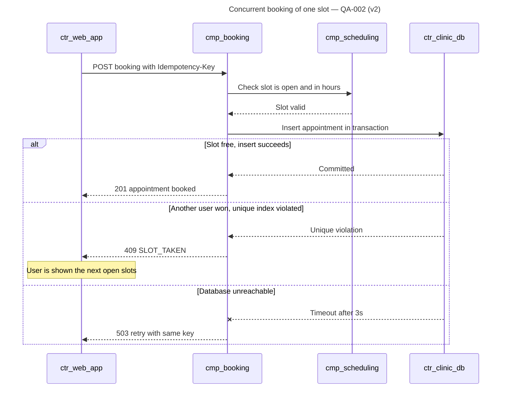
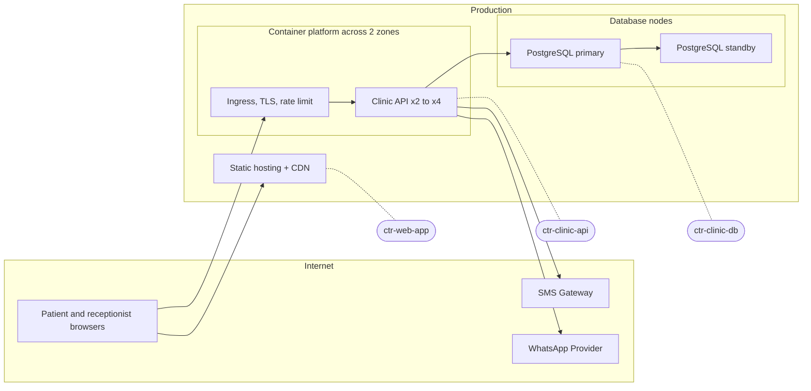

# Clinic Booking System — Architecture (HLD)

Version: v2 (requests 1 and 2 of requests.md) · Style: Modular monolith (ADR-0001) · Status: proposed

## 1. Context and scope

The Clinic Booking System lets a dental clinic's patients book, reschedule and cancel appointments online, lets receptionists see each dentist's day and mark no-shows, and sends a reminder 24 hours before a visit by SMS or WhatsApp, as the patient chose when booking. It is used by patients and receptionists of one clinic. Out of scope (inputs/clinic-prd.md): insurance claims and mobile apps.

Non-goals: insurance claims (CON-001), native or hybrid mobile apps (CON-002), payments, treatment records, patient check-in tracking beyond the day schedule.

| Actor | Kind (person / external system) | Interaction |
|---|---|---|
| act-patient | person | Registers, books, reschedules and cancels own appointments in the web app (US-1) |
| act-receptionist | person | Views each dentist's day, marks no-shows, maintains dentist working hours (US-2) |
| act-sms-gateway | external system | Receives reminder text messages and delivers them to patients' mobile phones |
| act-whatsapp-provider | external system | Receives reminder messages and delivers them to patients on WhatsApp (request 2) |

## 2. Requirements and drivers

### Functional requirements
| ID | Requirement | Priority (Must/Should/Could/Won't) | Source (request N / prd.md) |
|---|---|---|---|
| FR-1 | Patients book, reschedule and cancel appointments online (US-1: as a patient, I book a slot so that I don't have to call) | Must | inputs/clinic-prd.md FR-1, US-1 |
| FR-2 | Receptionists see each dentist's day and mark no-shows (US-2: as a receptionist, I see today's schedule so that I can check people in) | Must | inputs/clinic-prd.md FR-2, US-2 |
| FR-3 | Reminder 24 hours before the visit (originally SMS only; now sent on the channel chosen in FR-4, SMS by default) | Should | inputs/clinic-prd.md FR-3, request 2 |
| FR-4 | WhatsApp is a reminder channel alongside SMS: the patient chooses SMS or WhatsApp when booking, and the reminder goes out on that channel | Should | request 2 |

### Quality-attribute scenarios
| ID | Attribute | Priority (H/M/L importance / difficulty) | Source | Stimulus | Environment | Artifact | Response | Measure |
|---|---|---|---|---|---|---|---|---|
| QA-001 | Performance | M/M | Patient in a browser | Submits a booking, reschedule or cancel | Normal load, up to 10 requests/s (ASM-002) | Booking write path (cmp-booking) | Change committed and confirmed | p95 ≤ 1 s, error rate < 0.1% |
| QA-002 | Data integrity | H/H | Two users (patients or receptionists) | Submit the same dentist slot at the same moment | Peak booking time, up to 10 requests/s (ASM-002) | cmp-booking and ctr-clinic-db | Exactly one booking accepted, the other refused with a clear conflict | 0 double bookings in a test of 1,000 concurrent attempts on one slot, loser answered in p95 ≤ 1 s |
| QA-003 | Availability | H/M | Patient or receptionist | Uses the system during clinic hours | Production, a single instance or node fails | ctr-clinic-api, ctr-clinic-db | Service continues on the surviving instance | 99.9% monthly availability (ASM-010), failover ≤ 5 min |
| QA-004 | Reliability | H/M | Scheduler | Reminder falls due (24 h before visit) | SMS gateway returns errors for 1 hour | cmp-reminders, cmp-sms-adapter | Reminder retried with backoff, booking flow unaffected, no reminder after the cutoff | ≥ 99% of eligible reminders sent within 1 h of due time, none sent later than 2 h before the visit, duplicate rate < 0.1% |
| QA-005 | Performance | M/L | Receptionist | Opens a day schedule for all dentists | Peak morning, 3 receptionists refreshing every 30 s | cmp-day-schedule | Schedule returned | p95 ≤ 500 ms for up to 200 appointments (the assumed whole-clinic daily total, ASM-002) |
| QA-006 | Security | M/M | Anonymous or logged-in internet user | Calls any API operation, attempts another user's data | Production | ctr-clinic-api | Unauthenticated or unauthorised access refused, PII protected | OWASP ASVS L1 met, 0 endpoints other than register, login and /health reachable without a token, 0 PII values in logs |
| QA-007 | Scalability | L/M | Clinic growth | Load rises to 3× the assumed peak | Production | ctr-clinic-api | Handles load without redesign | 30 requests/s sustained with p95 ≤ 1 s by adding instances only |
| QA-008 | Durability | M/L | Operations | Database loss or corruption | Production | ctr-clinic-db | Restore from backup | RPO ≤ 15 min, RTO ≤ 1 h (ASM-010) |
| QA-009 | Reliability | M/M | Scheduler | A WhatsApp reminder falls due and the WhatsApp provider fails for 1 hour or rejects the recipient | Production | cmp-reminders, cmp-whatsapp-adapter | Transient errors retried with backoff, breaker open or permanent rejection switches that reminder once to SMS (ASM-015), booking flow unaffected, SMS channel unaffected | ≥ 99% of eligible reminders handed to a channel within 1 h of due time, none later than 2 h before the visit, a reminder is never sent on both channels (duplicate rate < 0.1%) |

Architectural drivers: QA-002.

### Constraints
| ID | Constraint | Kind (technical / regulatory / organizational / budget) |
|---|---|---|
| CON-001 | Insurance claims are out of scope (inputs/clinic-prd.md) | organizational |
| CON-002 | Mobile apps are out of scope: the client surface is a web app (inputs/clinic-prd.md) | organizational |
| CON-003 | WhatsApp business-initiated messages may only be sent with a provider-approved message template and to recipients who opted in (WhatsApp Business policy, request 2) | regulatory |

### Assumptions (to confirm with the client)
| ID | Assumption | Affects |
|---|---|---|
| ASM-001 | The hosting cloud is not stated: design is cloud-agnostic (Kubernetes container platform, PostgreSQL, static hosting) | ctr-clinic-api, ctr-clinic-db, ADR-0004 |
| ASM-002 | One clinic, about 10 dentists, 3 receptionists, 2,000 active patients, 200 appointments per day, peak 10 requests/s, receptionists refresh the day schedule every 30 s at the morning peak | QA-001, QA-005, QA-007, capacity |
| ASM-003 | Appointments occupy fixed 30-minute slots derived from each dentist's weekly working hours and blocked periods, which receptionists maintain | cmp-scheduling, ent-availability |
| ASM-004 | Patients self-register with email, password and a mobile number. Receptionist accounts are provisioned by clinic operations. No external identity provider | cmp-identity, ADR-0005 |
| ASM-005 | Patients may cancel or reschedule until 2 hours before the visit. Receptionists may cancel any time before the visit | cmp-booking, BR-005 |
| ASM-006 | One plain-text English reminder per appointment, due 24 h before the visit. No reminder when the booking is made less than 24 h ahead | cmp-reminders, FR-3 |
| ASM-007 | The clinic operates in one time zone. Times are stored in UTC and shown in the clinic time zone (value to be confirmed) | all time handling |
| ASM-008 | No regulation (GDPR, HIPAA, local health-data or SMS-consent law) is stated. GDPR-style controls are applied (minimal PII, retention, deletion). The client must confirm what applies and that patients have consented to reminder SMS | ent-patient, ent-reminder, RSK-006 |
| ASM-009 | The SMS gateway is a REST API with an API key, accepts an idempotency key and gives no delivery receipts. The provider is not yet chosen | rel-005, cmp-sms-adapter |
| ASM-010 | Customer-facing defaults apply: availability 99.9% monthly, RPO 15 min, RTO 1 h | QA-003, QA-008 |
| ASM-011 | Appointment and patient data are kept 3 years after the last visit, then anonymised. Reminder rows are kept 90 days | ent-appointment, ent-patient, ent-reminder |
| ASM-012 | Technology decision, not a client constraint: the backend is Python / FastAPI, the stack our backend agent builds. The client has no language or framework preference | ctr-clinic-api |
| ASM-013 | WhatsApp is reached through a WhatsApp Business API provider (not yet chosen) with a REST API, an API key and an idempotency key, one pre-approved English reminder template with first name, dentist and time as parameters, and no delivery receipts used. The client must pick the provider and have the template approved | rel-006, cmp-whatsapp-adapter, CON-003 |
| ASM-014 | The patient's single mobile number (E.164) is also their WhatsApp number. Choosing WhatsApp at booking counts as opt-in to WhatsApp reminders and the booking screen states this. Default channel when none is chosen is SMS. The client must confirm consent wording (extends ASM-008) | ent-patient, ent-appointment, RSK-008 |
| ASM-015 | If WhatsApp fails permanently (for example the number is not on WhatsApp) or its breaker is open, the reminder falls back to SMS once, because FR-3 values the reminder arriving over the channel. The client must confirm that SMS consent covers this | cmp-reminders, ADR-0007, RSK-009 |

## 3. Solution strategy

A modular monolith (ADR-0001): one FastAPI deployable whose capability modules each own their data, in front of one PostgreSQL database. It beats the next-simpler style (a plain monolith without enforced module ownership) because the SMS gateway must sit behind an anti-corruption adapter (QA-004) and the module boundaries keep later extraction cheap. It beats anything more distributed because QA-002 (no double booking) is solved by one database transaction and a unique constraint, which a split would turn into a saga.

Key patterns, each with its driver:
- Unique partial index on (dentist, start time) for active bookings, plus one transaction per booking (QA-002, ADR-0002).
- Idempotency key on booking writes so a retried request does not double-book (QA-001, QA-002).
- Reminders as rows in the database polled by an in-process scheduled job with row locks, not a message broker (QA-004, ADR-0003).
- Anti-corruption adapter around the SMS gateway with timeout, backoff and breaker (QA-004).
- A second adapter, cmp-whatsapp-adapter, behind the same channel interface; cmp-reminders picks the adapter from the reminder's channel, with one-time SMS fallback (QA-009, ADR-0006, ADR-0007). No new container: the change stays inside the modular monolith.
- Stateless API instances (at least 2) behind the ingress (QA-003, QA-007).
- RBAC with two roles, patient and receptionist, and own-records-only checks (QA-006).

## 4. Building blocks

Views: the container diagram (all containers), and the component diagram of ctr-clinic-api (its eight components).

The pair cmp-booking and cmp-scheduling is mutual by design: cmp-booking asks cmp-scheduling whether a slot is bookable, and cmp-scheduling asks cmp-booking only for read-only booked start times, so open slots exclude taken ones. Both are in-process calls through interfaces, never each other's tables, and the booked-start query is injected at startup to avoid an import cycle. cmp-day-schedule owns no data: it gets appointments from cmp-booking, dentist names from cmp-scheduling and patient names and mobiles from cmp-patient-registry.

### Containers
| ID | Name | Kind | Technology | Responsibilities | Owns data | Buildable by backend agent |
|---|---|---|---|---|---|---|
| ctr-web-app | Web App | Web front end (static SPA) | React, served from static hosting behind a CDN | Patient screens (register, login, find slot, book with reminder channel choice, reschedule, cancel) and receptionist screens (day schedule, no-show, working hours) | None | no |
| ctr-clinic-api | Clinic API | Backend service (modular monolith) | Python 3 + FastAPI | All business logic, authentication, scheduled reminder job, SMS and WhatsApp integration, `GET /health` | Owns all entities through its components (section 5) | yes |
| ctr-clinic-db | Clinic Database | Relational data store | PostgreSQL | Durable storage of every entity, uniqueness guarantee against double booking, backups | Physical store of ent-user-account, ent-patient, ent-dentist, ent-availability, ent-appointment, ent-reminder | no |

### Components

Container ctr-clinic-api:

| ID | Container | Name | Responsibility |
|---|---|---|---|
| cmp-identity | ctr-clinic-api | Identity and Access | Registration, login, password hashing, token issue and validation, role checks, login rate limiting |
| cmp-patient-registry | ctr-clinic-api | Patient Registry | Patient profiles and contact details, anonymisation on retention expiry |
| cmp-scheduling | ctr-clinic-api | Scheduling | Dentists, weekly working hours, blocked periods, computation of open slots |
| cmp-booking | ctr-clinic-api | Booking | Book (with the chosen reminder channel), reschedule, cancel, no-show transition, appointment queries, double-booking protection |
| cmp-day-schedule | ctr-clinic-api | Day Schedule | Receptionist view of each dentist's day, no-show entry point |
| cmp-reminders | ctr-clinic-api | Reminders | Creates and cancels reminder rows on the appointment's channel, scheduled job that dispatches due reminders through the adapter of the reminder's channel, one-time fallback from WhatsApp to SMS |
| cmp-sms-adapter | ctr-clinic-api | SMS Adapter | Anti-corruption adapter to the SMS gateway: timeout, error classification, breaker |
| cmp-whatsapp-adapter | ctr-clinic-api | WhatsApp Adapter | Anti-corruption adapter to the WhatsApp provider: approved template, timeout, error classification (including recipient not on WhatsApp), its own breaker |

## 5. Data

| ID | Entity | Owner (container or component) | Key attributes (mark PII / sensitive) | Store | Retention |
|---|---|---|---|---|---|
| ent-user-account | User account | cmp-identity | id, email (PII), password hash (sensitive), role (patient or receptionist), status, failed login count | ctr-clinic-db | Life of the account, deleted with the patient (ASM-011) |
| ent-patient | Patient | cmp-patient-registry | id, account id, full name (PII), mobile number (PII), erased flag | ctr-clinic-db | 3 years after last visit, then anonymised (ASM-011) |
| ent-dentist | Dentist | cmp-scheduling | id, display name, active flag | ctr-clinic-db | Life of the clinic's operation |
| ent-availability | Dentist availability | cmp-scheduling | dentist id, weekday, start time, end time, blocked-period flag, valid dates | ctr-clinic-db | 3 years (ASM-011) |
| ent-appointment | Appointment | cmp-booking | id, patient id (links to PII), dentist id, start and end time, status (booked, cancelled, no-show), idempotency key, marked-by, version, reminder channel (sms or whatsapp, default sms, ASM-014) | ctr-clinic-db | 3 years after the visit, then patient link anonymised (ASM-011) |
| ent-reminder | Reminder | cmp-reminders | id, appointment id, due time, channel (sms or whatsapp, copied from the appointment), fallback-used flag, status, attempts, sent time, provider reference | ctr-clinic-db | 90 days after the visit (ASM-011) |

Relationships: a patient has one user account (ent-patient → ent-user-account), a dentist has many availability rows (ent-dentist → ent-availability), a patient and a dentist each have many appointments (ent-patient, ent-dentist → ent-appointment), an appointment has at most one active reminder (ent-appointment → ent-reminder). Reminder message text is built at send time and never stored. A reschedule keeps the appointment's reminder channel, and the new reminder copies it. Deletion path for a patient on request: the API operation `DELETE /patients/{id}` cancels the patient's future appointments (cmp-booking), anonymises name and mobile and sets the erased flag (cmp-patient-registry `erase_patient`) and deletes the account (cmp-identity `delete_account`), orchestrated by cmp-identity in one transaction. Past appointments are kept with the anonymised link (LLD BR-016).

Consistency: every data crossing between components is an in-process call inside one database transaction, so it is strong. The only eventual relation is the reminder: ent-reminder is written in the booking transaction (strong), and the SMS is sent by the job within 1 h of the due time (QA-004). There are no cross-container data copies.

Backup, RPO and RTO for ctr-clinic-db: continuous WAL archiving with a daily full backup kept 30 days, point-in-time restore, RPO 15 min, RTO 1 h (ASM-010), a restore test each quarter.

## 6. Integration and APIs
| ID | From | To | Purpose | Protocol | Sync/async | Contract | Auth | Resilience (timeout, retry, breaker, fallback) |
|---|---|---|---|---|---|---|---|---|
| rel-001 | act-patient | ctr-web-app | Load the web app | HTTPS | sync | None (static assets, no data) | none (public static files) | CDN caching, no fallback needed |
| rel-002 | act-receptionist | ctr-web-app | Load the web app | HTTPS | sync | None (static assets, no data) | none (public static files) | CDN caching, no fallback needed |
| rel-003 | ctr-web-app | ctr-clinic-api | All business operations | HTTPS REST/JSON | sync | api-clinic-api-v1 | jwt (bearer, 60 min) | Browser timeout 10 s, retry GETs twice with backoff, writes retried only with the same Idempotency-Key, no breaker, user sees a retry message |
| rel-004 | ctr-clinic-api | ctr-clinic-db | Persist and read all entities | SQL over TLS | sync | None (internal) | DB credentials from secret store | Connection pool, statement timeout 3 s, retry twice on serialization failure, `/health` fails if unreachable, no fallback |
| rel-005 | ctr-clinic-api | act-sms-gateway | Send reminder SMS | HTTPS REST | sync call from a background job | External provider API (no contract file here) | apikey | Timeout 5 s, retry via the job with backoff 5, 15, 60 min up to 5 attempts and not after 2 h before the visit, breaker opens after 5 consecutive failures for 5 min, fallback: reminder stays pending and alerts fire, bookings are never blocked |
| rel-006 | ctr-clinic-api | act-whatsapp-provider | Send reminder on WhatsApp | HTTPS REST | sync call from a background job | External provider API (no contract file here) | apikey | Timeout 5 s, retry via the job with the same backoff and cutoff as rel-005, breaker opens after 5 consecutive failures for 5 min and is independent of rel-005, fallback: a permanent error or an open breaker switches the reminder once to SMS (rel-005, ADR-0007), bookings are never blocked |

`rel-003` also changes in content, not in transport: the book operation accepts the optional `reminder_channel`.

### Contracts
| ID | Owner | File | Version |
|---|---|---|---|
| api-clinic-api-v1 | ctr-clinic-api | contracts/clinic-api-v1.openapi.yaml | 1.1.0 |

Version 1.1.0 is additive: optional `reminder_channel` (`sms` or `whatsapp`, default `sms`) on the booking request and on the appointment response, so existing clients keep working. The Data & API Design agent updates the file.

### Events
No asynchronous messaging.

## 7. Runtime scenarios

Driver QA-002: two users submit the same slot at once.

## 8. Deployment
| Environment | Node | Kind | Hosts (container ids) | Replicas / scaling |
|---|---|---|---|---|
| dev | Static hosting | Object storage + CDN (or nginx) | ctr-web-app | 1 |
| dev | Container platform | Kubernetes deployment | ctr-clinic-api | 1 |
| dev | PostgreSQL | Single instance | ctr-clinic-db | 1, no standby |
| staging | Static hosting | Object storage + CDN (or nginx) | ctr-web-app | 1 |
| staging | Container platform | Kubernetes deployment | ctr-clinic-api | 2 |
| staging | PostgreSQL | Single instance | ctr-clinic-db | 1, no standby |
| prod | Static hosting | Object storage + CDN | ctr-web-app | CDN edge |
| prod | Container platform | Kubernetes deployment across 2 zones, outbound HTTPS to the SMS gateway and the WhatsApp provider | ctr-clinic-api | 2 minimum, scale to 4 at CPU above 65% |
| prod | PostgreSQL | Primary with standby in a second zone | ctr-clinic-db | 1 primary + 1 standby |

CI/CD: for ctr-clinic-api: build, unit tests, contract tests against `contracts/clinic-api-v1.openapi.yaml`, image scan, deploy to staging, smoke test (`GET /health`, a booking round trip), deploy to prod with a rolling update (availability target 99.9%). Database migrations are forward-compatible (expand then contract). ctr-web-app: build, tests, publish static files to staging then prod. Rollback trigger: any failed `/health` check after rollout, or a 5xx rate above 2% for 5 minutes, rolls back to the previous image.

## 9. Security

### Trust boundaries
| ID | Boundary | Members |
|---|---|---|
| tb-internet | Untrusted users and external systems | act-patient, act-receptionist, act-sms-gateway, act-whatsapp-provider, ctr-web-app (code running in the user's browser) |
| tb-internal | The clinic's application runtime | ctr-clinic-api |
| tb-data | Data stores | ctr-clinic-db |

Identity and access: patients and receptionists log in with email and password and receive a signed JWT valid for 60 minutes (ASM-004, ADR-0005). Roles: patient (own records only) and receptionist (all appointments, working hours, no-shows). Only register, login and `GET /health` are unauthenticated. The SMS gateway and the WhatsApp provider are each called with their own API key. The API reaches the database with its own DB credentials. There are no service-to-service calls.

Data protection and secrets: TLS 1.2+ on every edge, including the database connection. Encryption at rest on ctr-clinic-db and its backups. Passwords hashed with argon2id. The JWT signing key, database credentials, SMS API key and WhatsApp API key live in the platform secret store and reach the container as environment variables, never in images or documents. Logs carry ids and never email, name or mobile number. The reminder text contains only the first name, dentist name and time, and nothing about treatment.

### Threats (STRIDE)
| ID | STRIDE | Target (rel or container id) | Threat | Mitigation | Status (mitigated / accepted + RSK id) |
|---|---|---|---|---|---|
| thr-001 | Spoofing | rel-003 | Attacker guesses or reuses credentials to act as a patient or receptionist | argon2id hashing, 12-character minimum, lockout after 5 failures in 15 min and rate limit in cmp-identity, 60-minute token expiry | mitigated |
| thr-002 | Tampering | rel-003 | Patient edits an appointment id to change or cancel another patient's booking | Own-records check in cmp-booking (BR-004), identifiers are random UUIDs | mitigated |
| thr-003 | Repudiation | rel-003 | A user denies cancelling or a receptionist denies marking a no-show | Appointment stores who changed it and when, structured audit log with correlation id | mitigated |
| thr-004 | Information disclosure | ctr-clinic-db | Database or backup leaks patient names and mobile numbers | Encryption at rest, TLS, least-privilege DB user, restricted network, no PII in logs, 3-year retention then anonymisation | mitigated |
| thr-005 | Denial of service | rel-003 | Flood of requests, or one patient hoarding slots | Ingress and per-account rate limits, at most 5 future active appointments per patient (BR-003), stateless scale-out | mitigated |
| thr-006 | Elevation of privilege | rel-003 | Patient calls receptionist operations (day schedule, no-show, working hours) | RBAC enforced on every route by cmp-identity, deny by default (authorization matrix in LLD) | mitigated |
| thr-007 | Tampering | rel-004 | SQL injection through booking or search inputs | Parameterised queries through the ORM only, input validation, least-privilege DB user | mitigated |
| thr-008 | Spoofing | rel-005 | Leaked SMS API key lets an attacker send messages | Key in secret store, rotated every 90 days, TLS, spend alert on the provider account | mitigated |
| thr-009 | Information disclosure | rel-005 | Reminder text discloses personal or medical details to a wrong recipient | Minimal text (first name, dentist, time), mobile number validated and owned by the patient, no treatment data | mitigated |
| thr-010 | Spoofing | rel-006 | Leaked WhatsApp API key lets an attacker send messages in the clinic's name | Key in secret store, rotated every 90 days, TLS, spend and volume alert on the provider account | mitigated |
| thr-011 | Information disclosure | rel-006 | WhatsApp reminder reaches a number that is not the patient's, or reveals details on a lock screen | Only the approved template with first name, dentist and time (CON-003), number validated at registration and owned by the patient, no treatment data, WhatsApp only after the patient chose it (ASM-014) | mitigated |

## 10. Quality tactics and capacity
| Scenario | Tactic | Applied to (element ids) |
|---|---|---|
| QA-001 | Connection pooling, indexed lookups on dentist and start time, idempotency key on writes | ctr-clinic-api, cmp-booking, rel-004 |
| QA-002 | Unique partial index on active bookings, single transaction per booking, reschedule as one transaction | cmp-booking, ctr-clinic-db, ent-appointment |
| QA-003 | At least 2 API instances across zones, health checks on `/health` with auto-restart, managed database with standby | ctr-clinic-api, ctr-clinic-db |
| QA-004 | Retries with backoff, circuit breaker, anti-corruption adapter, row-lock claim so replicas never double-send, provider idempotency key, cutoff at 2 h before visit | cmp-reminders, cmp-sms-adapter, rel-005, ent-reminder |
| QA-009 | Separate adapter and breaker per channel, one-time fallback to SMS recorded on the reminder row (a reminder is claimed and sent on one channel at a time), same retry, row-lock claim and cutoff as QA-004 | cmp-reminders, cmp-whatsapp-adapter, cmp-sms-adapter, rel-006, ent-reminder |
| QA-005 | One indexed query per day view, pagination, connection pooling | cmp-day-schedule, ent-appointment |
| QA-006 | RBAC, argon2id, rate limiting, TLS, encryption at rest, PII-free logs | cmp-identity, rel-003, ctr-clinic-db |
| QA-007 | Stateless API behind ingress, autoscaling on CPU above 65%, database scaling path: larger instance then read replica | ctr-clinic-api, ctr-clinic-db |
| QA-008 | WAL archiving, daily full backup, standby, quarterly restore test | ctr-clinic-db |

Capacity estimate (ASM-002):
- Booking traffic: 200 appointments per day. A booking session is about 10 requests (login, dentists, slots, book, list), so 200 × 10 = 2,000 requests per day. Spread over a 12-hour day that is 2,000 / 43,200 s ≈ 0.05 requests/s on average. Allowing a 100× burst (morning peak, one hour) gives about 5 requests/s.
- Receptionist traffic: 3 receptionists refreshing every 30 s = 0.1 requests/s, plus clicks, about 1 request/s.
- Assumed peak 10 requests/s (the sum above rounded up), design target 3× = 30 requests/s (QA-007).
- Payload: JSON under 5 KB per response, so 30 × 5 KB = 150 KB/s, trivial.
- Instances: one FastAPI instance with 4 workers handles over 100 requests/s for this kind of work, so 2 instances (for availability, not load) carry 3× peak with margin.
- Data growth: appointment row about 1 KB plus indexes, reminder about 0.5 KB, so 200 × 1.5 KB = 300 KB per day ≈ 110 MB per year. Storage is about 0.1 GB at 1 year and 0.35 GB at 3 years including patients and availability. A 20 GB database volume is ample.

SLOs:
| SLI | Target | Window |
|---|---|---|
| Booking write (book, reschedule, cancel) latency, p95 | ≤ 1 s | 30 days |
| Booking requests not ending in 5xx | ≥ 99.9% | 30 days |
| API availability (`/health` plus success of probe booking) | 99.9% | calendar month |
| Day-schedule latency, p95 | ≤ 500 ms | 30 days |
| Reminders sent within 1 h of due time, on either channel | ≥ 99% | 30 days |

## 11. Traceability
| Requirement / scenario | Satisfied by (element ids) |
|---|---|
| FR-1 (US-1) | ctr-web-app, ctr-clinic-api, cmp-identity, cmp-patient-registry, cmp-scheduling, cmp-booking, ent-appointment, ent-availability, rel-003, rel-004, api-clinic-api-v1 |
| FR-2 (US-2) | ctr-web-app, cmp-day-schedule, cmp-booking, cmp-scheduling, ent-appointment, rel-003, rel-004, api-clinic-api-v1 |
| FR-3 | cmp-reminders, cmp-sms-adapter, cmp-whatsapp-adapter, ent-reminder, rel-005, rel-006, rel-004 |
| FR-4 | ctr-web-app, cmp-booking, cmp-reminders, cmp-whatsapp-adapter, ent-appointment, ent-reminder, rel-003, rel-006, api-clinic-api-v1, CON-003, ADR-0006, ADR-0007 |
| QA-001 | cmp-booking, rel-004, api-clinic-api-v1 |
| QA-002 | cmp-booking, ctr-clinic-db, ent-appointment, ADR-0002 |
| QA-003 | ctr-clinic-api, ctr-clinic-db, section 8 deployment |
| QA-004 | cmp-reminders, cmp-sms-adapter, rel-005, ent-reminder, ADR-0003 |
| QA-005 | cmp-day-schedule, ent-appointment |
| QA-009 | cmp-reminders, cmp-whatsapp-adapter, cmp-sms-adapter, rel-006, ent-reminder, ADR-0007 |
| QA-006 | cmp-identity, rel-003, ctr-clinic-db, tb-internet, tb-internal, tb-data, thr-001 to thr-011 |
| QA-007 | ctr-clinic-api, ctr-clinic-db |
| QA-008 | ctr-clinic-db |
| CON-001, CON-002 | Non-goals in section 1, no insurance or mobile elements exist |
| CON-003 | cmp-whatsapp-adapter (approved template only), thr-011, RSK-008 |
| ASM-013, ASM-014, ASM-015 | rel-006, cmp-whatsapp-adapter, ent-appointment, cmp-reminders |
| ASM-012 | ctr-clinic-api (Python / FastAPI) |

## 12. Risks and technical debt
| ID | Risk | Likelihood | Impact | Mitigation |
|---|---|---|---|---|
| RSK-001 | SMS gateway outage or slow delivery causes reminders to be late or missed | Medium | Medium | Backoff retries until 2 h before the visit, breaker, alert on pending reminders past due, bookings unaffected (QA-004) |
| RSK-002 | A crash between the SMS being accepted and the reminder being marked sent causes a duplicate SMS | Low | Low | Provider idempotency key equal to the reminder id (ASM-009), duplicate rate measure < 0.1% |
| RSK-003 | Kubernetes is heavy for one clinic's small load and needs ops skill (ADR-0004) | Medium | Medium | Managed Kubernetes or a managed container service once the cloud is known, ASM-001 confirmation |
| RSK-004 | Time zone or daylight-saving errors send reminders at the wrong time or break slot computation | Medium | High | UTC storage, clinic time zone in configuration (ASM-007), tests around DST changes |
| RSK-005 | Business rules chosen by assumption (30-minute slots, 2-hour cancel cutoff, no reminder under 24 h) do not match the clinic's practice | Medium | Medium | Rules are configuration values (LLD), client confirms ASM-003, ASM-005, ASM-006 |
| RSK-006 | Unknown regulation or SMS consent rules (health data, GDPR, local telemarketing law) require extra controls | Medium | High | Client confirms ASM-008, minimal PII, retention and anonymisation already designed, consent flag can be added to ent-patient |
| RSK-007 | In-process scheduled job is lost if all API instances are down, so reminders are delayed | Low | Medium | Job catches up on start (due and not yet expired reminders), 2+ instances, alert on backlog |
| RSK-008 | WhatsApp template is not approved, is rejected or changed by the provider, or opt-in wording is insufficient (CON-003, ASM-014), so WhatsApp reminders cannot go out | Medium | Medium | Client has the template approved before go-live, WhatsApp option hidden by configuration until then, fallback to SMS, client confirms ASM-013 and ASM-014 |
| RSK-009 | Fallback to SMS for a patient who chose WhatsApp may exceed their consent, or a fallback after an ambiguous WhatsApp failure sends the reminder twice | Low | Medium | Client confirms ASM-015, fallback only on permanent error or open breaker and at most once (ADR-0007), provider idempotency key per channel |

## 13. Backend handoff
| Container | Backend mode | Language / framework | Database | Auth method | Contract file |
|---|---|---|---|---|---|
| ctr-clinic-api | fastapi_greenfield | Python / FastAPI | PostgreSQL (ctr-clinic-db) | jwt (bearer) | contracts/clinic-api-v1.openapi.yaml |

Not built by the backend agent: ctr-web-app (a web front end, which the backend agent does not build), ctr-clinic-db (managed database infrastructure).

## 14. Change log
| Version | Request | Change | Impact (element ids) | Compatibility / migration |
|---|---|---|---|---|
| v1 | request 1 | Initial design | all | Not applicable (first version) |
| v2 | request 2 | Add WhatsApp as a reminder channel; patient chooses SMS or WhatsApp when booking. Adds FR-4, QA-009, CON-003, ASM-013 to ASM-015, act-whatsapp-provider, cmp-whatsapp-adapter, rel-006, thr-010, thr-011, RSK-008, RSK-009, ADR-0006, ADR-0007. Changes FR-3 wording, ent-appointment, ent-reminder, cmp-booking, cmp-reminders, ctr-web-app, ctr-clinic-api, rel-003 content, api-clinic-api-v1 | FR-3, FR-4, QA-004, QA-009, ctr-web-app, ctr-clinic-api, cmp-booking, cmp-reminders, cmp-whatsapp-adapter, ent-appointment, ent-reminder, rel-003, rel-006, api-clinic-api-v1, tb-internet, thr-010, thr-011 | Additive and backward compatible: api-clinic-api-v1 1.0.0 → 1.1.0 (optional `reminder_channel`, default `sms`, so current clients are unaffected; consumer ctr-web-app). Migration: (1) expand: add nullable `reminder_channel` on ent-appointment and `channel`, `fallback_used` on ent-reminder, default `sms`, deployable before code; (2) deploy the API, WhatsApp hidden by configuration; (3) backfill existing rows to `sms`; (4) deploy the web app channel choice, then enable WhatsApp once the template is approved (feature flag). Rollback: disable the flag, existing WhatsApp reminders then fall back to SMS; columns stay |
