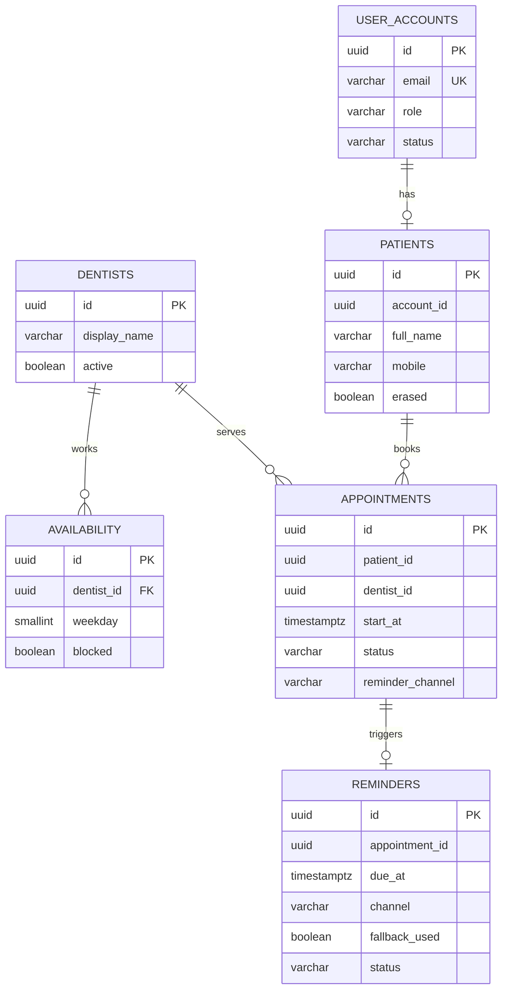

# Clinic Booking System — Data Model

Based on: architecture v2 · Status: proposed

## 1. Stores

| Store (ctr id) | Engine and version | Owner (ctr / cmp id) | Entities | Backup / RPO / RTO |
|---|---|---|---|---|
| ctr-clinic-db | PostgreSQL 16, one database, schema `clinic`, TLS required, encryption at rest | ctr-clinic-api (each table is owned by the component named in section 3) | ent-user-account (cmp-identity), ent-patient (cmp-patient-registry), ent-dentist (cmp-scheduling), ent-availability (cmp-scheduling), ent-appointment (cmp-booking), ent-reminder (cmp-reminders) | Continuous WAL archiving plus daily full backup kept 30 days, point-in-time restore, standby in a second zone. RPO 15 min, RTO 1 h (ASM-010), restore test each quarter |

Ownership rule: a component reads and writes only its own tables. Other components go through its interface (LLD section 2.1). Because of that, a column that points at another component's table is a plain `uuid` column with **no foreign key**, marked "not enforced" below. Foreign keys exist only between tables of the same component (`availability` → `dentists`). The application keeps these references consistent inside one transaction.

Conventions: ids are `uuid` generated by the API (UUID v4). All timestamps are `timestamptz` and hold UTC. Enumerations are `varchar` with a `check` constraint (no PostgreSQL enum type, so a new value is a simple migration). The database holds no money.

## 2. Entity-relationship diagrams

Store ctr-clinic-db (6 tables). Cross-component relationships are logical (not enforced by a foreign key). The full column list is in section 3.

## 3. Tables

### user_accounts (ent-user-account)
Owner: cmp-identity.

| Column | Type | Null | Default | Constraint (PK / FK / unique / check) | Classification (PII / sensitive / -) |
|---|---|---|---|---|---|
| id | uuid | no | none (set by API) | PK | - |
| email | varchar(254) | no | none | unique on `lower(email)` (index below), check length ≥ 3 | PII |
| password_hash | varchar(255) | no | none | argon2id encoded hash | sensitive |
| role | varchar(16) | no | none | check in ('patient', 'receptionist') | - |
| status | varchar(16) | no | 'active' | check in ('active', 'locked'). The LLD state Deleted is not stored: `delete_account` removes the row | - |
| failed_logins | integer | no | 0 | check ≥ 0 | - |
| first_failed_at | timestamptz | yes | null | start of the 15-minute failure window (BR-013) | - |
| locked_until | timestamptz | yes | null | set when status = 'locked' | - |
| created_at | timestamptz | no | now() | | - |

Indexes:
| Name | Columns | Unique | Serves (access pattern id) |
|---|---|---|---|
| pk_user_accounts | id | yes | AP-002 |
| ux_user_accounts_email_lower | lower(email) | yes | AP-001, EMAIL_TAKEN check at registration |

### patients (ent-patient)
Owner: cmp-patient-registry.

| Column | Type | Null | Default | Constraint (PK / FK / unique / check) | Classification (PII / sensitive / -) |
|---|---|---|---|---|---|
| id | uuid | no | none (set by API) | PK | - |
| account_id | uuid | yes | none | Reference to user_accounts.id, **not enforced** (other owner). Null after the account is deleted on erasure (BR-016). Unique when not null | PII (links to an identity) |
| full_name | varchar(200) | no | none | overwritten with 'ERASED' on anonymisation | PII |
| mobile | varchar(16) | no | none | check matches `^\+[1-9][0-9]{7,14}$` (E.164, BR-014). Overwritten with '+0000000000' on anonymisation (the check pattern is relaxed for that value: `mobile = '+0000000000' or` the E.164 pattern) | PII |
| erased | boolean | no | false | The `erased` flag of ent-patient (LLD classDiagram, BR-016). Set to true together with `anonymised_at` when name and mobile are overwritten, by erasure on request or by retention. Never set back to false | - |
| anonymised_at | timestamptz | yes | null | set when name and mobile were overwritten (erasure or retention). Table check `ck_patients_erased`: `(erased = true) = (anonymised_at is not null)` | - |
| created_at | timestamptz | no | now() | | - |

Indexes:
| Name | Columns | Unique | Serves (access pattern id) |
|---|---|---|---|
| pk_patients | id | yes | AP-002, AP-015 |
| ux_patients_account | account_id where account_id is not null | yes | AP-003 |
| ix_patients_anonymisation | created_at where erased = false | no | AP-016 |

### dentists (ent-dentist)
Owner: cmp-scheduling.

| Column | Type | Null | Default | Constraint (PK / FK / unique / check) | Classification (PII / sensitive / -) |
|---|---|---|---|---|---|
| id | uuid | no | none (set by API or seed) | PK | - |
| display_name | varchar(120) | no | none | | - (business contact, a staff name already shown to patients) |
| active | boolean | no | true | | - |
| created_at | timestamptz | no | now() | | - |

Indexes:
| Name | Columns | Unique | Serves (access pattern id) |
|---|---|---|---|
| pk_dentists | id | yes | AP-004 |
| ix_dentists_active_name | active, display_name | no | AP-004 |

### availability (ent-availability)
Owner: cmp-scheduling. One table holds both weekly working-hours rules (`blocked = false`) and blocked periods (`blocked = true`), as the HLD entity does. Times of day are clinic local time (`CLINIC_TIMEZONE`); blocked periods are absolute instants.

| Column | Type | Null | Default | Constraint (PK / FK / unique / check) | Classification (PII / sensitive / -) |
|---|---|---|---|---|---|
| id | uuid | no | none (set by API) | PK | - |
| dentist_id | uuid | no | none | FK → dentists.id (same owner), on delete restrict | - |
| blocked | boolean | no | false | | - |
| weekday | smallint | yes | null | check between 0 (Monday) and 6 (Sunday). Required when blocked = false, null when blocked = true | - |
| start_time | time | yes | null | local start of working hours. Required when blocked = false | - |
| end_time | time | yes | null | check end_time > start_time. Required when blocked = false | - |
| valid_from | date | yes | null | first day the rule applies (null = no lower bound) | - |
| valid_to | date | yes | null | check valid_to ≥ valid_from when both set | - |
| blocked_from_at | timestamptz | yes | null | Required when blocked = true (UTC) | - |
| blocked_to_at | timestamptz | yes | null | check blocked_to_at > blocked_from_at. Required when blocked = true | - |
| created_at | timestamptz | no | now() | | - |

Table check `ck_availability_kind`: `(blocked = false and weekday is not null and start_time is not null and end_time is not null and blocked_from_at is null and blocked_to_at is null) or (blocked = true and blocked_from_at is not null and blocked_to_at is not null and weekday is null)`.

Indexes:
| Name | Columns | Unique | Serves (access pattern id) |
|---|---|---|---|
| pk_availability | id | yes | AP-005 |
| ix_availability_dentist_rules | dentist_id, weekday where blocked = false | no | AP-005 |
| ix_availability_dentist_blocks | dentist_id, blocked_from_at where blocked = true | no | AP-005 |
| ix_availability_retention_rules | valid_to where blocked = false and valid_to is not null | no | AP-019 |
| ix_availability_retention_blocks | blocked_to_at where blocked = true | no | AP-019 |

### appointments (ent-appointment)
Owner: cmp-booking.

| Column | Type | Null | Default | Constraint (PK / FK / unique / check) | Classification (PII / sensitive / -) |
|---|---|---|---|---|---|
| id | uuid | no | none (set by API) | PK | - |
| patient_id | uuid | no | none | Reference to patients.id, **not enforced** (other owner). Past appointments stay after patient anonymisation (BR-016) | PII (links to a person) |
| dentist_id | uuid | no | none | Reference to dentists.id, **not enforced** (other owner) | - |
| start_at | timestamptz | no | none | | - |
| end_at | timestamptz | no | none | check end_at > start_at | - |
| status | varchar(16) | no | 'booked' | check in ('booked', 'cancelled', 'no_show') | - |
| idempotency_key | varchar(100) | yes | null | Set on create by `book` (BR-012). Null for rows created by reschedule | - |
| changed_by | uuid | yes | null | Account id of the last actor, **not enforced** (other owner). May point at a deleted account | PII (links to a person) |
| changed_at | timestamptz | yes | null | | - |
| version | integer | no | 1 | check ≥ 1, incremented on every update | - |
| reminder_channel | varchar(16) | no (nullable only between V007 and V009, see section 6) | 'sms' | check in ('sms', 'whatsapp') (`ck_appointments_reminder_channel`, BR-017). Chosen by the patient at booking, an omitted API value is stored as 'sms'. Kept by a reschedule (the new row copies it). 'whatsapp' is only accepted by the API while WHATSAPP_ENABLED is true. Not an index column: never queried by channel | - (a preference, not PII on its own) |
| created_at | timestamptz | no | now() | | - |

Indexes:
| Name | Columns | Unique | Serves (access pattern id) |
|---|---|---|---|
| pk_appointments | id | yes | AP-007 |
| ux_appointments_active_slot | dentist_id, start_at where status = 'booked' | yes | AP-007 (the QA-002 guard, BR-002), AP-006 |
| ux_appointments_idem | patient_id, idempotency_key where idempotency_key is not null | yes | AP-011 |
| ix_appointments_patient_start | patient_id, start_at | no | AP-008, AP-010, AP-016 |
| ix_appointments_start | start_at | no | AP-009 |

### reminders (ent-reminder)
Owner: cmp-reminders. `appointment_start_at` is a copy kept by cmp-reminders (written in the same transaction as the booking, never updated: a reschedule creates a new appointment and a new reminder), so that the cutoff (BR-010) and retention need no read of cmp-booking's table. Message text is never stored.

| Column | Type | Null | Default | Constraint (PK / FK / unique / check) | Classification (PII / sensitive / -) |
|---|---|---|---|---|---|
| id | uuid | no | none (set by API) | PK. Also the provider idempotency key (BR-011) | - |
| appointment_id | uuid | no | none | Reference to appointments.id, **not enforced** (other owner) | - |
| appointment_start_at | timestamptz | no | none | | - |
| due_at | timestamptz | no | none | check due_at ≤ appointment_start_at | - |
| channel | varchar(16) | no (nullable only between V007 and V009, see section 6) | 'sms' | check in ('sms', 'whatsapp') (`ck_reminders_channel`). Copied from `appointments.reminder_channel` when the row is created (BR-017), so cmp-reminders never reads cmp-booking's table. Changed from 'whatsapp' to 'sms' once by the fallback (BR-019) | - |
| fallback_used | boolean | no (nullable only between V007 and V009) | false | Set to true by the one-time WhatsApp → SMS fallback (BR-019, ADR-0007). Table check `ck_reminders_fallback`: `fallback_used = false or channel = 'sms'`. Never set back to false | - |
| status | varchar(16) | no | 'pending' | check in ('pending', 'sending', 'sent', 'failed', 'expired', 'cancelled') | - |
| attempts | integer | no | 0 | check between 0 and 5 | - |
| next_attempt_at | timestamptz | no | none (set to due_at on create) | | - |
| claimed_at | timestamptz | yes | null | set when status becomes 'sending' (stuck-row recovery, JOB-001) | - |
| sent_at | timestamptz | yes | null | | - |
| provider_ref | varchar(100) | yes | null | message reference from the SMS gateway or the WhatsApp provider, whichever accepted the message | - |
| created_at | timestamptz | no | now() | | - |

Indexes:
| Name | Columns | Unique | Serves (access pattern id) |
|---|---|---|---|
| pk_reminders | id | yes | AP-012 |
| ux_reminders_active_per_appointment | appointment_id where status in ('pending', 'sending') | yes | AP-014 (at most one active reminder per appointment) |
| ix_reminders_due | next_attempt_at where status = 'pending' | no | AP-012 |
| ix_reminders_sending | claimed_at where status = 'sending' | no | AP-013 |
| ix_reminders_retention | appointment_start_at | no | AP-017 |

## 4. Access patterns

| ID | Query (in words) | Issued by (cmp id) | Frequency (per second at peak) | Served by (index) |
|---|---|---|---|---|
| AP-001 | Find one account by lower-case email (login, registration duplicate check) | cmp-identity | 1 | ux_user_accounts_email_lower |
| AP-002 | Get one account or patient by id (token check data, profile read) | cmp-identity, cmp-patient-registry | 5 | pk_user_accounts, pk_patients |
| AP-003 | Find the patient of an account id | cmp-patient-registry | 1 | ux_patients_account |
| AP-004 | List active dentists ordered by name, one page | cmp-scheduling | 2 | ix_dentists_active_name |
| AP-005 | Read one dentist's working-hours rules and blocked periods overlapping a date range (open slots, `is_bookable`, working-hours list) | cmp-scheduling | 3 | ix_availability_dentist_rules, ix_availability_dentist_blocks |
| AP-006 | Booked start times of one dentist in a time range (open slots) | cmp-booking (for cmp-scheduling) | 3 | ux_appointments_active_slot |
| AP-007 | Insert an appointment, refused when the dentist already has a booked one at that start time. Read and update one appointment by id (cancel, reschedule, no-show) | cmp-booking | 3 | ux_appointments_active_slot, pk_appointments |
| AP-008 | List one patient's appointments by start time, newest first, one page | cmp-booking | 2 | ix_appointments_patient_start |
| AP-009 | List all appointments starting in a day window, all dentists or one, ordered by dentist and start time (up to 200 rows) | cmp-booking (for cmp-day-schedule) | 1 | ix_appointments_start, ux_appointments_active_slot |
| AP-010 | Count and list a patient's future booked appointments (BR-003 limit, erasure cancellation) | cmp-booking | 3 | ix_appointments_patient_start |
| AP-011 | Find an appointment by patient and idempotency key | cmp-booking | 3 | ux_appointments_idem |
| AP-012 | Claim up to 50 pending reminders whose next attempt time has passed, skip locked rows, and update one reminder by id | cmp-reminders (JOB-001) | 0.02 (once per 60 s) | ix_reminders_due, pk_reminders |
| AP-013 | Find reminders stuck in Sending for more than 10 minutes | cmp-reminders (JOB-001) | 0.02 | ix_reminders_sending |
| AP-014 | Find the active reminder of an appointment (cancel, reschedule) | cmp-reminders | 1 | ux_reminders_active_per_appointment |
| AP-015 | Get name and mobile for up to 200 patient ids | cmp-patient-registry (for cmp-day-schedule) | 1 | pk_patients |
| AP-016 | Find patients with `erased = false` whose last appointment started more than 3 years ago, or who have none and were created more than 3 years ago | cmp-patient-registry (JOB-002) | daily | ix_patients_anonymisation, ix_appointments_patient_start |
| AP-017 | Delete reminders whose appointment started more than 90 days ago | cmp-reminders (JOB-002) | daily | ix_reminders_retention |
| AP-018 | Delete one account by id (`delete_account`, erasure on request and JOB-002). The caller reads the patient's `account_id` before `erase_patient` sets it to null | cmp-identity | 0.1 | pk_user_accounts |
| AP-019 | Delete working-hours rules whose `valid_to` and blocked periods whose `blocked_to_at` are older than 3 years | cmp-scheduling (JOB-002) | daily | ix_availability_retention_rules, ix_availability_retention_blocks |

## 5. Data lifecycle

| Entity | Retention | Deletion / anonymisation path | Archive |
|---|---|---|---|
| ent-user-account (user_accounts) | Life of the account, deleted with the patient (ASM-011). Receptionist accounts: until clinic operations removes them | Patient erasure (`DELETE /patients/{id}`, BR-016) calls `delete_account`, a hard delete. JOB-002 also deletes the account of an anonymised patient. Backups age out after 30 days | None |
| ent-patient (patients) | 3 years after the last visit, then anonymised (ASM-011) | JOB-002 `anonymise_expired` (daily 02:00) or erasure on request: `full_name` and `mobile` overwritten, `erased` set to true, `anonymised_at` set, `account_id` set to null (erasure runs in one transaction orchestrated by cmp-identity `erase_patient_data`: cancel future appointments, `erase_patient`, `delete_account`). The row stays so past appointments keep a valid link | None |
| ent-dentist (dentists) | Life of the clinic's operation | Set `active = false`, never deleted, so old appointments keep a dentist | None |
| ent-availability (availability) | 3 years (ASM-011) | A daily JOB-002 step deletes working-hours rules whose `valid_to` and blocked periods whose `blocked_to_at` are older than 3 years | None |
| ent-appointment (appointments) | 3 years after the visit, then the patient link is anonymised (ASM-011) | The row is kept with the anonymised patient. `changed_by` is not cleared (it is an account id, and the account is deleted) | None. Rows older than 3 years can be dropped by a later migration if the clinic asks |
| ent-reminder (reminders) | 90 days after the visit (ASM-011) | JOB-002 deletes rows with `appointment_start_at` older than 90 days (AP-017) | None |

Every table holding PII (user_accounts, patients, appointments via `patient_id` and `changed_by`) has a row above. Logs hold ids only, never these columns.

## 6. Migrations

Tool: Alembic in `app/infra/migrations`, applied by the deploy pipeline before the new image starts. V001 to V006 are the first version and only create objects. Later changes follow expand → migrate → contract and never edit existing files. V007 to V009 (architecture v2, request 2, WhatsApp channel) follow the rollout order of the HLD Change log.

| Migration | Creates | Reversible |
|---|---|---|
| V001 | Schema `clinic`, table `user_accounts` with `ux_user_accounts_email_lower` (ent-user-account) | yes (drop table, drop schema) |
| V002 | Table `patients` with `erased`, `ck_patients_erased` and its indexes (ent-patient) | yes (drop table) |
| V003 | Tables `dentists` and `availability` with `ck_availability_kind` and indexes incl. the retention indexes (ent-dentist, ent-availability) | yes (drop tables) |
| V004 | Table `appointments` with `ux_appointments_active_slot`, `ux_appointments_idem` and the other indexes (ent-appointment) | yes (drop table) |
| V005 | Table `reminders` with its indexes (ent-reminder) | yes (drop table) |
| V006 | Database roles: `clinic_api` (select, insert, update, delete on schema `clinic`, no DDL, no superuser) | yes (revoke, drop role) |
| V007 | Expand: add nullable `appointments.reminder_channel` (default 'sms'), `reminders.channel` (default 'sms') and `reminders.fallback_used` (default false). No constraints yet, so it is deployable before the code and old code that ignores the columns keeps working (the defaults fill new rows) | yes (drop the three columns) |
| V008 | Migrate: backfill existing rows in batches of 1,000: `appointments.reminder_channel = 'sms'` and `reminders.channel = 'sms'`, `reminders.fallback_used = false` where null. Re-runnable, touches no other column | yes (no-op: values are the defaults) |
| V009 | Contract: after V008 is verified (no null left), set the three columns NOT NULL and add `ck_appointments_reminder_channel`, `ck_reminders_channel` and `ck_reminders_fallback` (added NOT VALID, then validated). Run only after the API of v2 is deployed everywhere | yes (drop the checks, drop NOT NULL) |

Rollout for request 2: V007, deploy the API with WHATSAPP_ENABLED off, V008, deploy the web app channel choice, V009, then enable WhatsApp once the template is approved. Rollback: switch the flag off, existing WhatsApp reminders fall back to SMS (BR-019); the columns and checks stay. No existing migration is edited.

Reversibility is for an empty or just-created database. After go-live, a rollback of data-bearing migrations means a point-in-time restore, not a down script.

## 7. Reference and seed data

- No lookup tables exist: roles, statuses and reminder states are `check` constrained values.
- Dentists: loaded before go-live by a documented data-load script run by clinic operations (the API has no operation to create dentists, see the upstream issues in the reply). Each dentist gets default Monday to Friday working-hours rules, which receptionists then maintain through the API (ASM-003).
- Receptionist accounts: provisioned by clinic operations with a provisioning script that hashes the password with argon2id (ASM-004). No account and no password is stored in a migration or in this document.
- Test and dev environments: a seed script creates 2 dentists, 1 receptionist and 1 patient with fictional data. It never runs in production.
