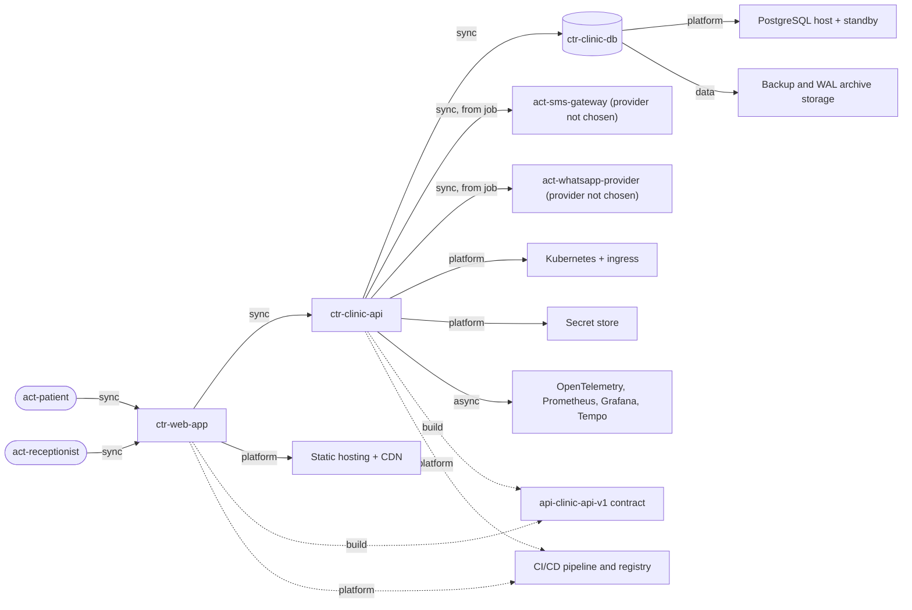

# Clinic Booking System — Dependency Map

Based on: architecture v2 · Status: proposed

Change for v2 (request 2, WhatsApp channel): new external system act-whatsapp-provider (rel-006) and dependencies DEP-025 to DEP-031. DEP-008, DEP-012 and DEP-022 were extended, DEP-013 now covers V001 to V009. Nothing was removed. The HLD's RSK-008 and RSK-009 for WhatsApp are tracked as RSK-031 and RSK-032 here because the ids were already taken (see risk-register section 1).

Scope note: the HLD names three containers (ctr-web-app, ctr-clinic-api, ctr-clinic-db), two external systems (act-sms-gateway, and since v2 act-whatsapp-provider) and the platform services implied by its deployment, security and observability sections (static hosting and CDN, Kubernetes with ingress, a secret store, a managed or operated PostgreSQL with standby, backup storage, and the OpenTelemetry, Prometheus, Grafana and Tempo stack). No vendor, plan or SLA is named for any of them, so every SLA below is "unknown, to confirm" and is itself a risk (RSK-008, RSK-009, RSK-025, RSK-033).

## 1. Runtime dependency graph

Solid arrows are runtime or platform dependencies and point from the dependent to what it needs. Dotted arrows are build-time dependencies. Decision and team rows (DEP-014 to DEP-020, DEP-028 to DEP-030) and the data-model migrations (DEP-013) are intentionally not drawn: they are not runtime elements and are listed in sections 2 and 6. The CI/CD pipeline and registry (DEP-021 for ctr-clinic-api, DEP-024 for ctr-web-app) are drawn.

## 2. Dependencies

| ID | From | To | Kind | Criticality (hard / soft) | If it fails | Fallback | Linked risk |
|---|---|---|---|---|---|---|---|
| DEP-001 | act-patient | ctr-web-app (rel-001) | runtime-sync | soft | Patient cannot load the app. Already-loaded sessions keep working | CDN serves the last cached version | RSK-028 |
| DEP-002 | act-receptionist | ctr-web-app (rel-002) | runtime-sync | soft | Receptionist cannot load the app | CDN cached version. Clinic falls back to phone and paper | RSK-028 |
| DEP-003 | ctr-web-app | ctr-clinic-api (rel-003, api-clinic-api-v1) | runtime-sync | hard | No booking, schedule or login at all | At least 2 instances across zones with ingress health checks. User sees a retry message. No offline mode | RSK-011, RSK-003 |
| DEP-004 | ctr-clinic-api | ctr-clinic-db (rel-004) | runtime-sync | hard | Every operation returns 503 and `/health` fails. Reminder job stops | None in the application. Platform failover to the standby (target 5 min, unproven) | RSK-011, RSK-012 |
| DEP-005 | ctr-clinic-api (cmp-sms-adapter) | act-sms-gateway (rel-005) | runtime-sync (from JOB-001) | soft | Booking, cancelling and the schedule are unaffected. Reminders are late, Expired or Failed (the FR-3 effect is recorded as hard in DEP-023) | Backoff retries, breaker, alerts. No second channel and no second provider | RSK-001, RSK-002, RSK-009, RSK-020, RSK-021 |
| DEP-006 | ctr-web-app | Static hosting and CDN | platform | hard | The web app cannot be delivered to new visitors | CDN edge cache only. No second origin | RSK-028 |
| DEP-007 | ctr-clinic-api | Kubernetes cluster and ingress | platform | hard | API unreachable. No TLS termination or rate limiting | 2 zones, restart on failed health check. Cluster control plane is not redundant by our design | RSK-003, RSK-008 |
| DEP-008 | ctr-clinic-api | Secret store (DATABASE_URL, JWT_SIGNING_KEY, SMS_API_KEY, WHATSAPP_API_KEY) | platform | hard | New instances cannot start. Running instances keep their environment variables | None. No key-rotation procedure for JWT_SIGNING_KEY is designed | RSK-029 |
| DEP-009 | ctr-clinic-api | OpenTelemetry, Prometheus, Grafana, Tempo | runtime-async | soft | Metrics, traces and alerts are lost. The application still works but failures go unseen (the alerts for `reminders_overdue` and `breaker_opened` depend on it) | Application logs on stdout | RSK-027 |
| DEP-010 | ctr-clinic-db | PostgreSQL host and standby (managed service or operator) | platform | hard | Primary loss means downtime until failover | Standby in a second zone. Failover not yet tested | RSK-011, RSK-008 |
| DEP-011 | ctr-clinic-db | Backup and WAL archive storage | data | hard | For QA-008: no point-in-time restore, RPO 15 min and RTO 1 h not met after a loss | Standby covers node loss but not corruption or deletion | RSK-012 |
| DEP-012 | ctr-web-app | api-clinic-api-v1 (contracts/clinic-api-v1.openapi.yaml, 1.1.0, additive: optional `reminder_channel`) | build | hard | The web app cannot be built against a stable interface or show the reminder channel choice | The contract file exists and is the source of truth. Mock server generated from it | RSK-019, RSK-023 |
| DEP-013 | ctr-clinic-api | data-model.md migrations V001 to V009 (V007 to V009 from v2, rollout order in the HLD Change log) and ctr-clinic-db provisioned | build | hard | No integration or concurrency tests, nothing can run | Local PostgreSQL 16 in CI for tests. Production database waits on DEP-010 | RSK-008, RSK-013, RSK-019, RSK-035 |
| DEP-014 | ctr-clinic-api (cmp-sms-adapter) | SMS provider choice, sandbox key and API shape | decision | hard | For FR-3 only: adapter cannot be mapped or tested against the real provider | Adapter built against our canonical shape and a local stub (integration-specs section 4). FR-3 is Should, so it can ship last | RSK-009 |
| DEP-015 | ctr-clinic-api, ctr-clinic-db, platform | ASM-001 hosting cloud confirmed | decision | hard | Managed database, secret store, CDN and Kubernetes cannot be ordered | Cloud-agnostic design (ADR-0004) lets development continue on local containers | RSK-008, RSK-003 |
| DEP-016 | ctr-clinic-api (cmp-scheduling, cmp-reminders) | ASM-007 clinic time zone confirmed | decision | hard | Slot hours and the 02:00 job and displayed times can be wrong | Default UTC (config `CLINIC_TIMEZONE`) | RSK-004 |
| DEP-017 | ent-patient, ent-reminder, cmp-reminders | ASM-008 regulation and SMS consent confirmed | decision | hard | For FR-3 go-live only: reminders may not be legally sendable. Extra controls may be required | Consent flag can be added to ent-patient. FR-3 can be switched off by not configuring the provider | RSK-006, RSK-026 |
| DEP-018 | cmp-scheduling, cmp-booking, cmp-reminders | ASM-003, ASM-005, ASM-006 business rules confirmed | decision | soft | Rules in production differ from the clinic's practice | All three are configuration values (`SLOT_MINUTES`, `CHANGE_CUTOFF_HOURS`, `REMINDER_LEAD_HOURS`) | RSK-005 |
| DEP-019 | ctr-clinic-api (dentists and receptionist accounts) | Clinic operations team running the provisioning and seed script (team) | team | hard | No dentist means no slots, no receptionist account means no FR-2. No one can be added or removed without that person | None designed: no API operation creates dentists or receptionists | RSK-017 |
| DEP-020 | ctr-web-app | A team and plan to build the React SPA (not buildable by the backend agent) | team | hard | FR-1 and FR-2 have no user interface | None named | RSK-023 |
| DEP-021 | ctr-clinic-api | CI/CD pipeline, container registry and migration role (deploy pipeline runs Alembic) | platform | hard | Cannot release: cannot deploy or roll back | Manual deploy from a built image. Tooling not stated in the HLD, to confirm | RSK-013, RSK-030 |
| DEP-022 | ctr-clinic-api | api-clinic-api-v1 (contracts/clinic-api-v1.openapi.yaml, 1.1.0) | build | hard | The API cannot be built or contract-tested (the CI contract tests run against this file) | The contract file exists and is the source of truth. Any breaking change needs a new major file, and the consumer ctr-web-app is listed | RSK-019, RSK-023, RSK-037 |
| DEP-023 | ctr-clinic-api (cmp-sms-adapter) | act-sms-gateway (rel-005), for FR-3 | runtime-sync (from JOB-001) | hard | FR-3 only: no reminder can be sent, so the feature is lost while the provider is down or not chosen. Booking is unaffected (see DEP-005) | Backoff retries, breaker, alerts. No second channel and no second provider. FR-3 is Should and can be switched off | RSK-001, RSK-009, RSK-020 |
| DEP-024 | ctr-web-app | CI/CD pipeline and container registry (build and publish of static files) | platform | hard | Cannot release: the web app cannot be built, published or rolled back | Manual build and upload of the static files to the host. Tooling not stated in the HLD, to confirm | RSK-013, RSK-030 |
| DEP-025 | ctr-clinic-api (cmp-whatsapp-adapter) | act-whatsapp-provider (rel-006) | runtime-sync (from JOB-001) | soft | Booking, cancelling and the schedule are unaffected, SMS reminders are unaffected (own breaker). WhatsApp reminders are retried, then switch once to SMS (DEP-026) | Backoff retries, own breaker, one-time fallback to SMS (ADR-0007), alerts. No second WhatsApp provider | RSK-031, RSK-033, RSK-034, RSK-036, RSK-038 |
| DEP-026 | ctr-clinic-api (cmp-reminders) | cmp-sms-adapter and act-sms-gateway (rel-005) as the fallback target of WhatsApp reminders | runtime-sync (from JOB-001) | soft | If SMS is also down, a WhatsApp reminder that fell back has no channel: it is retried until the cutoff, then Expired. The SMS dependency is recorded as hard in DEP-023 | SMS backoff, breaker, alerts. Reception phones patients. No third channel | RSK-001, RSK-032, RSK-034 |
| DEP-027 | ctr-clinic-api | Secret store entries WHATSAPP_API_KEY, WHATSAPP_API_URL, WHATSAPP_TEMPLATE_NAME | platform | soft | Only needed while `WHATSAPP_ENABLED` is true. With the flag on and a value missing, WhatsApp reminders cannot be sent (and start-up may fail, to confirm in the LLD) | Flag off: all reminders go by SMS | RSK-036, RSK-029 |
| DEP-028 | ctr-clinic-api (cmp-whatsapp-adapter) | WhatsApp provider choice, sandbox key and API shape (ASM-013) | decision | hard | For FR-4 only: the adapter cannot be mapped or tested against the real provider | Adapter built against our canonical shape and a local stub (integration-specs rel-006). FR-4 is Should, so it can ship last or stay off | RSK-033 |
| DEP-029 | cmp-whatsapp-adapter, ctr-web-app | WhatsApp message template approved and opt-in wording confirmed (CON-003, ASM-013, ASM-014) | decision | hard | WhatsApp cannot be enabled: business-initiated messages need an approved template and an opted-in recipient | `WHATSAPP_ENABLED` stays false, SMS-only. Fallback to SMS if a live template is paused | RSK-031 |
| DEP-030 | cmp-reminders, ent-patient | ASM-015 SMS fallback consent and the data terms of the WhatsApp provider confirmed (extends ASM-008) | decision | hard | For FR-4 go-live only: the fallback or the transfer of patient data may not be allowed | `REMINDER_SMS_FALLBACK` false (ADR-0007 option 1), flag off | RSK-032, RSK-038, RSK-006 |
| DEP-031 | ctr-web-app | api-clinic-api-v1 1.1.0 `reminder_channel` and a way to know whether WhatsApp is offered | build | soft | The SPA shows the channel choice at the wrong time or gets 422 VALIDATION_ERROR on `whatsapp` | Release the SPA change with the flag. SMS is the default when the field is omitted | RSK-037, RSK-023 |

Coverage: rel-001 DEP-001, rel-002 DEP-002, rel-003 DEP-003, rel-004 DEP-004, rel-005 DEP-005, DEP-023 and DEP-026, rel-006 DEP-025. ctr-web-app DEP-001 to DEP-003, DEP-006, DEP-012, DEP-020, DEP-024, DEP-029, DEP-031. ctr-clinic-api DEP-003 to DEP-005, DEP-007 to DEP-009, DEP-013, DEP-014, DEP-019, DEP-021 to DEP-023, DEP-025 to DEP-030. ctr-clinic-db DEP-004, DEP-010, DEP-011, DEP-013.

## 3. External and platform dependencies

| Dependency | Kind | Used by (ctr ids) | Version / plan | SLA | Lock-in and exit path |
|---|---|---|---|---|---|
| SMS gateway (act-sms-gateway) | third-party | ctr-clinic-api | Provider not chosen (ASM-009). REST with API key and idempotency key assumed | Unknown, to confirm (provider, delivery, rate limits, sender id rules) | Low. cmp-sms-adapter is the only code that knows the provider, so a swap is one adapter and two config values. Exit cost depends on whether the new provider supports idempotency keys |
| PostgreSQL | platform | ctr-clinic-db, ctr-clinic-api | PostgreSQL 16 (data-model.md). Managed service or operator, to confirm (ASM-001) | Unknown, to confirm. Target needed: 99.9% monthly, failover ≤ 5 min, RPO 15 min, RTO 1 h (ASM-010) | Low. Standard PostgreSQL, no extensions named, dump and restore to any host. Migrations are Alembic |
| Kubernetes and ingress | platform | ctr-clinic-api | ADR-0004, 2 to 4 replicas over 2 zones, managed or self-run to confirm | Unknown, to confirm | Low to medium. Portable manifests. Exit is to a managed container service with no design change (ADR-0004) |
| Static hosting and CDN | platform | ctr-web-app | Object storage plus CDN, or nginx in dev. Provider to confirm | Unknown, to confirm | Low. Static files can move to any host |
| Secret store | platform | ctr-clinic-api | Platform secret store, delivered as environment variables. Product to confirm | Unknown, to confirm | Low. Environment variables are the interface |
| OpenTelemetry, Prometheus, Grafana, Tempo | platform | ctr-clinic-api | Open source stack named in the LLD. Hosting and who operates it to confirm | Not applicable (self-run) or unknown (hosted), to confirm | Low. OpenTelemetry is vendor neutral |
| Backup and WAL archive storage | platform | ctr-clinic-db | Continuous WAL archiving, daily full backup kept 30 days | Unknown, to confirm | Low. Standard PostgreSQL backups |
| WhatsApp provider (act-whatsapp-provider) | third-party | ctr-clinic-api | Provider not chosen (ASM-013). WhatsApp Business API provider with REST, API key, idempotency key, one approved English template assumed | Unknown, to confirm (provider, template approval time, rate limits, delivery, data terms) | Low to medium. cmp-whatsapp-adapter is the only code that knows the provider, so a swap is one adapter and three config values. The approved template and sender number may be tied to the provider account and need re-approval on a swap, to confirm |
| Python 3, FastAPI and an ORM (Alembic for migrations) | build | ctr-clinic-api | Python 3 and FastAPI (ASM-012). Exact versions not pinned | Not applicable (open source) | Low. Technology choice of ours, not a client constraint |
| CI/CD pipeline and container registry | platform | ctr-clinic-api, ctr-web-app | Not named in the HLD | Unknown, to confirm | Low, assuming standard container images |

## 4. Build order and critical path

Derived from the contract (api-clinic-api-v1) and the shared data (data-model.md). Steps marked **[CP]** are on the critical path.

1. **Platform decisions and provisioning (ASM-001, DEP-015)** **[CP]**: the cloud, PostgreSQL host with standby, Kubernetes, secret store, CDN. The client's answer is needed before this step starts. Steps 2 to 8 run on local containers and a local PostgreSQL 16 meanwhile, so a late answer delays staging (step 9), not coding. It is on the critical path because step 9 cannot start without it.
2. **ctr-clinic-db schema V001 to V006 (DEP-013)** **[CP]**: needs the data model and a PostgreSQL 16 instance. Everything stateful needs it. V007 (expand) is part of the same pipeline and can be applied here, since the columns carry defaults (see step 7a).
3. **api-clinic-api-v1 frozen at 1.1.0 (DEP-012)**: already written (1.0.0 plus the additive `reminder_channel`). Needed by steps 4 and 8. A breaking change here would need a new major file for the one consumer, ctr-web-app.
4. **ctr-clinic-api foundation** **[CP]**: `app/infra` (config, db session, logging, migrations), `GET /health`. Needs step 2. Step 5 needs it.
5. **cmp-patient-registry, then cmp-identity** **[CP]**: identity needs patient registry (create profile). Everything else needs authentication.
6. **cmp-scheduling and cmp-booking together** **[CP]**: mutual calls, wired by the injected `booked_starts` callable. Needs steps 2 and 5. cmp-booking calls cmp-reminders (`schedule_for`, `cancel_for`) inside the booking transaction, but cmp-reminders is built in step 7: step 6 codes against the LLD interface with a no-op stub, which step 7 replaces with the real component, and the booking tests are re-run then (including the reminder rows written in the same transaction). The QA-002 test (1,000 concurrent attempts on one slot, real PostgreSQL) must pass here, because the unique index and booking transaction are the only guard (RSK-010).
7. **cmp-sms-adapter against the local stub, then cmp-reminders, then cmp-day-schedule**: reminders need booking (same transaction), patient registry and the adapter. Day schedule needs booking, scheduling and patient registry. The real provider is swapped in when ASM-009 is decided (DEP-014).
7a. **WhatsApp channel (FR-4, request 2)**, off the critical path: needs steps 6 and 7 (the reminder rows, the SMS adapter for the fallback) and the 1.1.0 contract. Order from the HLD Change log: V007, API with `WHATSAPP_ENABLED` off, cmp-whatsapp-adapter against the local stub, V008 backfill, web app channel choice (step 8), V009, then enable the flag only when the provider is chosen (DEP-028), the template is approved (DEP-029) and the fallback consent and data terms are confirmed (DEP-030).
8. **ctr-web-app** (separate team, DEP-020): can start after step 3 against a mock of the contract, in parallel with steps 4 to 7. Integration needs the staging API.
9. **Staging deployment, end-to-end tests and platform hardening** **[CP]**: smoke test, booking round trip, failover drill, backup restore drill (RSK-012), load test at 30 requests/s (RSK-022), partner test with the provider sandbox (RSK-009).
10. **Go-live gate**: client has answered ASM-007, ASM-008 and ASM-009, restore test passed, alerts wired (DEP-009). WhatsApp has its own gate (step 7a): the flag stays off until ASM-013 to ASM-015 are answered, and the system goes live on SMS alone if they are not.

Critical path: platform decision → database and migrations → API foundation → identity → scheduling and booking with the QA-002 test → staging end-to-end with restore and failover drills → go-live. FR-3 (reminders against the real provider) sits off the critical path because it is a Should and only needs step 7 and the provider decision.

## 5. Single points of failure

| Element | Why it is a single point of failure | Mitigation or accepted risk |
|---|---|---|
| ctr-clinic-db primary | One write path. All operations and the reminder job stop when it is down. The standby failover is designed but not tested, and the primary is the only copy until WAL archive is verified | Standby in a second zone, WAL archive, quarterly restore test. Linked to RSK-011 and RSK-012. Not fully mitigated: accepted to be re-assessed after the drills |
| act-sms-gateway (one provider, one channel) | FR-3 depends on a single provider with no second channel | Breaker, backoff, alerts, booking unaffected. FR-3 is a Should. Accepted under RSK-001, RSK-009, RSK-020 |
| act-whatsapp-provider (one provider for the WhatsApp channel) | WhatsApp reminders depend on one provider and one approved template | Not a single point of failure for reminders: own breaker and one-time fallback to SMS, so the channel degrades to SMS. Accepted under RSK-031, RSK-033, RSK-034 |
| Secret store | Instances cannot start without it, and one shared JWT_SIGNING_KEY signs every token | Running instances keep their variables. No rotation procedure designed. RSK-029 |
| Kubernetes control plane and ingress | One ingress path for all API traffic | Multiple replicas and zones for pods only. Choice of managed Kubernetes to be made under ASM-001. RSK-003, RSK-008 |
| Static hosting and CDN origin | One origin for the web app | CDN edge cache. RSK-028 |
| Reminder job in ctr-clinic-api | The job lives in the API process, so no instance means no reminders | 2 or more instances, catch-up at start, overdue alert. RSK-007 |
| Clinic operations person running the provisioning script | The only way to add a dentist or a receptionist | None designed. RSK-017 |
| Single person's knowledge of the stack (Python, Kubernetes, PostgreSQL operations) | A small team holds all the knowledge | Runbooks and the documents under review. RSK-030 |

## 6. Decisions and assumptions to close

| Item (ASM / open question) | Blocks (element or build step) | Needed by | Owner (role) |
|---|---|---|---|
| ASM-001 hosting cloud and managed services | Build step 1 (provisioning), DEP-007, DEP-010, DEP-011, RSK-003 | Before build step 1 starts (development on local containers does not wait) | Client |
| ASM-009 SMS provider, sandbox, idempotency support, receipts, sender id | Build step 7 (real provider), rel-005, RSK-009 | Before FR-3 integration tests | Client, with Tech Lead |
| ASM-008 applicable regulation and SMS consent | FR-3 go-live, ent-patient, ent-reminder | Before go-live | Client |
| ASM-013 WhatsApp provider, sandbox, template approved (CON-003) | Build step 7a, rel-006, DEP-028, DEP-029, RSK-031, RSK-033 | Before enabling `WHATSAPP_ENABLED` | Client, with Tech Lead |
| ASM-014 WhatsApp opt-in wording and one number for SMS and WhatsApp | FR-4 go-live, ctr-web-app booking screen, DEP-029, RSK-031 | Before the web app channel choice is released | Client |
| ASM-015 SMS fallback consent, ambiguous-timeout rule, provider data terms | cmp-reminders fallback, `REMINDER_SMS_FALLBACK`, DEP-030, RSK-032, RSK-038 | Before enabling `WHATSAPP_ENABLED` | Client (consent), Solution Architect (timeout rule) |
| How the web app learns that WhatsApp is offered | ctr-web-app, api-clinic-api-v1 (possible 1.2.0), DEP-031, RSK-037 | Before step 8 integration | Tech Lead |
| ASM-007 clinic time zone | cmp-scheduling, JOB-002, reminder times | Before step 6 | Client |
| ASM-003, ASM-005, ASM-006 slot length, cancel cutoff, reminder rules | cmp-scheduling, cmp-booking, cmp-reminders defaults | Before acceptance testing | Product Owner |
| ASM-002 clinic size and peak load | QA-001, QA-005, QA-007 sizing and load test | Before step 9 | Product Owner |
| ASM-010 availability 99.9%, RPO 15 min, RTO 1 h accepted by the client | DEP-010, DEP-011, QA-003, QA-008 | Before step 1 | Client |
| ASM-011 retention of 3 years then anonymisation | JOB-002, ent-patient, ent-appointment | Before go-live | Client |
| ASM-004 receptionist provisioning by clinic operations, no password reset | DEP-019, RSK-016, RSK-017 | Before step 5 | Product Owner |
| Dentist and receptionist management in the UI (change request or runbook) | DEP-019 | Before go-live | Product Owner |
| Who builds ctr-web-app | DEP-020, build step 8 | Before step 3 ends | Tech Lead |
| Receptionist correction of a patient's mobile number | rel-005 reminder success, RSK-018 | Before go-live | Product Owner |
| How JOB-002 avoids running on every instance at the same time | JOB-002 design | Before step 7 | Solution Architect |
| Hosting choice for the observability stack and secret store | DEP-008, DEP-009 | Before step 9 | DevOps |
