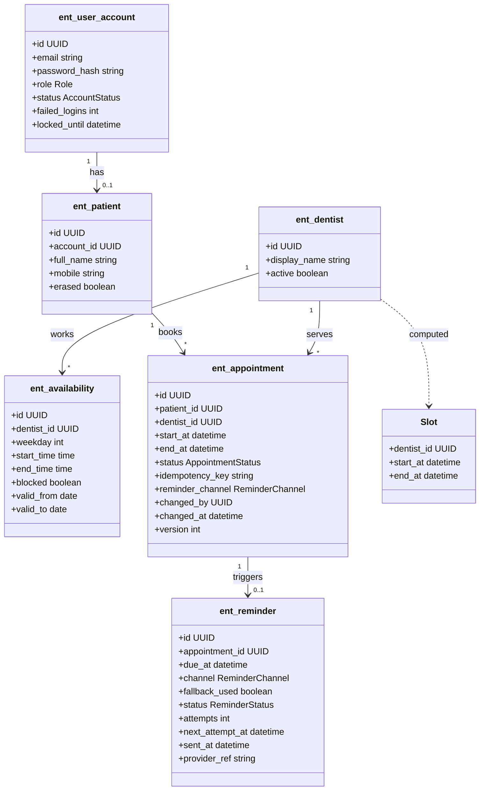
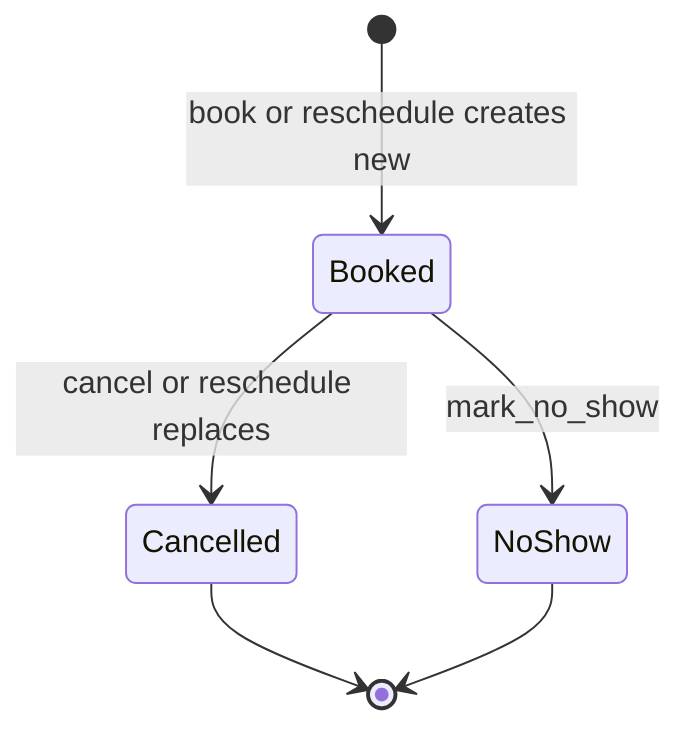
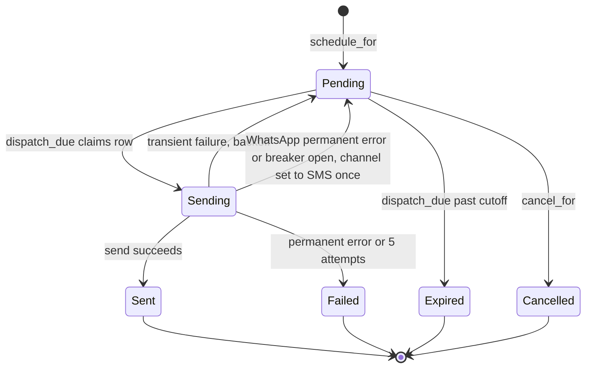
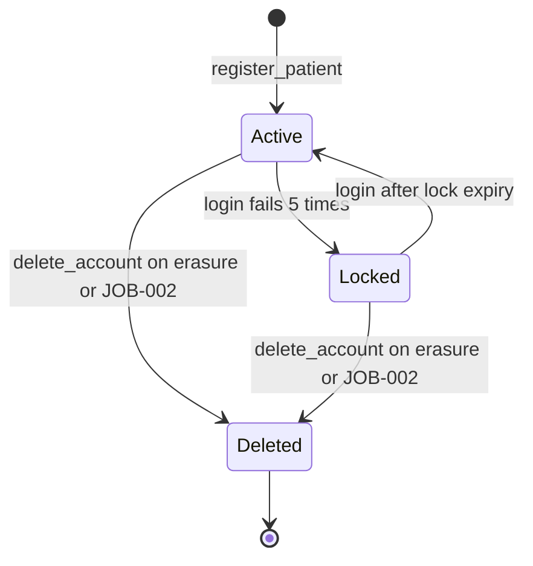
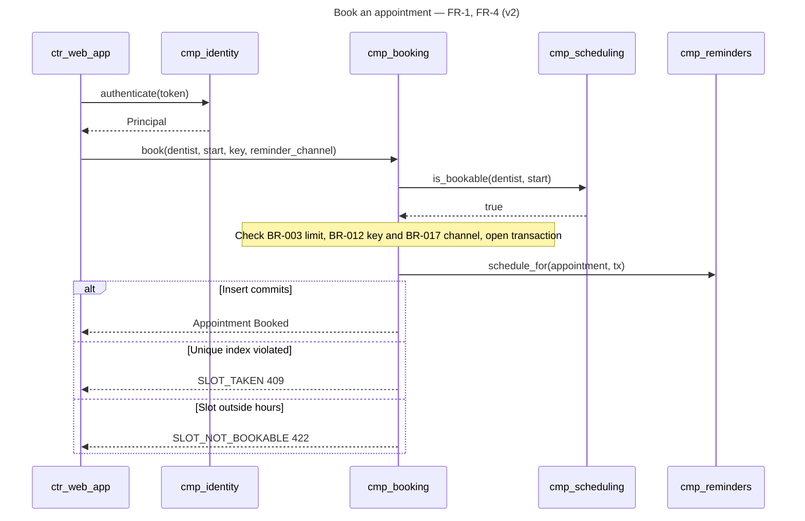
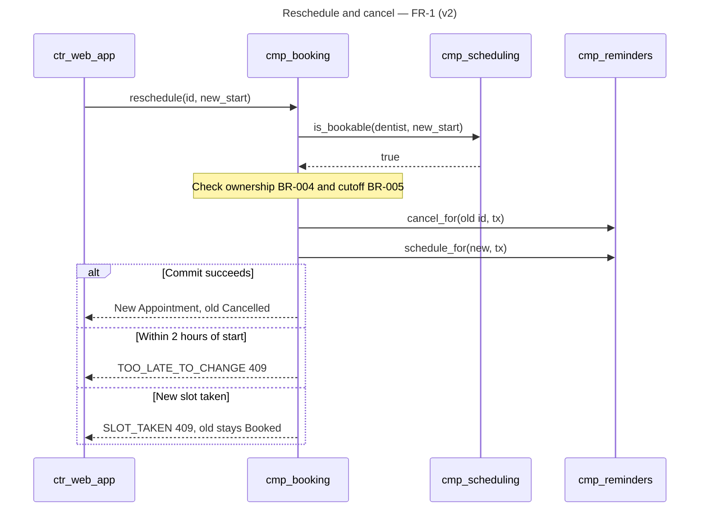
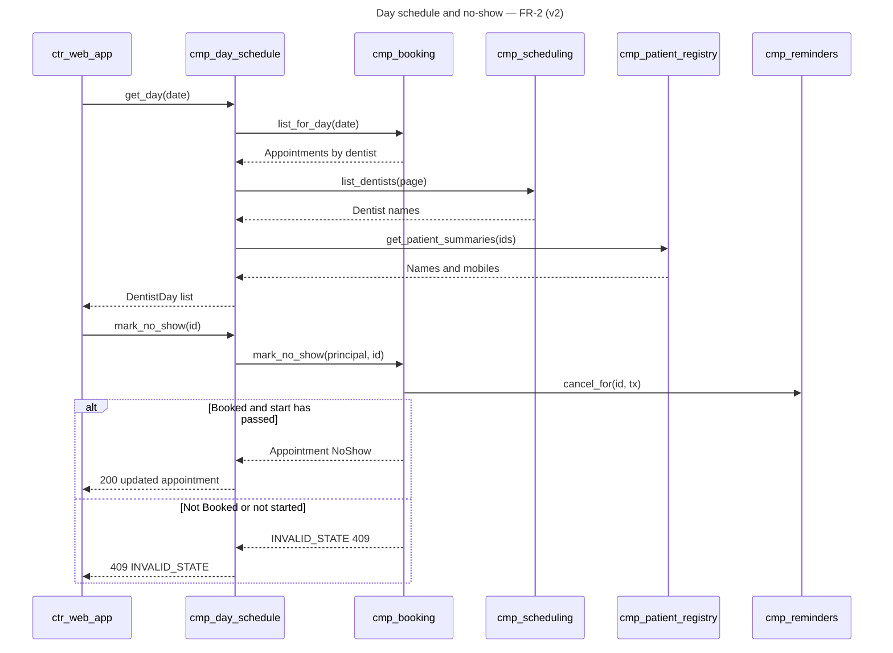
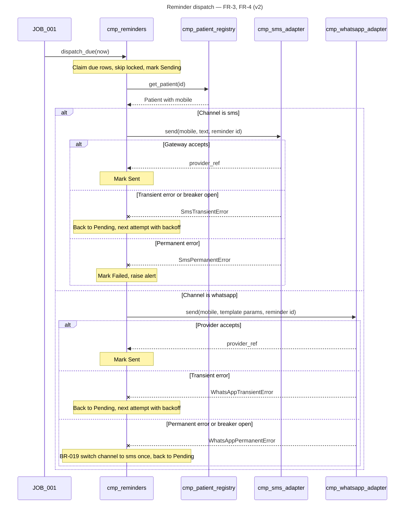

# Clinic Booking System — Low-Level Design

Based on: architecture v2 · Status: proposed

## 1. Scope and conventions

Covered container: ctr-clinic-api (the only container the backend agent builds, `fastapi_greenfield`). ctr-web-app (static React SPA, no server logic) and ctr-clinic-db (managed PostgreSQL) have no designed logic beyond what is described here.

Conventions shared by the container:
- Naming: Python packages in `snake_case`, one package per component. REST paths are plural nouns (`/appointments`), JSON fields `snake_case`.
- Ids: all entity ids are UUID v4 generated by the API. Times are stored as UTC `timestamptz`, exchanged as ISO 8601 UTC, shown to users in the clinic time zone (ASM-007).
- Errors: every 4xx/5xx body is `{code, message, timestamp, correlation_id}`. `code` is one of the codes in section 2.1.
- Logging: JSON lines with `correlation_id` (taken from `X-Correlation-Id` or generated), `event`, entity ids, role. Never email, name, mobile number, password or token.
- Pagination: every list takes `page` and `page_size` (default 50, max 100).
- Writes that create appointments accept an `Idempotency-Key` header.
- Ports: 8000, `GET /health` (unauthenticated, checks database), Swagger at `/docs`.

## 2. Container designs

### 2.1 ctr-clinic-api — Clinic API

Module structure:
```
app/
  main.py              (FastAPI app, router wiring, scheduler start)
  api/                 (routers: auth, patients, dentists, slots, appointments, schedule, health, deps, errors)
  identity/            (cmp-identity: service, passwords, tokens, rate_limit, repository)
  patients/            (cmp-patient-registry: service, repository)
  scheduling/          (cmp-scheduling: service, slot_calculator, repository)
  booking/             (cmp-booking: service, rules, repository)
  dayschedule/         (cmp-day-schedule: service)
  reminders/           (cmp-reminders: service, dispatcher_job, repository)
  sms/                 (cmp-sms-adapter: client, breaker, errors)
  whatsapp/            (cmp-whatsapp-adapter: client, template, breaker, errors)
  infra/               (db session, config, clock, logging, migrations)
```

| Component (cmp id) | Module / package | Responsibility | Depends on |
|---|---|---|---|
| cmp-identity | app/identity | Register, login, token issue and check, role guard, login lockout, erasure orchestration | cmp-patient-registry, cmp-booking |
| cmp-patient-registry | app/patients | Patient profiles, contact details, anonymisation | none |
| cmp-scheduling | app/scheduling | Dentists, working hours, blocked periods, open slots | cmp-booking (booked_starts) |
| cmp-booking | app/booking | Book (with reminder channel), reschedule, cancel, no-show, queries, conflict handling | cmp-scheduling, cmp-patient-registry, cmp-reminders |
| cmp-day-schedule | app/dayschedule | Day view per dentist, no-show entry point | cmp-booking, cmp-scheduling (dentist names), cmp-patient-registry (patient names, mobiles) |
| cmp-reminders | app/reminders | Reminder rows, dispatch job, channel selection and SMS fallback | cmp-sms-adapter, cmp-whatsapp-adapter, cmp-patient-registry |
| cmp-sms-adapter | app/sms | Gateway client, error classification, breaker | external gateway (rel-005) |
| cmp-whatsapp-adapter | app/whatsapp | Provider client, approved template, error classification, own breaker | external provider (rel-006) |

Note: cmp-scheduling asks cmp-booking only for read-only booked start times, and cmp-booking asks cmp-scheduling only to validate a slot. Both calls are function calls in one process and never touch each other's tables. To avoid an import cycle, the booked-start query is passed to cmp-scheduling as a callable at startup.

Interfaces:
| Component | Operation (signature) | Input | Output | Errors | Used by |
|---|---|---|---|---|---|
| cmp-identity | `register_patient(email, password, full_name, mobile)` | strings | account id, patient id | VALIDATION_ERROR, EMAIL_TAKEN | api/auth |
| cmp-identity | `login(email, password)` | strings | signed token, expiry | INVALID_CREDENTIALS, ACCOUNT_LOCKED | api/auth |
| cmp-identity | `authenticate(token)` | bearer token | Principal(account id, role, patient id) | UNAUTHENTICATED | api/deps |
| cmp-identity | `require_role(principal, roles)` | principal, roles | none | FORBIDDEN | api/deps |
| cmp-patient-registry | `create_patient(account_id, full_name, mobile)` | ids, strings | Patient | VALIDATION_ERROR | cmp-identity |
| cmp-patient-registry | `get_patient(patient_id)` | id | Patient | NOT_FOUND | cmp-booking, cmp-reminders, api/patients |
| cmp-patient-registry | `update_contact(patient_id, mobile)` | id, E.164 string | Patient | VALIDATION_ERROR, NOT_FOUND | api/patients |
| cmp-patient-registry | `get_patient_summaries(patient_ids)` | list of ids (max 200) | map of id to (full name, mobile) | none (unknown ids omitted) | cmp-day-schedule |
| cmp-patient-registry | `anonymise_expired(cutoff)` | date | count | none | JOB-002 |
| cmp-patient-registry | `erase_patient(principal, patient_id)` | id | none (name and mobile overwritten, flagged erased) | NOT_FOUND, FORBIDDEN | cmp-identity |
| cmp-identity | `erase_patient_data(principal, patient_id)` | ids | none (calls `cancel_future_for_patient`, `erase_patient`, `delete_account` in one transaction) | NOT_FOUND, FORBIDDEN | api/patients |
| cmp-identity | `delete_account(account_id)` | id | none (account row removed, lifecycle state Deleted) | NOT_FOUND | cmp-identity, JOB-002 |
| cmp-scheduling | `list_dentists(page)` | page | Page of Dentist | none | api/dentists |
| cmp-scheduling | `set_working_hours(dentist_id, rules)` | id, weekly rules | list of Availability | NOT_FOUND, VALIDATION_ERROR | api/dentists |
| cmp-scheduling | `block_period(dentist_id, from_at, to_at)` | id, times | Availability | NOT_FOUND, VALIDATION_ERROR | api/dentists |
| cmp-scheduling | `list_open_slots(dentist_id, date_from, date_to, page)` | id, dates (max 14 days) | Page of Slot | NOT_FOUND, VALIDATION_ERROR | api/slots |
| cmp-scheduling | `is_bookable(dentist_id, start_at)` | id, time | boolean | none | cmp-booking |
| cmp-booking | `book(principal, patient_id, dentist_id, start_at, idempotency_key, reminder_channel)` | ids, time, key, channel `sms` or `whatsapp` (optional, default `sms`) | Appointment | SLOT_NOT_BOOKABLE, SLOT_TAKEN, LIMIT_REACHED, FORBIDDEN, IDEMPOTENCY_CONFLICT | api/appointments |
| cmp-booking | `cancel(principal, appointment_id)` | id | Appointment | NOT_FOUND, FORBIDDEN, TOO_LATE_TO_CHANGE, INVALID_STATE | api/appointments |
| cmp-booking | `reschedule(principal, appointment_id, new_start_at)` | id, time | new Appointment | NOT_FOUND, FORBIDDEN, TOO_LATE_TO_CHANGE, SLOT_NOT_BOOKABLE, SLOT_TAKEN, INVALID_STATE | api/appointments |
| cmp-booking | `list_for_patient(principal, patient_id, page)` | ids, page | Page of Appointment | FORBIDDEN | api/appointments |
| cmp-booking | `list_for_day(date, dentist_id or none)` | date | appointments by dentist | none | cmp-day-schedule |
| cmp-booking | `mark_no_show(principal, appointment_id)` | id | Appointment | NOT_FOUND, FORBIDDEN, INVALID_STATE | cmp-day-schedule |
| cmp-booking | `cancel_future_for_patient(patient_id)` | id | count cancelled (reminders cancelled in the same transaction) | none | cmp-identity (erasure), JOB-002 |
| cmp-booking | `booked_starts(dentist_id, from_at, to_at)` | id, range | set of start times | none | cmp-scheduling |
| cmp-day-schedule | `get_day(date, dentist_id or none)` | date | list of DentistDay(dentist name from `list_dentists`, appointments from `list_for_day`, each joined with name and mobile from `get_patient_summaries`) | VALIDATION_ERROR | api/schedule |
| cmp-day-schedule | `mark_no_show(principal, appointment_id)` | id | Appointment | as cmp-booking | api/schedule |
| cmp-reminders | `schedule_for(appointment, tx)` | appointment (carries `reminder_channel`), open transaction | Reminder with the same channel, or none | none | cmp-booking |
| cmp-reminders | `cancel_for(appointment_id, tx)` | id, transaction | none | none | cmp-booking |
| cmp-reminders | `dispatch_due(now)` | time | counts sent, retried, failed | none (errors handled per row) | JOB-001 |
| cmp-sms-adapter | `send(msisdn, text, idempotency_key)` | strings | SmsResult(provider_ref) | SmsTransientError, SmsPermanentError, BreakerOpen | cmp-reminders |
| cmp-whatsapp-adapter | `send(msisdn, template_params, idempotency_key)` | E.164 string, params (first name, dentist name, time), key | WhatsAppResult(provider_ref) | WhatsAppTransientError, WhatsAppPermanentError (includes recipient not on WhatsApp, template rejected), BreakerOpen | cmp-reminders |









Business rules:
| ID | Rule | Enforced in (cmp id) | Source (FR / QA id) |
|---|---|---|---|
| BR-001 | A slot is bookable only if it is in the future, on a 30-minute boundary (SLOT_MINUTES), inside the dentist's working hours and outside blocked periods | cmp-scheduling (`is_bookable`) | FR-1, ASM-003 |
| BR-002 | At most one appointment with status Booked per dentist and start time: unique partial index in ctr-clinic-db. A violation is reported as SLOT_TAKEN | cmp-booking, ctr-clinic-db | QA-002 |
| BR-003 | A patient may hold at most MAX_ACTIVE_APPOINTMENTS (5) future Booked appointments | cmp-booking | QA-006 |
| BR-004 | A patient may read, cancel and reschedule only their own appointments. Receptionists may act on any | cmp-booking, cmp-identity | QA-006 |
| BR-005 | A patient may cancel or reschedule only until CHANGE_CUTOFF_HOURS (2) before the start. Receptionists may cancel until the start | cmp-booking | FR-1, ASM-005 |
| BR-006 | Reschedule books the new slot and cancels the old one in one transaction. If the new slot fails, the old appointment stays Booked | cmp-booking | FR-1, QA-002 |
| BR-007 | Only a receptionist may mark a no-show, only on a Booked appointment whose start time has passed. It cannot be undone and records `changed_by` and `changed_at` | cmp-booking | FR-2 |
| BR-008 | When an appointment is booked with start at least REMINDER_LEAD_HOURS (24) ahead, one Reminder with due time start minus 24 h is created in the same transaction. Otherwise none | cmp-reminders | FR-3, ASM-006 |
| BR-009 | Cancelling, rescheduling or no-show cancels the Pending reminder. Rescheduling creates a new one for the new start (BR-008 applies) | cmp-reminders, cmp-booking | FR-3 |
| BR-010 | A reminder not sent by REMINDER_LATEST_LEAD_HOURS (2) before the start becomes Expired and is never sent | cmp-reminders | QA-004 |
| BR-011 | A reminder is retried with backoff 5, 15, 60 min (then 60 min), at most REMINDER_MAX_ATTEMPTS (5). A permanent gateway error fails it at once. The provider idempotency key is the reminder id | cmp-reminders, cmp-sms-adapter | QA-004 |
| BR-012 | A repeated book call with the same patient and Idempotency-Key returns the original appointment. The same key with different slot data returns IDEMPOTENCY_CONFLICT | cmp-booking | QA-001, QA-002 |
| BR-013 | Passwords: minimum 12 characters, argon2id. After LOGIN_MAX_FAILURES (5) failures in 15 min the account is Locked for 15 min | cmp-identity | QA-006 |
| BR-014 | A patient must have a valid E.164 mobile number to book | cmp-booking, cmp-patient-registry | FR-3 |
| BR-016 | Erasure on request (`DELETE /patients/{id}`, the patient themselves or a receptionist): future Booked appointments are cancelled, name and mobile are overwritten and the patient flagged erased (`erased` = true), the account is deleted (Deleted state, the row is removed). Past appointments stay with the anonymised patient. Done in one transaction by cmp-identity (`erase_patient_data`) calling cmp-booking, cmp-patient-registry and its own `delete_account` in that order | cmp-identity, cmp-booking, cmp-patient-registry | QA-006, ASM-008, ASM-011 |
| BR-017 | The patient chooses the reminder channel, `sms` or `whatsapp`, when booking. An omitted value means `sms`. `whatsapp` is accepted only when WHATSAPP_ENABLED is true, otherwise VALIDATION_ERROR. A reschedule keeps the channel and the new reminder copies it. The reminder row stores the channel at creation (BR-008) | cmp-booking, cmp-reminders | FR-4, ASM-014 |
| BR-018 | A WhatsApp reminder is sent only with the approved template (first name, dentist name, time as parameters, no free text, no treatment data) to the patient's E.164 mobile number | cmp-whatsapp-adapter | FR-4, CON-003 |
| BR-019 | If a WhatsApp send ends in a permanent error or the WhatsApp breaker is open, and REMINDER_SMS_FALLBACK is true and `fallback_used` is false, the reminder changes channel to `sms`, sets `fallback_used`, resets attempts and returns to Pending. This happens at most once and never after the cutoff (BR-010). Otherwise a permanent error fails the reminder (BR-011) | cmp-reminders | QA-009, ASM-015 |
| BR-015 | Every API operation except register, login and `/health` requires a valid token and a role in the authorization matrix. Deny by default | cmp-identity | QA-006 |

Errors:
| Error code | Meaning | HTTP status | Retryable | Raised by |
|---|---|---|---|---|
| VALIDATION_ERROR | Input fails validation (format, range, 14-day slot window) | 422 | no | all |
| UNAUTHENTICATED | Missing, invalid or expired token | 401 | no (log in again) | cmp-identity |
| INVALID_CREDENTIALS | Wrong email or password | 401 | no | cmp-identity |
| ACCOUNT_LOCKED | Too many failed logins | 429 | yes, after lock expiry | cmp-identity |
| FORBIDDEN | Role or ownership check failed | 403 | no | cmp-identity, cmp-booking |
| NOT_FOUND | Entity does not exist or is not visible to the caller | 404 | no | all |
| EMAIL_TAKEN | An account with this email exists | 409 | no | cmp-identity |
| SLOT_NOT_BOOKABLE | Slot violates BR-001 | 422 | no | cmp-booking |
| SLOT_TAKEN | Slot was booked by someone else (BR-002) | 409 | no (pick another slot) | cmp-booking |
| LIMIT_REACHED | Patient holds 5 future appointments | 409 | no | cmp-booking |
| TOO_LATE_TO_CHANGE | Inside the cutoff (BR-005) | 409 | no | cmp-booking |
| INVALID_STATE | Transition not allowed from the current status | 409 | no | cmp-booking |
| IDEMPOTENCY_CONFLICT | Idempotency key reused with different data | 422 | no | cmp-booking |
| RATE_LIMITED | Request rate limit exceeded | 429 | yes, with backoff | api/deps |
| DEPENDENCY_UNAVAILABLE | Database unreachable or timed out | 503 | yes, same Idempotency-Key | infra |
| INTERNAL_ERROR | Unexpected failure | 500 | no | api/errors |

## 3. Detailed flows

Flow 1: book an appointment (FR-1), with the conflict path.



Flow 2: reschedule and cancel (FR-1), with the cutoff path.



Cancel is the same flow without the scheduling check and the new reminder: status moves Booked to Cancelled, `cancel_for` runs in the same transaction, errors are NOT_FOUND, FORBIDDEN, TOO_LATE_TO_CHANGE, INVALID_STATE. Plain reads (list dentists, open slots, own appointments) call the owning component and return one page.

Flow 3: receptionist day schedule and no-show (FR-2), with the invalid-state path.



Flow 4: reminder dispatch (FR-3, FR-4), on the reminder's channel, with the gateway failure path and the WhatsApp fallback.



## 4. Background jobs and schedules
| ID | Trigger (cron / event / queue) | What it does | Idempotency | On failure |
|---|---|---|---|---|
| JOB-001 | Every 60 s (REMINDER_POLL_SECONDS), in-process scheduler on every API instance, plus once at startup | Calls `dispatch_due`: expires Pending reminders past the cutoff (BR-010), claims up to 50 due reminders with `FOR UPDATE SKIP LOCKED`, sends via cmp-sms-adapter or cmp-whatsapp-adapter according to the row's channel, updates status (BR-011) and applies the SMS fallback (BR-019) | A claimed row is Sending and invisible to other instances. Provider idempotency key = reminder id (per channel) | Row returns to Pending with backoff, switches to SMS once (BR-019) or becomes Failed. A row stuck in Sending over 10 min returns to Pending. Alert when Pending reminders are more than 1 h past due |
| JOB-002 | Daily at 02:00 clinic time | Anonymises patients (`anonymise_expired`) older than RETENTION_YEARS (3) after last visit, deletes their account (`delete_account`), deletes reminder rows older than 90 days | Re-running finds nothing more to do | Logs the error, retries next day, alert after 2 consecutive failures |

## 5. Cross-cutting design

### Configuration
| Key | Purpose | Default | Secret (yes/no) | Container |
|---|---|---|---|---|
| DATABASE_URL | PostgreSQL connection | none, required | yes | ctr-clinic-api |
| JWT_SIGNING_KEY | Signs and verifies tokens | none, required | yes | ctr-clinic-api |
| JWT_TTL_MINUTES | Token lifetime | 60 | no | ctr-clinic-api |
| SMS_API_URL | Gateway endpoint | none, required | no | ctr-clinic-api |
| SMS_API_KEY | Gateway credential | none, required | yes | ctr-clinic-api |
| SMS_TIMEOUT_SECONDS | Gateway call timeout | 5 | no | ctr-clinic-api |
| WHATSAPP_API_URL | WhatsApp provider endpoint | none, required when WHATSAPP_ENABLED | no | ctr-clinic-api |
| WHATSAPP_API_KEY | WhatsApp provider credential | none, required when WHATSAPP_ENABLED | yes | ctr-clinic-api |
| WHATSAPP_TEMPLATE_NAME | Approved reminder template (CON-003) | none, required when WHATSAPP_ENABLED | no | ctr-clinic-api |
| WHATSAPP_TIMEOUT_SECONDS | Provider call timeout | 5 | no | ctr-clinic-api |
| WHATSAPP_ENABLED | Feature flag: offers WhatsApp at booking (RSK-008) | false | no | ctr-clinic-api |
| REMINDER_SMS_FALLBACK | Allows the one-time WhatsApp to SMS fallback (ADR-0007) | true | no | ctr-clinic-api |
| CLINIC_TIMEZONE | Time zone for display and the 02:00 job | UTC, to be confirmed (ASM-007) | no | ctr-clinic-api |
| SLOT_MINUTES | Slot length | 30 | no | ctr-clinic-api |
| CHANGE_CUTOFF_HOURS | Patient cancel or reschedule cutoff | 2 | no | ctr-clinic-api |
| MAX_ACTIVE_APPOINTMENTS | Future bookings per patient | 5 | no | ctr-clinic-api |
| REMINDER_LEAD_HOURS | Reminder lead time | 24 | no | ctr-clinic-api |
| REMINDER_LATEST_LEAD_HOURS | Last time a reminder may still be sent | 2 | no | ctr-clinic-api |
| REMINDER_MAX_ATTEMPTS | Send attempts | 5 | no | ctr-clinic-api |
| REMINDER_POLL_SECONDS | Job interval | 60 | no | ctr-clinic-api |
| LOGIN_MAX_FAILURES | Failed logins before lock | 5 | no | ctr-clinic-api |
| RETENTION_YEARS | Years kept after last visit | 3 | no | ctr-clinic-api |
| CORS_ALLOWED_ORIGINS | Origins of the web app | none, required | no | ctr-clinic-api |

### Authorization matrix
| Operation | patient | receptionist | anonymous |
|---|---|---|---|
| Register, log in | n/a | n/a | allowed |
| `GET /health` | allowed | allowed | allowed |
| List dentists, list open slots | allowed | allowed | denied |
| Book appointment | own-records-only (for self) | allowed (for any patient) | denied |
| List appointments | own-records-only | allowed | denied |
| Cancel or reschedule appointment | own-records-only, before cutoff | allowed | denied |
| View day schedule | denied | allowed | denied |
| Mark no-show | denied | allowed | denied |
| Set working hours, block period | denied | allowed | denied |
| Read or update own contact details | own-records-only | denied | denied |
| Erase patient (`DELETE /patients/{id}`) | own-records-only | allowed | denied |

### Caching
No caching. At about 10 requests/s with indexed queries, QA-001 and QA-005 are met without it, and it would add staleness to slot availability (QA-002).

### Observability
| Container | Logs (events, never PII) | Metrics (name, type) | Traces (spans) | Alerts |
|---|---|---|---|---|
| ctr-clinic-api | `appointment_booked`, `appointment_cancelled`, `appointment_rescheduled`, `no_show_marked`, `slot_conflict`, `login_failed`, `account_locked`, `reminder_sent`, `reminder_retry`, `reminder_failed`, `reminder_expired`, `reminder_channel_fallback`, `breaker_opened` (ids only, with channel) | `http_requests_total` (counter, by route and status), `http_request_duration_seconds` (histogram), `slot_conflicts_total` (counter), `reminders_total` (counter, by status and channel), `reminder_fallbacks_total` (counter), `reminders_overdue` (gauge), `db_pool_in_use` (gauge) | One trace per request: API route, component call, database statement, SMS call | 5xx rate above 2% for 5 min, booking p95 above 1 s for 10 min, `reminders_overdue` above 0 for 1 h, `breaker_opened`, `/health` failing, backup or JOB-002 failure |

OpenTelemetry exports to Prometheus, Grafana and Tempo (cloud-agnostic, ASM-001).

## 6. Traceability
| Requirement | Component(s) | Operation(s) |
|---|---|---|
| FR-1 (US-1) | cmp-identity, cmp-patient-registry, cmp-scheduling, cmp-booking, cmp-reminders | `register_patient`, `login`, `authenticate`, `list_dentists`, `list_open_slots`, `is_bookable`, `book`, `reschedule`, `cancel`, `list_for_patient`, `update_contact` |
| FR-2 (US-2) | cmp-day-schedule, cmp-booking, cmp-scheduling, cmp-identity | `get_day`, `list_for_day`, `mark_no_show`, `set_working_hours`, `block_period`, `require_role`, `get_patient_summaries`, `list_dentists` |
| FR-3 | cmp-reminders, cmp-sms-adapter, cmp-whatsapp-adapter, cmp-patient-registry | `schedule_for`, `cancel_for`, `dispatch_due`, `send`, `get_patient` |
| FR-4 | cmp-booking, cmp-reminders, cmp-whatsapp-adapter, cmp-sms-adapter | `book` (reminder_channel), `schedule_for`, `dispatch_due`, `send` (WhatsApp), BR-017, BR-018, BR-019 |
