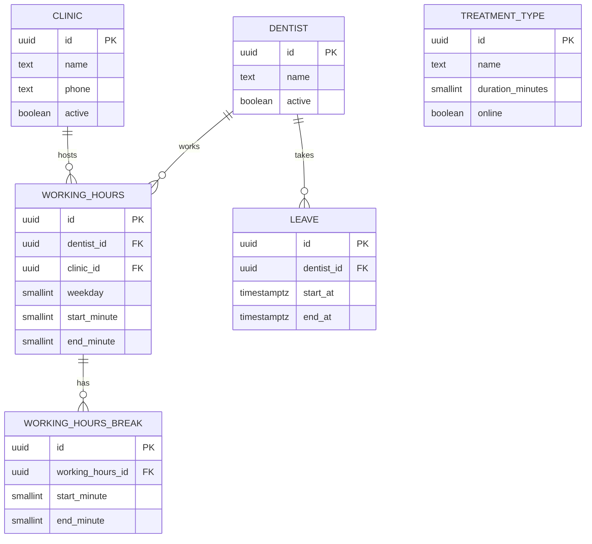
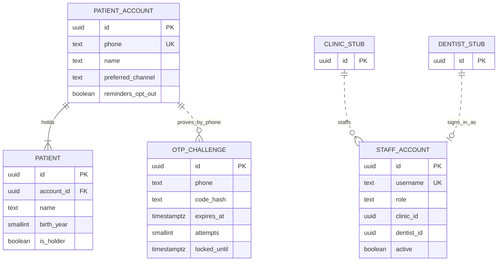
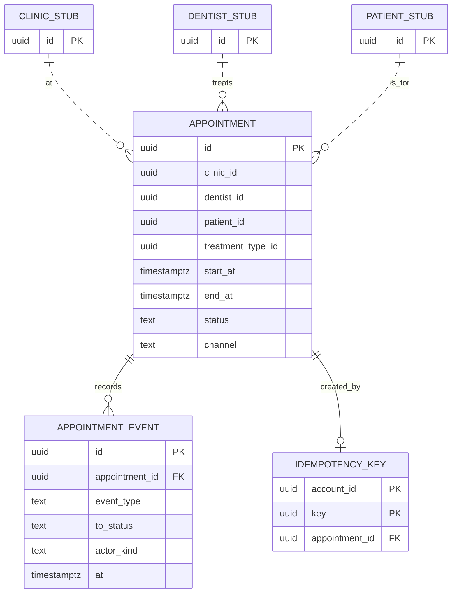
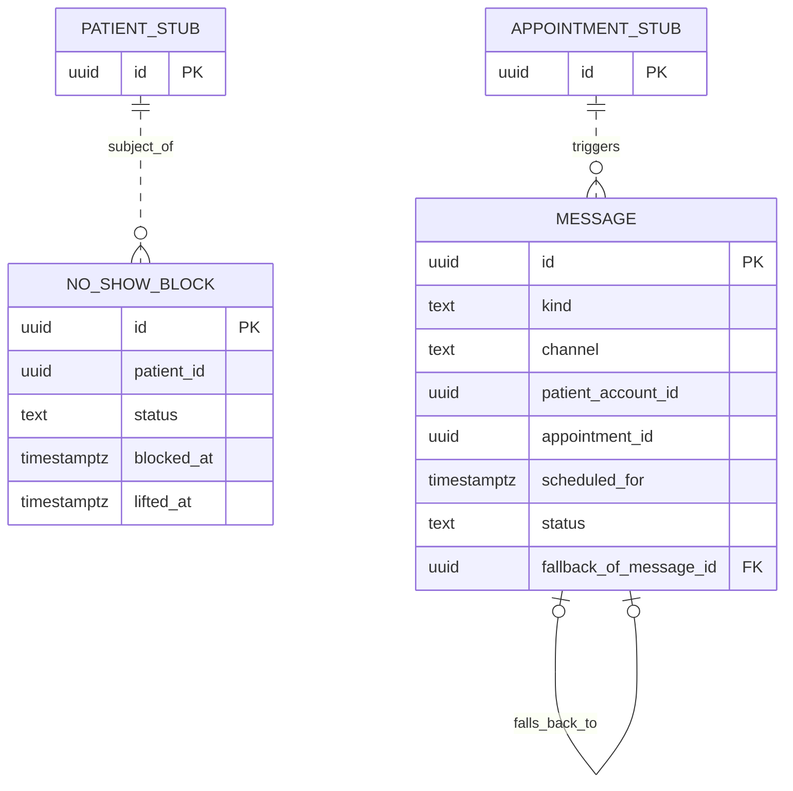

# BrightSmile Booking — Data Model

Based on: architecture v1 · Status: proposed

## 1. Stores

| Store (ctr id) | Engine and version | Owner (ctr / cmp id) | Entities | Backup / RPO / RTO |
|---|---|---|---|---|
| ctr-db | PostgreSQL 16, managed, HA standby in a second zone; extensions `btree_gist`, `pg_trgm` | ctr-clinic-api (tables split by owning component: cmp-scheduling, cmp-identity, cmp-booking, cmp-noshow-policy, cmp-messaging) | ent-clinic, ent-dentist, ent-treatment-type, ent-working-hours, ent-working-hours-break, ent-leave, ent-staff-account, ent-patient-account, ent-patient, ent-otp-challenge, ent-appointment, ent-appointment-event, ent-idempotency-key, ent-no-show-block, ent-message | Continuous log archiving with point-in-time restore plus a daily snapshot kept 14 days, encrypted; RPO 15 minutes, RTO 1 hour (ASM-007); restore tested before go-live |

Physical-only tables (not in the HLD, each serves an HLD entity): `ent-working-hours-break` (the breaks of `ent-working-hours`, owner cmp-scheduling) and `ent-idempotency-key` (the booking idempotency record of `ent-appointment`, owner cmp-booking).

Ownership rule: every foreign key stays inside one owning component. A column that points at another component's table (for example `appointment.patient_id`) is a plain uuid column, **not enforced** by a foreign key, and is marked "ref, not enforced" below. The application checks it through the owner's interface. All times are `timestamptz` (UTC); an IST day or month is computed at the edge. Phones are E.164 text. Ids are `uuid` with default `gen_random_uuid()`. Enumerations are `text` with a `check` constraint, so adding a value is a one-line migration.

## 2. Entity-relationship diagrams

The store has 15 tables, so there is one diagram per owning component. A table owned elsewhere appears only as a stub with its key column. The full column lists are in section 3. A dotted line is a reference that is not enforced by a foreign key.

## 3. Tables

### clinic (ent-clinic)
Owner: cmp-scheduling.

| Column | Type | Null | Default | Constraint (PK / FK / unique / check) | Classification (PII / sensitive / -) |
|---|---|---|---|---|---|
| id | uuid | no | gen_random_uuid() | PK | - |
| name | text | no | | unique, check length 1–100 | - |
| address | text | no | | check length ≤ 300 | - |
| phone | text | no | | check length ≤ 20; the clinic's public phone, shown when online change is refused | - |
| active | boolean | no | true | | - |
| created_at | timestamptz | no | now() | | - |

Indexes:
| Name | Columns | Unique | Serves (access pattern id) |
|---|---|---|---|
| clinic_pkey | id | yes | AP-001 |
| ux_clinic_name | name | yes | AP-001 |
| ix_clinic_active | (id) where active | no | AP-001 |

### dentist (ent-dentist)
Owner: cmp-scheduling.

| Column | Type | Null | Default | Constraint (PK / FK / unique / check) | Classification (PII / sensitive / -) |
|---|---|---|---|---|---|
| id | uuid | no | gen_random_uuid() | PK | - |
| name | text | no | | check length 1–100 | PII |
| active | boolean | no | true | | - |
| deactivated_at | timestamptz | yes | | set when active becomes false | - |
| anonymised_at | timestamptz | yes | | set by JOB-004 (name replaced by "Former dentist") | - |
| created_at | timestamptz | no | now() | | - |

Indexes:
| Name | Columns | Unique | Serves (access pattern id) |
|---|---|---|---|
| dentist_pkey | id | yes | AP-001, AP-003 |
| ix_dentist_deactivated | deactivated_at where anonymised_at is null and active = false | no | AP-026 |

### treatment_type (ent-treatment-type)
Owner: cmp-scheduling.

| Column | Type | Null | Default | Constraint (PK / FK / unique / check) | Classification (PII / sensitive / -) |
|---|---|---|---|---|---|
| id | uuid | no | gen_random_uuid() | PK | - |
| name | text | no | | unique, check length 1–100 | - |
| duration_minutes | smallint | no | | check in (30, 60, 90) | - |
| online | boolean | no | false | patients may book it online | - |
| active | boolean | no | true | | - |
| created_at | timestamptz | no | now() | | - |

Indexes:
| Name | Columns | Unique | Serves (access pattern id) |
|---|---|---|---|
| treatment_type_pkey | id | yes | AP-002 |
| ux_treatment_type_name | name | yes | AP-002 |

### working_hours (ent-working-hours)
Owner: cmp-scheduling. One row is one span of one weekday for one dentist at one clinic; a split day (morning and afternoon) is two rows.

| Column | Type | Null | Default | Constraint (PK / FK / unique / check) | Classification (PII / sensitive / -) |
|---|---|---|---|---|---|
| id | uuid | no | gen_random_uuid() | PK | - |
| dentist_id | uuid | no | | FK → dentist.id | - |
| clinic_id | uuid | no | | FK → clinic.id | - |
| weekday | smallint | no | | check between 1 and 7 (1 Monday) | - |
| start_minute | smallint | no | | minutes after midnight IST, check multiple of 30, between 0 and 1410 | - |
| end_minute | smallint | no | | check multiple of 30, greater than start_minute, at most 1440 | - |
| span | int4range | no | generated | `int4range(start_minute, end_minute)` stored; used by the overlap constraint | - |
| created_at | timestamptz | no | now() | | - |

Constraints: `EXCLUDE USING gist (dentist_id WITH =, weekday WITH =, span WITH &&)` stops a dentist's spans overlapping, at the same or another clinic (HOURS_OVERLAP).

Indexes:
| Name | Columns | Unique | Serves (access pattern id) |
|---|---|---|---|
| working_hours_pkey | id | yes | AP-003 |
| ex_working_hours_no_overlap | gist (dentist_id, weekday, span) | no | AP-003 |
| ix_working_hours_clinic_weekday | (clinic_id, weekday) | no | AP-003, AP-031 |

### working_hours_break (ent-working-hours-break)
Owner: cmp-scheduling. Serves ent-working-hours.

| Column | Type | Null | Default | Constraint (PK / FK / unique / check) | Classification (PII / sensitive / -) |
|---|---|---|---|---|---|
| id | uuid | no | gen_random_uuid() | PK | - |
| working_hours_id | uuid | no | | FK → working_hours.id on delete cascade | - |
| start_minute | smallint | no | | check multiple of 30 | - |
| end_minute | smallint | no | | check multiple of 30, greater than start_minute; the service checks it lies inside the parent span and breaks do not overlap | - |

Indexes:
| Name | Columns | Unique | Serves (access pattern id) |
|---|---|---|---|
| working_hours_break_pkey | id | yes | AP-003 |
| ix_wh_break_hours | (working_hours_id) | no | AP-003 |

### leave (ent-leave)
Owner: cmp-scheduling. Applies to the dentist at every clinic.

| Column | Type | Null | Default | Constraint (PK / FK / unique / check) | Classification (PII / sensitive / -) |
|---|---|---|---|---|---|
| id | uuid | no | gen_random_uuid() | PK | - |
| dentist_id | uuid | no | | FK → dentist.id | - |
| start_at | timestamptz | no | | | - |
| end_at | timestamptz | no | | check end_at > start_at | - |
| created_by | uuid | no | | ref staff_account.id, not enforced (cmp-identity) | - |
| created_at | timestamptz | no | now() | | - |

Indexes:
| Name | Columns | Unique | Serves (access pattern id) |
|---|---|---|---|
| leave_pkey | id | yes | AP-004 |
| ix_leave_dentist_range | gist (dentist_id, tstzrange(start_at, end_at)) | no | AP-004 |
| ix_leave_dentist_start | (dentist_id, start_at desc) | no | AP-004 (leave list) |

### staff_account (ent-staff-account)
Owner: cmp-identity.

| Column | Type | Null | Default | Constraint (PK / FK / unique / check) | Classification (PII / sensitive / -) |
|---|---|---|---|---|---|
| id | uuid | no | gen_random_uuid() | PK | - |
| username | text | no | | check length 3–60; unique on lower(username) | PII |
| display_name | text | no | | check length 1–100 | PII |
| password_hash | text | no | | argon2id hash; never returned by the API | sensitive |
| role | text | no | | check in ('receptionist', 'dentist', 'manager') | - |
| clinic_id | uuid | yes | | ref clinic.id, not enforced (cmp-scheduling); check: required when role = receptionist | - |
| dentist_id | uuid | yes | | ref dentist.id, not enforced; check: required when role = dentist | - |
| active | boolean | no | true | | - |
| failed_attempts | smallint | no | 0 | reset on success | - |
| locked_until | timestamptz | yes | | set after 5 failures for 15 minutes | - |
| deactivated_at | timestamptz | yes | | | - |
| anonymised_at | timestamptz | yes | | set by JOB-004 | - |
| created_at | timestamptz | no | now() | | - |

Indexes:
| Name | Columns | Unique | Serves (access pattern id) |
|---|---|---|---|
| staff_account_pkey | id | yes | AP-012 |
| ux_staff_username | lower(username) | yes | AP-012 |
| ix_staff_created | (created_at) | no | AP-024 |

### patient_account (ent-patient-account)
Owner: cmp-identity. One row per phone number (ASM-001).

| Column | Type | Null | Default | Constraint (PK / FK / unique / check) | Classification (PII / sensitive / -) |
|---|---|---|---|---|---|
| id | uuid | no | gen_random_uuid() | PK | - |
| phone | text | no | | unique; check `^\+[1-9][0-9]{7,14}$` | PII |
| name | text | no | | holder's name; check length 1–100 | PII |
| preferred_channel | text | no | 'sms' | check in ('sms', 'whatsapp'); the last choice at booking | - |
| reminders_opt_out | boolean | no | false | set by STOP or by reception | - |
| active | boolean | no | true | | - |
| last_seen_at | timestamptz | no | now() | updated at sign-in | - |
| erased_at | timestamptz | yes | | set by erasure on request | - |
| created_at | timestamptz | no | now() | | - |

Indexes:
| Name | Columns | Unique | Serves (access pattern id) |
|---|---|---|---|
| patient_account_pkey | id | yes | AP-013 |
| ux_patient_account_phone | phone | yes | AP-013, AP-014 |
| ix_patient_account_phone_prefix | phone text_pattern_ops | no | AP-014 |

### patient (ent-patient)
Owner: cmp-identity. A person: the holder (`is_holder`) or a family member (ADR-0008).

| Column | Type | Null | Default | Constraint (PK / FK / unique / check) | Classification (PII / sensitive / -) |
|---|---|---|---|---|---|
| id | uuid | no | gen_random_uuid() | PK | - |
| account_id | uuid | no | | FK → patient_account.id | - |
| name | text | no | | check length 1–100 | PII |
| birth_year | smallint | yes | | check between 1900 and 2100; null for a holder created by reception | PII |
| is_holder | boolean | no | false | exactly one holder per account (unique partial index) | - |
| active | boolean | no | true | | - |
| anonymised_at | timestamptz | yes | | set by erasure and by JOB-004; name becomes "Anonymised" | - |
| created_at | timestamptz | no | now() | | - |

At most 5 non-holder rows per account (BR-003) is enforced by the service, which locks the account row (`SELECT ... FOR UPDATE`) before counting.

Indexes:
| Name | Columns | Unique | Serves (access pattern id) |
|---|---|---|---|
| patient_pkey | id | yes | AP-008 |
| ux_patient_holder | (account_id) where is_holder | yes | AP-029 |
| ix_patient_account | (account_id) | no | AP-029 |
| ix_patient_name_trgm | gin (lower(name) gin_trgm_ops) | no | AP-014 |

### otp_challenge (ent-otp-challenge)
Owner: cmp-identity. One row per code request (history is kept 24 hours so daily caps can be counted).

| Column | Type | Null | Default | Constraint (PK / FK / unique / check) | Classification (PII / sensitive / -) |
|---|---|---|---|---|---|
| id | uuid | no | gen_random_uuid() | PK | - |
| phone | text | no | | E.164; ref to patient_account.phone by value, not enforced (the account may not exist yet) | PII |
| code_hash | text | no | | hash of the 6-digit code | sensitive |
| expires_at | timestamptz | no | | request time + 10 minutes | - |
| attempts | smallint | no | 0 | wrong tries; at 5 the phone is locked | - |
| locked_until | timestamptz | yes | | now + 15 minutes at the 5th wrong try | - |
| consumed_at | timestamptz | yes | | set on success; a code works once | - |
| ip_hash | text | yes | | hash of the requester address, for the per-IP limit | sensitive |
| created_at | timestamptz | no | now() | | - |

Indexes:
| Name | Columns | Unique | Serves (access pattern id) |
|---|---|---|---|
| otp_challenge_pkey | id | yes | AP-015 |
| ix_otp_phone_created | (phone, created_at desc) | no | AP-015 |
| ix_otp_ip_created | (ip_hash, created_at) | no | AP-016 |
| ix_otp_created | (created_at) | no | AP-028 |

### appointment (ent-appointment)
Owner: cmp-booking.

| Column | Type | Null | Default | Constraint (PK / FK / unique / check) | Classification (PII / sensitive / -) |
|---|---|---|---|---|---|
| id | uuid | no | gen_random_uuid() | PK | - |
| clinic_id | uuid | no | | ref clinic.id, not enforced (cmp-scheduling) | - |
| dentist_id | uuid | no | | ref dentist.id, not enforced | - |
| patient_id | uuid | no | | ref patient.id, not enforced (cmp-identity); the person the visit is for. After erasure it points to an anonymised person, which keeps the counts (RSK-007) | - |
| treatment_type_id | uuid | no | | ref treatment_type.id, not enforced | - |
| start_at | timestamptz | no | | | - |
| end_at | timestamptz | no | | check end_at > start_at; start_at + treatment duration | - |
| time_range | tstzrange | no | generated | `tstzrange(start_at, end_at, '[)')` stored | - |
| status | text | no | 'booked' | check in ('booked', 'arrived', 'no_show', 'cancelled_by_patient', 'cancelled_by_clinic') | - |
| channel | text | no | 'sms' | check in ('sms', 'whatsapp'); the channel for this appointment's messages | - |
| booked_by_kind | text | no | | check in ('patient', 'staff') | - |
| booked_by_id | uuid | no | | ref patient_account.id or staff_account.id by kind, not enforced | - |
| created_at | timestamptz | no | now() | | - |
| updated_at | timestamptz | no | now() | | - |

Constraints: `ex_appointment_no_overlap EXCLUDE USING gist (dentist_id WITH =, time_range WITH &&) WHERE (status IN ('booked', 'arrived'))` (ADR-0003, BR-009). Undoing a no-show back to booked can hit this constraint if the slot was meanwhile re-booked; the service answers 409 SLOT_TAKEN. The application user has no DDL rights (thr-011).

Indexes:
| Name | Columns | Unique | Serves (access pattern id) |
|---|---|---|---|
| appointment_pkey | id | yes | AP-009 |
| ex_appointment_no_overlap | gist (dentist_id, time_range) where status in booked, arrived | no | AP-005 |
| ix_appointment_dentist_start | (dentist_id, start_at) | no | AP-007 |
| ix_appointment_clinic_start | (clinic_id, start_at) include (status) | no | AP-006, AP-021 |
| ix_appointment_patient_start | (patient_id, start_at desc) | no | AP-008, AP-026 |
| ix_appointment_noshow | (patient_id, start_at) where status = 'no_show' | no | AP-010 |
| ix_appointment_booked_start | (start_at) where status = 'booked' | no | AP-023 |

### appointment_event (ent-appointment-event)
Owner: cmp-booking. Append-only history (FR-024, thr-006).

| Column | Type | Null | Default | Constraint (PK / FK / unique / check) | Classification (PII / sensitive / -) |
|---|---|---|---|---|---|
| id | uuid | no | gen_random_uuid() | PK | - |
| appointment_id | uuid | no | | FK → appointment.id | - |
| event_type | text | no | | check in ('booked', 'rescheduled', 'status_changed') | - |
| from_status | text | yes | | null for the first event | - |
| to_status | text | no | | same values as appointment.status | - |
| old_start_at | timestamptz | yes | | set on a move | - |
| new_start_at | timestamptz | yes | | set on a move | - |
| actor_kind | text | no | | check in ('patient', 'staff', 'system') | - |
| actor_id | uuid | yes | | ref patient_account.id or staff_account.id by kind, not enforced; null for system | - |
| reason | text | yes | | check length ≤ 200 (for example "patient asked") | - |
| at | timestamptz | no | now() | | - |

The application user has insert and select rights on this table only (no update or delete).

Indexes:
| Name | Columns | Unique | Serves (access pattern id) |
|---|---|---|---|
| appointment_event_pkey | id | yes | AP-009 |
| ix_event_appointment_at | (appointment_id, at) | no | AP-009 |

### idempotency_key (ent-idempotency-key)
Owner: cmp-booking. Serves ent-appointment: remembers the result of a booking request so a repeat returns it (QA-003 tactic).

| Column | Type | Null | Default | Constraint (PK / FK / unique / check) | Classification (PII / sensitive / -) |
|---|---|---|---|---|---|
| account_id | uuid | no | | PK part; ref patient_account.id, not enforced | - |
| key | uuid | no | | PK part; the `Idempotency-Key` header | - |
| request_hash | text | no | | hash of the request body; a different body with the same key is VALIDATION_ERROR | - |
| appointment_id | uuid | no | | FK → appointment.id | - |
| created_at | timestamptz | no | now() | | - |

Indexes:
| Name | Columns | Unique | Serves (access pattern id) |
|---|---|---|---|
| idempotency_key_pkey | (account_id, key) | yes | AP-025 |
| ix_idempotency_created | (created_at) | no | AP-025 (purge) |

### no_show_block (ent-no-show-block)
Owner: cmp-noshow-policy (R2 behaviour, table created in the MVP).

| Column | Type | Null | Default | Constraint (PK / FK / unique / check) | Classification (PII / sensitive / -) |
|---|---|---|---|---|---|
| id | uuid | no | gen_random_uuid() | PK | - |
| patient_id | uuid | no | | ref patient.id, not enforced (cmp-identity) | - |
| status | text | no | 'active' | check in ('active', 'lifted', 'expired') | - |
| blocked_at | timestamptz | no | now() | | - |
| lifted_by | uuid | yes | | ref staff_account.id, not enforced; required when status = lifted | - |
| lifted_at | timestamptz | yes | | counting restarts here (BR-017) | - |
| expired_at | timestamptz | yes | | set when the no-shows drop below 2 | - |

Indexes:
| Name | Columns | Unique | Serves (access pattern id) |
|---|---|---|---|
| no_show_block_pkey | id | yes | AP-011 |
| ux_block_active_patient | (patient_id) where status = 'active' | yes | AP-011 |
| ix_block_patient_lifted | (patient_id, lifted_at desc) | no | AP-010 |

### message (ent-message)
Owner: cmp-messaging. Work list for the dispatcher, not an event stream (ADR-0002). Sign-in codes are sent in the request and have no row (see Upstream issues in the hand-off).

| Column | Type | Null | Default | Constraint (PK / FK / unique / check) | Classification (PII / sensitive / -) |
|---|---|---|---|---|---|
| id | uuid | no | gen_random_uuid() | PK; sent to the provider as the client reference | - |
| kind | text | no | | check in ('confirmation', 'notice', 'reminder') | - |
| channel | text | no | | check in ('sms', 'whatsapp') | - |
| patient_account_id | uuid | no | | ref patient_account.id, not enforced (cmp-identity) | - |
| appointment_id | uuid | yes | | ref appointment.id, not enforced (cmp-booking) | - |
| clinic_id | uuid | yes | | snapshot of the appointment's clinic, for the failed-reminder list | - |
| appointment_start_at | timestamptz | yes | | snapshot of the start; a reschedule creates a new reminder row | - |
| recipient_phone | text | no | | snapshot of the phone at creation | PII |
| params | jsonb | no | '{}' | template values: clinic, dentist, date, time, link, patient first name | PII |
| template_id | text | no | | registered DLT or WhatsApp template (BR-025) | - |
| due_at | timestamptz | yes | | reminder: start − 24 hours; null for other kinds | - |
| scheduled_for | timestamptz | no | | quiet-hours-adjusted send time (BR-021); now for confirmations | - |
| next_attempt_at | timestamptz | no | | starts equal to scheduled_for; pushed out by retry backoff | - |
| status | text | no | 'queued' | check in ('queued', 'sending', 'sent', 'delivered', 'failed', 'cancelled', 'skipped') | - |
| attempts | smallint | no | 0 | check between 0 and 3 | - |
| claimed_at | timestamptz | yes | | set when status = sending; stale claims older than 5 minutes return to queued | - |
| provider_message_id | text | yes | | the provider's id | - |
| last_error_code | text | yes | | mapped adapter code (RETRYABLE, REJECTED, RECEIPT_FAILED) | - |
| sent_at | timestamptz | yes | | reminder lag = sent_at − scheduled_for | - |
| delivered_at | timestamptz | yes | | | - |
| fallback_of_message_id | uuid | yes | | FK → message.id; the WhatsApp row this SMS replaces | - |
| created_at | timestamptz | no | now() | | - |

Constraints: unique on `fallback_of_message_id` (one fallback per reminder, thr-018); partial unique on `appointment_id` where kind = 'reminder' and status in ('queued', 'sending') and fallback_of_message_id is null (one pending reminder per appointment, JOB-005).

Indexes:
| Name | Columns | Unique | Serves (access pattern id) |
|---|---|---|---|
| message_pkey | id | yes | AP-019 |
| ix_message_due | (next_attempt_at) where status = 'queued' | no | AP-017 |
| ix_message_stale_claim | (claimed_at) where status = 'sending' | no | AP-017 |
| ux_message_fallback | (fallback_of_message_id) where fallback_of_message_id is not null | yes | AP-020 |
| ux_message_pending_reminder | (appointment_id) where kind = 'reminder' and status in queued, sending and fallback_of_message_id is null | yes | AP-018, AP-023 |
| ix_message_appointment | (appointment_id) | no | AP-018 |
| ux_message_provider_id | (channel, provider_message_id) where provider_message_id is not null | yes | AP-019 |
| ix_message_failed_clinic_day | (clinic_id, appointment_start_at) where kind = 'reminder' and status = 'failed' | no | AP-020 |
| ix_message_account_queued | (patient_account_id) where status = 'queued' | no | AP-030 |
| ix_message_created | (created_at) | no | AP-027 |

## 4. Access patterns

Peak is the design peak of about 35 requests/s (HLD section 10); each request issues 3–6 statements.

| ID | Query (in words) | Issued by (cmp id) | Frequency (per second at peak) | Served by (index) |
|---|---|---|---|---|
| AP-001 | List active clinics, and dentists working at a clinic | cmp-scheduling | 5 | ix_clinic_active, ix_working_hours_clinic_weekday |
| AP-002 | List treatment types, online only for patients | cmp-scheduling | 5 | ux_treatment_type_name |
| AP-003 | Working spans with breaks of one or all dentists at a clinic on a weekday, and a dentist's weekly hours | cmp-scheduling | 20 | ex_working_hours_no_overlap, ix_working_hours_clinic_weekday, ix_wh_break_hours |
| AP-004 | Leave of a dentist overlapping a date range, and a dentist's leave list | cmp-scheduling | 20 | ix_leave_dentist_range, ix_leave_dentist_start |
| AP-005 | Active (booked, arrived) appointments of a dentist overlapping a time range: free slots, slot check, to-move list | cmp-scheduling via cmp-booking | 25 | ex_appointment_no_overlap |
| AP-006 | Appointments of a clinic on an IST day, by dentist and time | cmp-reception via cmp-booking | 1 | ix_appointment_clinic_start |
| AP-007 | Appointments of one dentist on an IST day, all clinics | cmp-reception via cmp-booking | 0.5 | ix_appointment_dentist_start |
| AP-008 | A patient account's persons' appointments, upcoming first then past, paged | cmp-booking | 5 | ix_appointment_patient_start, ix_patient_account |
| AP-009 | One appointment by id, and its history in time order | cmp-booking | 5 | appointment_pkey, ix_event_appointment_at |
| AP-010 | Count a person's no-shows since the later of 6 months ago and the last lift | cmp-noshow-policy | 5 | ix_appointment_noshow, ix_block_patient_lifted |
| AP-011 | The active block of a person | cmp-noshow-policy | 5 | ux_block_active_patient |
| AP-012 | Staff account by username, and the staff list | cmp-identity | 1 | ux_staff_username |
| AP-013 | Patient account by phone or id, read on every request to re-check active flag and role | cmp-identity | 35 | ux_patient_account_phone, patient_account_pkey |
| AP-014 | Find persons by phone prefix or name part, at least 3 characters | cmp-identity | 0.5 | ix_patient_account_phone_prefix, ix_patient_name_trgm |
| AP-015 | Latest code challenge of a phone, and its lock state | cmp-identity | 2 | ix_otp_phone_created |
| AP-016 | Count code requests from one address in the last hour, and per phone in 24 hours | cmp-identity | 2 | ix_otp_ip_created, ix_otp_phone_created |
| AP-017 | Claim up to 50 queued messages whose next attempt is due (skip locked), and release stale claims | cmp-messaging | 0.1 (every 30 s per replica) | ix_message_due, ix_message_stale_claim |
| AP-018 | Messages of one appointment, to cancel or replace its reminder | cmp-messaging | 2 | ix_message_appointment, ux_message_pending_reminder |
| AP-019 | Message by provider message id for a receipt | cmp-messaging | 1 | ux_message_provider_id |
| AP-020 | Failed reminders of a clinic for an IST day with no fallback after them | cmp-messaging | 0.1 | ix_message_failed_clinic_day, ux_message_fallback |
| AP-021 | Per clinic and month: count of not-cancelled and of no-show appointments, 12 months | cmp-booking for cmp-reporting | 0.05 | ix_appointment_clinic_start |
| AP-023 | Booked appointments starting 24 hours or more ahead with no pending reminder | cmp-messaging (JOB-005) | 0.01 | ix_appointment_booked_start, ux_message_pending_reminder |
| AP-024 | List staff accounts, paged | cmp-identity | 0.05 | ix_staff_created |
| AP-025 | Booking idempotency record by account and key, and purge by age | cmp-booking | 5 | idempotency_key_pkey, ix_idempotency_created |
| AP-026 | Persons and staff with nothing booked for 24 months, and old deactivated dentists | cmp-identity (JOB-004) | 0.001 | ix_appointment_patient_start, ix_dentist_deactivated |
| AP-027 | Messages older than 90 days | cmp-messaging (JOB-003) | 0.001 | ix_message_created |
| AP-028 | Code challenges older than 24 hours | cmp-identity (JOB-002) | 0.001 | ix_otp_created |
| AP-029 | The persons of one account | cmp-identity | 5 | ix_patient_account, ux_patient_holder |
| AP-030 | Queued messages of one account, to skip after STOP | cmp-messaging | 0.1 | ix_message_account_queued |
| AP-031 | Dentists working at a clinic on a weekday (day view columns) | cmp-reception | 1 | ix_working_hours_clinic_weekday |

AP-022 is not used (the to-move list is AP-005 over a leave range).

## 5. Data lifecycle

| Entity | Retention | Deletion / anonymisation path | Archive |
|---|---|---|---|
| ent-clinic | Kept | Deactivate (`active = false`); never deleted | none |
| ent-dentist | Kept; anonymised 24 months after deactivation | JOB-004 replaces the name; appointments keep the id | none |
| ent-treatment-type | Kept | Deactivate | none |
| ent-working-hours, ent-working-hours-break | Kept | Replaced when the manager sets the weekday again; deleted with the replaced row | none |
| ent-leave | 24 months | Deleted by JOB-004 when its end is older than 24 months | none |
| ent-staff-account (PII) | Kept while active; anonymised 24 months after deactivation | JOB-004 replaces username with `anon-<id>`, display_name with "Former staff", clears password_hash | none |
| ent-patient-account (PII) | Until deletion on request (within 30 days); anonymised after 24 months with nothing booked | Erasure operation (BR-030) replaces phone with `+00` plus the id digits and name with "Anonymised", sets erased_at; JOB-004 does the same for idle accounts | none |
| ent-patient (PII) | Until deletion on request; anonymised at 24 months idle | Name and birth year replaced, anonymised_at set; row kept so appointment counts and the report stay (RSK-007) | none |
| ent-otp-challenge (PII) | 24 hours | JOB-002 deletes by age | none |
| ent-appointment | 24 months, then the personal link is removed | JOB-004 anonymises the person it points to; the row stays for the 12-month report | none (small: about 73 MB a year) |
| ent-appointment-event | Same as its appointment | Kept with the appointment; actor ids of anonymised staff stay as ids | none |
| ent-idempotency-key | 48 hours | Purged by age (needs a job, see hand-off) | none |
| ent-no-show-block | 24 months | Deleted by JOB-004 by age of blocked_at | none |
| ent-message (PII: recipient_phone, params) | 90 days | JOB-003 deletes by age; erasure deletes the account's rows at once | none |

## 6. Migrations

Alembic, forward-only (LLD section 2). V001 to V006 create the whole model in the MVP, including the R2 tables (`no_show_block`, family members use `patient`), so R2 needs no data migration (ADR-0008). A first deploy has no data, so each is reversible by `drop` until go-live; after go-live a migration is never edited.

| Migration | Content | Reversible |
|---|---|---|
| V001_extensions | `CREATE EXTENSION btree_gist; CREATE EXTENSION pg_trgm;` | yes (drop extension) before data exists |
| V002_scheduling | `clinic`, `dentist`, `treatment_type`, `working_hours` (with generated `span` and exclusion constraint), `working_hours_break`, `leave` and their indexes | yes (drop tables) |
| V003_identity | `patient_account`, `patient`, `staff_account`, `otp_challenge`, indexes including the trigram index | yes |
| V004_booking | `appointment` (generated `time_range`, exclusion constraint), `appointment_event`, `idempotency_key`, indexes; grants for the application user: insert and select only on `appointment_event` | yes |
| V005_noshow | `no_show_block` and its indexes | yes |
| V006_messaging | `message` and its indexes, unique keys for fallback and pending reminder | yes |
| V007_seed | Reference and seed data from section 7 (idempotent inserts) | yes (delete the seed rows) |

Future changes follow expand → migrate → contract: first a migration that adds the column nullable or the new table (compatible with the running release), then a backfill migration, then, one release later, a migration that adds `NOT NULL` or drops the old column. Each step states whether it is reversible. A quiet-hours change (Q-009) does not move existing message rows; a one-off script updates `scheduled_for` (ADR-0009).

## 7. Reference and seed data

- **Clinics:** Indiranagar and Whitefield (address and phone supplied by the clinic before staging). A third clinic is a row added in the staff screen, not a migration (QA-011).
- **Treatment types:** check-up (30 min, online), cleaning (30, online), consultation (30, online); reception-only: root canal (90), extraction (60). The practice manager edits the list (FR-009).
- **First manager account:** one `staff_account` with role `manager`, created at set-up by a one-off command that reads the initial password from the secret store; the password must be changed at first sign-in. No password appears in any document or migration.
- **Dentists, hours, staff:** entered by the practice manager in the staff screens (6 dentists and their hours before go-live); not seeded.
- **Message templates:** template ids per kind and channel are configuration (`TEMPLATE_IDS`), not table data.
