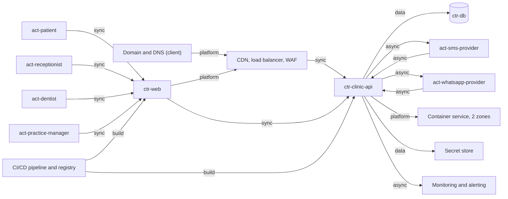

# BrightSmile Booking — Dependency Map

Based on: architecture v1 · Status: proposed

Ids: `DEP-001` to `DEP-006` are the Gate 1 scope's own dependencies (`scope/scope.md`) and keep their ids; they are the client's and practice manager's inputs. New dependencies from this map continue at `DEP-007`. Risk ids are in `risk-register.md`. Scope and estimate were available for this run (`scope/scope.md`, `scope/estimate.md`, `product/backlog.md`, `requirements/clarifications.md`).

## 1. Runtime dependency graph

Containers (`ctr_`), people and external systems (`act_`) are the HLD's elements. The `plat_` nodes are managed platform services the HLD deployment names without an id (section 8 of the HLD): the edge, the container service, the secret store, DNS, monitoring and the build pipeline.

Reading the graph: everything a user does passes ctr-web, then ctr-clinic-api, then ctr-db. The two providers are the only systems outside the cloud account, and the SMS provider is the only one on the sign-in path.

## 2. Dependencies

Owner of a client-side row is named in the To column. "Hard" means the system or the go-live cannot work without it.

| ID | From | To | Kind | Criticality (hard / soft) | If it fails | Fallback | Linked risk |
|---|---|---|---|---|---|---|---|
| DEP-001 | ctr-clinic-api (owner: Client) | act-sms-provider account: SMS account in the clinic's name, DLT sender ID and templates | third-party | hard | No sign-in code, confirmation or reminder can be sent, so patients cannot sign in and the system cannot go live (CON-003). Test account due week 1, registration before UAT | None for sign-in. Staging uses provider sandbox. Reception books by phone as today | RSK-001, RSK-015, RSK-016 |
| DEP-002 | ctr-clinic-api (owner: Client) | act-whatsapp-provider account: WhatsApp Business number and approved templates | third-party | soft | WhatsApp choice cannot be offered. Number due week 2, templates before UAT | Go live with SMS only (SMS is the default, FR-013). Needs the client's agreement because Q-002 asked for both | RSK-001, RSK-015 |
| DEP-003 | cmp-scheduling (owner: Practice manager) | Treatment list (online flag, durations) and each dentist's weekly hours at each clinic | decision | hard | No free slots to test or to show at UAT. Due week 2 | Seed treatment types in V007 (data-model section 7). Hours have no default: UAT and the diary entry wait | RSK-017 |
| DEP-004 | plat_edge (owner: Client) | Domain or subdomain for the website | third-party | hard | Site and `/api` must share one domain for the cookie session (ADR-0004). No production go-live. Due before UAT | Use the provider's default host name for staging and UAT only | RSK-017, RSK-008 |
| DEP-005 | act-receptionist (owner: Client) | Reception PCs with a current browser at both clinics | team | hard | Reception cannot run the day view on 1 March | None from us. Dentists may use phones (rel-003) but reception has no substitute | RSK-017 |
| DEP-006 | act-receptionist (owner: Client) | Reception time to type future paper-diary appointments, in the 2 weeks before go-live (SA-005) | team | hard | Day-one diary incomplete: double bookings and missing visits | Paper diary kept in parallel for the first week, checked against the screen each day | RSK-010, RSK-017 |
| DEP-007 | act-patient | ctr-web (rel-001) | runtime-sync | hard | Patients cannot open the booking screens | CDN serves the last good build. Phone booking at reception | RSK-033 |
| DEP-008 | act-receptionist | ctr-web (rel-002) | runtime-sync | hard | Reception screens unavailable | As DEP-007. Reception phones and paper diary | RSK-033 |
| DEP-009 | act-dentist | ctr-web (rel-003) | runtime-sync | soft | Dentist cannot see their day | Reception prints or reads the day view | RSK-033 |
| DEP-010 | act-practice-manager | ctr-web (rel-004) | runtime-sync | soft | No set-up or report screens | Changes wait. Slots keep working | RSK-033, RSK-037 |
| DEP-011 | ctr-web | ctr-clinic-api (rel-005) | runtime-sync | hard | Every screen fails with the retry message | None in the web app. Replica restart and zone redundancy (2 replicas). Phone booking | RSK-004, RSK-022, RSK-033 |
| DEP-012 | ctr-clinic-api | ctr-db (rel-006) | runtime-sync | hard | No reads or writes. Failover to the standby takes about 60 seconds. Queued messages are untouched | HA standby in zone B. No fallback for a region loss | RSK-029, RSK-033 |
| DEP-013 | ctr-clinic-api | act-sms-provider (rel-007) | runtime-async | hard (sign-in code), soft (messages) | Codes fail with PROVIDER_UNAVAILABLE. Other messages stay queued, then fail after 3 attempts | Messages: retry, breaker, reception list (FR-033). Codes: 7-day session, patient asks again, phone booking. No second SMS provider | RSK-002, RSK-016, RSK-033 |
| DEP-014 | ctr-clinic-api | act-whatsapp-provider (rel-008) | runtime-async | soft | WhatsApp messages not sent | One SMS fallback when `FALLBACK_WHATSAPP_TO_SMS` is on (R2, not yet agreed) | RSK-005, RSK-020 |
| DEP-015 | act-sms-provider | ctr-clinic-api (rel-009) | runtime-async | soft | Delivery status and STOP replies are not received | Provider retries (assumed, ASM-009). A missed receipt leaves the row `sent` | RSK-020, RSK-021, RSK-016 |
| DEP-016 | act-whatsapp-provider | ctr-clinic-api (rel-010) | runtime-async | soft | A failed WhatsApp receipt is not seen, so no SMS fallback | None: the row stays `sent` (known gap) | RSK-020, RSK-021 |
| DEP-017 | ctr-web | plat_edge: CDN, load balancer, WAF | platform | hard | Static files and `/api` routing lost | CDN serves the last good build if the origin is down. No fallback if the edge itself fails | RSK-033 |
| DEP-018 | ctr-clinic-api | plat_containers: managed container service, zones A and B | platform | hard | API and dispatcher stop | 2 replicas in two zones, restart on failed health check. The service must keep CPU running outside requests for the dispatcher | RSK-022, RSK-008 |
| DEP-019 | ctr-clinic-api | plat_secrets: secret store (database URL, provider keys, webhook secrets, signing key) | platform | hard (at start) | A restarted or new replica cannot start. Running replicas keep their values | Running replicas unaffected. Rolling deploys can wait | RSK-033 |
| DEP-020 | ctr-db | Managed PostgreSQL 16 service: standby, log archiving, daily snapshots, `btree_gist` and `pg_trgm` extensions | platform | hard | No double-booking guarantee (ADR-0003) if the extension is not allowed. Data loss beyond RPO if backups are bad | Synchronous standby, point-in-time restore, snapshots kept 14 days. Restore test before go-live | RSK-029, RSK-023 |
| DEP-021 | ctr-clinic-api | plat_monitoring: metrics, logs and paging (product not chosen) | platform | soft | Reminder lag, dispatcher heartbeat and 5xx alerts are not seen | None. Reception list of failed reminders is the human check | RSK-004, RSK-032 |
| DEP-022 | ctr-web, ctr-clinic-api | plat_cicd: build, test, image scan, deploy pipeline and image registry | build | hard (for delivery), soft (runtime) | No deploy or rollback of the previous image | Manual deploy of the previous image from the registry | RSK-014 |
| DEP-023 | ctr-web, ctr-clinic-api | Contract `api-clinic-api-v1` (`contracts/clinic-api-v1.openapi.yaml` 1.0.0) | build | hard | Web and API drift, rework late in the plan | Contract tests in CI. Contract exists, so build can start | RSK-036 |
| DEP-024 | ctr-clinic-api | ctr-db schema: migrations V001 to V007 (extensions, tables, seed) | data | hard | API cannot start. The no-overlap constraint is missing | Migrations are reversible until go-live. After go-live they are forward-only | RSK-030 |
| DEP-025 | cmp-identity, cmp-booking, cmp-reception | cmp-scheduling and cmp-channel-adapters with cmp-messaging (inside ctr-clinic-api) | build | hard | Sign-in needs `send_code`. Booking needs `validate_slot` and `on_booked`. Day view needs bookings | Build order in section 4, stubs for providers in dev | RSK-011, RSK-015 |
| DEP-026 | Client | Decision Q-007: family members on one phone number (ASM-001) | decision | soft | MOD-01 grows by 2 to 4 person-days if separate sign-ins are needed | Default: one account per phone, up to 5 family members. FR-006 is R2 | RSK-003 |
| DEP-027 | Client | Decision Q-008: hosting and domain (ASM-002) | decision | soft | Service names and cost change. Provider choice delays staging | Default: we choose a cloud region in India (SA-002) | RSK-008, RSK-022 |
| DEP-028 | Client | Decision Q-009: night-time reminder rule, and Q-015: walk-in recording (ASM-003, ASM-004, ASM-014) | decision | soft | Quiet-hours or no-show-rate definition changes. Rows already created are not moved | Defaults in SA-003 and SA-004. One-off script (ADR-0009) | RSK-035 |
| DEP-029 | Client | Agreement to the WhatsApp-to-SMS fallback (PRD Questions to raise 2, ASM-005) and to confirmations (backlog Decisions needed 3) | decision | soft | Extra message charges. R2 scope or the switch changes | Built behind `FALLBACK_WHATSAPP_TO_SMS`, default on | RSK-005, RSK-034 |
| DEP-030 | Client | Agreement to the release split: US-006 and US-027 in R2 (backlog Decisions needed 1) | decision | soft | If both return to the MVP, about 5 to 8 person-days more | Plan holds the split until confirmed | RSK-018 |
| DEP-031 | Practice manager | Acceptance by trying each flow (A-006) and Gate 2 confirmation of NFR-002 and NFR-004 (ASM-006) | decision | hard | No sign-off, no go-live. Targets stay proposals | None | RSK-019, RSK-006 |
| DEP-032 | Solution Architect with Client | Choice and contract of the SMS and WhatsApp providers (REQ-029: a provider we choose, accounts in the clinic's name) | decision | hard | DEP-001 and DEP-002 cannot start. Registration clock does not run | None. This is the first step of the critical path | RSK-001, RSK-016 |
| DEP-033 | Client | Clinic addresses and phones, dentist and staff names for seed and set-up (data-model section 7) | data | hard | Refusal pages cannot show the clinic phone. Staff accounts cannot be created | Placeholders in staging only | RSK-017 |
| DEP-034 | Client | Confirmation of retention periods (ASM-012), the erasure screen (ASM-013) and the privacy notice wording | decision | soft | Data kept too long or too short. Deletion on request done by hand | Defaults in the HLD. Practice manager runs erasure | RSK-027, RSK-028 |

## 3. External and platform dependencies

Nothing in the documents names a vendor, a plan or an SLA. Every SLA below is "unknown, to confirm", and that gap is itself a risk (RSK-033).

| Dependency | Kind | Used by (ctr ids) | Version / plan | SLA | Lock-in and exit path |
|---|---|---|---|---|---|
| SMS provider | third-party | ctr-clinic-api | Not chosen. Needs DLT-registered sender ID and templates, delivery webhooks, STOP forwarding, test account (ASM-009) | Unknown, to confirm | Adapter `cmp-channel-adapters` isolates the API (ADR-0006). Whether DLT templates move to another provider without re-registration is unknown, to confirm. Exit: new adapter plus new templates |
| WhatsApp provider | third-party | ctr-clinic-api | Not chosen. Business number and approved templates | Unknown, to confirm. Provider messaging tier limits unknown | As SMS. Templates are approved per account, to confirm |
| Cloud region in India (container service) | platform | ctr-clinic-api | Not chosen (Q-008). Serverless container runtime, 2 replicas, scale 2 to 4 | Unknown, to confirm | Three managed service kinds only (ADR-0005). Image is portable. Exit: redeploy the image elsewhere |
| Managed PostgreSQL 16 with HA standby | platform | ctr-db | Not chosen. Small tier: 2 vCPU, 4 GB RAM, 20 GB disk. Needs `btree_gist`, `pg_trgm` | Unknown, to confirm. RPO 15 minutes and RTO 1 hour are our defaults (ASM-007) | Standard PostgreSQL: dump and restore to another host. Exit effort low, no vendor features used |
| CDN, load balancer, WAF | platform | ctr-web, ctr-clinic-api | Not chosen. WAF 300 requests per minute per IP, webhooks 600 | Unknown, to confirm | Static files and routing rules only. Exit: any CDN |
| Secret store | platform | ctr-clinic-api | Cloud-native, values passed as environment variables | Unknown, to confirm | Environment variables, so low lock-in |
| Domain and DNS | third-party | ctr-web | Client's domain or subdomain (DEP-004) | Unknown, to confirm (client's registrar) | Owned by the client, so no lock-in. Certificate renewal owner not stated |
| Monitoring and alerting | platform | ctr-clinic-api | Not chosen. Needs metrics, structured logs, paging | Unknown, to confirm | Metric names are ours (LLD observability). Exit: re-point the exporter |
| CI/CD pipeline and image registry | platform | ctr-web, ctr-clinic-api | Not chosen | Unknown, to confirm | Standard container image and static build. Exit: any pipeline |

## 4. Build order and critical path

Derived from the contract (DEP-023), the schema (DEP-024), the module calls in LLD section 2 and the estimate's modules. The estimate gives Release 1 as 104 to 185 person-days, 7 to 13 weeks for 4.25 people, against about 16 weeks to 1 March 2027. Steps marked **[CP]** are on the critical path.

1. **[CP] Provider choice and account requests (DEP-032, DEP-001, DEP-002).** Needs the client. Starts in week 1 and runs in parallel with everything else, because DLT registration and template approval are outside our control. Nothing needs to be built for it.
2. **Foundations (week 1 to 2).** Contract `api-clinic-api-v1` (exists), dev and staging environments with the secret store (DevOps), the schema migrations V001 to V007 (DEP-024), `core` (config, logging, errors, access context), CI/CD (DEP-022). Needs: contract and data model, both done.
3. **cmp-scheduling and the staff side of cmp-identity (MOD-02, part of MOD-01).** Clinics, dentists, treatments, hours, leave, free slots, staff login and roles. Needs: step 2 and the treatment list and hours (DEP-003, week 2).
4. **[CP] cmp-channel-adapters (SMS first) and `send_code` in cmp-messaging.** Patient sign-in needs this, so it comes before booking. Needs: the SMS test account (DEP-001, week 1 to 2), step 2.
5. **Patient side of cmp-identity (sign-in, account, channel choice).** Needs: step 4.
6. **cmp-booking (MOD-03, MOD-04).** Booking, reschedule, cancel, history, the exclusion-constraint race test (QA-003). Needs: steps 3 and 5, plus the `on_booked` hooks of cmp-messaging (stubbed until step 7) and an `is_blocked` stub of cmp-noshow-policy (real in R2).
7. **[CP] cmp-messaging in full (MOD-07, 15 to 24 person-days).** Reminder rows, quiet hours, dispatcher, retries, breaker, WhatsApp adapter, receipts, STOP, webhooks. Needs: step 6 (appointments to remind), step 4, WhatsApp sandbox (DEP-002, week 2), webhook behaviour confirmed with the chosen providers (ASM-009).
8. **cmp-reception (MOD-05).** Day view, check-in, no-show and undo, dentist's day, patient search. Needs: step 6.
9. **ctr-web screens.** Built against the contract in parallel from step 3, one role at a time (patient first), with a mock server until the API is ready. Reception and manager screens follow steps 8 and 3.
10. **[CP] Integration test with real providers, load test, restore test, UAT, diary entry (DEP-006), go-live.** Needs: all of the above, real DLT-registered templates (DEP-001), domain (DEP-004), PCs (DEP-005), practice manager sign-off (DEP-031). Provider registration finishing late lands here.
11. **R2 (2 to 3 weeks after go-live):** cmp-noshow-policy (MOD-06), cmp-reporting (MOD-08), family screens (US-006), fallback and failed-reminder list (US-027). Tables already exist from V005 and V006, so R2 needs no migration.

Critical path: provider choice (1) → registration and template approval → adapters and messaging (4, 7) → integration test with real providers (10) → UAT → go-live. The code path (steps 2 to 8) fits inside the estimate. The external registration path is the one that can slip.

## 5. Single points of failure

| Element | Why it is a single point of failure | Mitigation or accepted risk |
|---|---|---|
| act-sms-provider (sign-in path) | One SMS provider carries every sign-in code. No second provider and no other sign-in method (REQ-023 wants no passwords) | Accepted with limits (RSK-002): 7-day session, breaker, alert, phone booking by reception |
| DEP-032 provider choice and DEP-001 registration | One clinic-owned registration gates all messaging and sign-in. No second provider is registered in parallel | Request accounts in week 1 (RSK-001) |
| ctr-clinic-api as one deployable, with the dispatcher inside it | A defect, bad deploy or throttled CPU stops booking and reminders together (ADR-0001, ADR-0002) | 2 replicas in two zones, rolling deploy, lag alert, option to run the dispatcher as a worker (RSK-004, RSK-022) |
| ctr-db primary | One primary and one synchronous standby. Failover takes about 60 seconds. One region only, so a region loss is not covered | Managed HA, point-in-time restore. Region loss accepted at 99.5% (RSK-029, RSK-033) |
| plat_edge (CDN, load balancer, WAF) | All traffic enters through one managed edge | Last good build served from the CDN. Accepted, managed service (RSK-033) |
| plat_secrets | A replica that restarts while the store is down cannot start | Running replicas keep their values. Accepted (RSK-033) |
| First manager account | Created by a set-up command, no story, no password reset. If it is locked or lost nobody can create staff or set hours | Second manager account at set-up and a documented reset command (RSK-037) |
| Practice manager as the only source of hours, treatments and sign-off | One person enters DEP-003 and gives acceptance (DEP-031) | Name a deputy at the clinic (RSK-017, RSK-019) |
| Client-owned domain | Only the client can change DNS | Agree the contact at kick-off (RSK-017) |

## 6. Decisions and assumptions to close

Dates are relative to the plan because no calendar was given beyond 1 March 2027. "Week N" counts from the start of the build.

| Item (ASM / open question) | Blocks (element or build step) | Needed by | Owner (role) |
|---|---|---|---|
| Provider choice and contract (DEP-032) | Build steps 1 and 4, DEP-001, DEP-002 | Week 1 | Solution Architect with Client |
| SMS and WhatsApp accounts, DLT registration, template approval (DEP-001, DEP-002, A-005) | Build steps 4, 7, 10 | Accounts week 1 and 2, approval before UAT | Client |
| ASM-009: providers offer receipts, STOP forwarding, idempotent client reference, test account | Build step 7, rel-007 to rel-010 | Before provider choice is signed | Tech Lead |
| Treatment list and weekly hours (DEP-003) | Build step 3, UAT | Week 2 | Client (Practice manager) |
| Domain (DEP-004), Q-008 hosting | Build step 10, staging set-up | Hosting before staging, domain before UAT | Client |
| Reception PCs (DEP-005), diary entry time (DEP-006) | Go-live | PCs before UAT, diary 2 weeks before go-live | Client |
| Q-007 family members (ASM-001) | US-006 in R2, MOD-01 | Before R2 build | Client |
| Q-009 night-time reminders (ASM-003), Q-015 walk-ins (ASM-004, ASM-014) | Build step 7 settings, FR-032 definition | Before step 7 | Client |
| WhatsApp-to-SMS fallback agreement (ASM-005) and confirmation messages | US-027, rel-008, message charges | Before R2 build | Client |
| Release split of US-006 and US-027 | Plan for MVP and R2 | Before build step 6 | Product Owner |
| ASM-006 NFR targets, ASM-015 no-show baseline | QA-001, QA-002, QA-005, FR-032 | Gate 2 | Product Owner |
| ASM-007 RPO 15 minutes, RTO 1 hour, 14-day backups | Managed database plan, restore test | Before staging | DevOps |
| ASM-011 receptionist searches all patients versus NFR-006 | cmp-identity `find_patients`, QA-007 tests | Before build step 5 | Product Owner |
| ASM-012 retention periods, ASM-013 erasure screen, privacy notice | cmp-identity erasure, JOB-003, JOB-004 | Before UAT | Client |
| WhatsApp STOP handling (NFR-011) | rel-010 inbound, QA-009 | Before build step 7 | Tech Lead |
| Who receives alerts and supports the system after go-live (A-004) | Plat monitoring, rollback | Before go-live | DevOps with Client |
| Practice manager sign-off by trying each flow (A-006) | Go-live | UAT | Client (Practice manager) |
