# BrightSmile Booking — Low-Level Design

Based on: architecture v1 · Status: proposed

## 1. Scope and conventions

This LLD covers `ctr-clinic-api`, the only container the backend agent builds (FastAPI, `fastapi_greenfield`). `ctr-web` is a React SPA with no business rules of its own (it hides buttons the API would refuse, such as the 4-hour cut-off, but the API is the authority); `ctr-db` is managed PostgreSQL, whose tables come from `data-model.md`. Contract operations come from `contracts/clinic-api-v1.openapi.yaml` and map to the interfaces below once it exists.

Conventions shared by all modules:
- **Layers** in every module: `api` (FastAPI routers, request and response schemas), `domain` (rules, no I/O), `infra` (SQLAlchemy repositories, provider clients). Modules call each other only through a module's `service.py` interface, never its tables or repositories.
- **Ids:** UUIDs for rows; clients receive them as strings. Phone numbers are stored in E.164 (`+91...`). Times are stored as UTC `timestamptz`, converted to IST (`Asia/Kolkata`) at the edge; "day" and "month" mean an IST day or month.
- **Errors:** every 4xx/5xx body is `{code, message, timestamp, correlation_id}`; `code` is from the Errors tables (stable strings), `message` is plain English safe to show.
- **Correlation id:** taken from `X-Request-Id` or generated; written to every log line and returned in the error body.
- **Logging:** structured JSON, ids only; never a phone number, name, birth year, code or message text.
- **Writes:** one database transaction per request; the booking request carries an `Idempotency-Key` header, so a repeated request returns the first result.
- **Access context:** every service call takes an `AccessContext(role, account_id, clinic_id, dentist_id)` built by `cmp-identity`.
- **Pagination:** every list endpoint takes `page` and `page_size` (default 50, maximum 200).

## 2. Container designs

### 2.1 ctr-clinic-api — Clinic API

Module structure:
```
app/
  main.py                  # FastAPI app, health, startup of dispatcher and jobs
  core/                    # config, logging, errors, access context, clock (IST helpers), db session
  identity/                # api, domain, infra, service       (cmp-identity)
  scheduling/              # api, domain, infra, service       (cmp-scheduling)
  booking/                 # api, domain, infra, service       (cmp-booking)
  reception/               # api, service                      (cmp-reception, no tables of its own)
  noshow_policy/           # domain, infra, service            (cmp-noshow-policy)
  messaging/               # domain (templates, timing), infra, dispatcher, service   (cmp-messaging)
  channel_adapters/        # sms.py, whatsapp.py, webhooks.py  (cmp-channel-adapters)
  reporting/               # api, service                      (cmp-reporting, no tables)
  jobs/                    # scheduler wiring for JOB-001 to JOB-005
migrations/                # Alembic, forward-only
```

| Component (cmp id) | Module / package | Responsibility | Depends on |
|---|---|---|---|
| cmp-identity | `app/identity` | Sign-in (phone code, staff password), tokens, AccessContext, staff and patient accounts, family members, channel choice and STOP flag, erasure | cmp-messaging (to send the code), core |
| cmp-scheduling | `app/scheduling` | Clinics, dentists, treatments, hours, breaks, leave, free-slot calculation, "to move" list | cmp-booking (reads appointments to find free time and to-move) |
| cmp-booking | `app/booking` | Appointment aggregate, status machine, history, online and reception booking rules | cmp-scheduling, cmp-noshow-policy, cmp-messaging, cmp-identity |
| cmp-reception | `app/reception` | Day views, check-in, no-show and undo, failed-reminder list, patient search for reception | cmp-booking, cmp-noshow-policy, cmp-messaging, cmp-identity |
| cmp-noshow-policy | `app/noshow_policy` | Counts no-shows, creates, shows and lifts blocks | cmp-booking (counts no-show events) |
| cmp-messaging | `app/messaging` | Templates, quiet-hours timing, message rows, dispatcher, fallback, receipts, STOP | cmp-channel-adapters, cmp-identity, cmp-booking (to re-check appointment status) |
| cmp-channel-adapters | `app/channel_adapters` | SMS and WhatsApp provider clients, webhook verification and parsing | none (outbound HTTPS only) |
| cmp-reporting | `app/reporting` | Monthly no-show report per clinic | cmp-booking |

Interfaces (what each component exposes; "API" names the route family that calls it, the exact paths are in the contract):

| Component | Operation (signature) | Input | Output | Errors | Used by |
|---|---|---|---|---|---|
| cmp-identity | `request_code(phone) -> None` | phone | none (code sent) | RATE_LIMITED, VALIDATION_ERROR | API auth |
| cmp-identity | `verify_code(phone, code, name=None) -> Session` | phone, code, name for a new number | session cookie, patient summary | AUTH_CODE_INVALID, AUTH_CODE_EXPIRED, AUTH_LOCKED, VALIDATION_ERROR | API auth |
| cmp-identity | `staff_login(username, password) -> Session` | credentials | session cookie, role | AUTH_BAD_CREDENTIALS, AUTH_LOCKED, AUTH_ACCOUNT_INACTIVE | API auth |
| cmp-identity | `authorize(token) -> AccessContext` | cookie | access context, re-reading role, clinic, active flag | AUTH_REQUIRED, AUTH_ACCOUNT_INACTIVE | every router |
| cmp-identity | `create_staff(ctx, username, password, role, clinic_id, dentist_id) -> Staff` | staff data | staff | FORBIDDEN, VALIDATION_ERROR, CONFLICT | API staff |
| cmp-identity | `set_staff_active(ctx, staff_id, active) -> Staff` | id, flag | staff | FORBIDDEN, NOT_FOUND | API staff |
| cmp-identity | `list_staff(ctx) -> Page~Staff~` | page | staff list | FORBIDDEN | API staff |
| cmp-identity | `list_family(ctx) -> List~Patient~` | context | account holder and family | FORBIDDEN | API patients |
| cmp-identity | `add_family_member(ctx, name, birth_year) -> Patient` | name, year | person | FAMILY_LIMIT, VALIDATION_ERROR | API patients |
| cmp-identity | `set_channel_preference(account_id, channel) -> None` | account, SMS or WHATSAPP | none | VALIDATION_ERROR | cmp-booking |
| cmp-identity | `set_reminders_opt_out(ctx, patient_id, opt_out) -> None` | person, flag | none | FORBIDDEN, NOT_FOUND | API patients (reception) |
| cmp-identity | `opt_out_by_phone(phone) -> None` | phone from STOP reply | none | none (unknown numbers ignored) | cmp-messaging |
| cmp-identity | `find_patients(ctx, query) -> Page~PatientSummary~` | phone or name | name, phone, block flag only | FORBIDDEN | cmp-reception |
| cmp-identity | `create_patient(ctx, name, phone) -> Patient` | name, phone | person and account if new | FORBIDDEN, VALIDATION_ERROR | cmp-reception |
| cmp-identity | `erase_patient_data(ctx, account_id) -> ErasureResult` | account | anonymised counts | FORBIDDEN, NOT_FOUND | API admin |
| cmp-scheduling | `list_clinics() -> List~Clinic~` | none | active clinics | none | API catalogue |
| cmp-scheduling | `save_clinic(ctx, ...) / save_dentist(ctx, ...)` | clinic or dentist data | the row | FORBIDDEN, VALIDATION_ERROR | API settings |
| cmp-scheduling | `list_treatments(online_only) -> List~Treatment~` | flag | treatments | none | API catalogue |
| cmp-scheduling | `save_treatment(ctx, name, minutes, online) -> Treatment` | data | treatment | FORBIDDEN, VALIDATION_ERROR | API settings |
| cmp-scheduling | `set_working_hours(ctx, dentist_id, clinic_id, weekday, start, end, breaks) -> Hours` | hours | hours | FORBIDDEN, VALIDATION_ERROR, HOURS_OVERLAP | API settings |
| cmp-scheduling | `add_leave(ctx, dentist_id, start, end) -> LeaveResult` | range | leave and the to-move appointments | FORBIDDEN, VALIDATION_ERROR | API settings |
| cmp-scheduling | `list_to_move(ctx, clinic_id) -> Page~Appointment~` | clinic | booked appointments inside leave | FORBIDDEN | cmp-reception |
| cmp-scheduling | `free_slots(clinic_id, treatment_id, dentist_id or None, date_from, date_to) -> List~Slot~` | search | slots with dentist, at most 10 for "first available" | OUTSIDE_HORIZON, TREATMENT_NOT_ONLINE | cmp-booking, API slots |
| cmp-scheduling | `validate_slot(clinic_id, dentist_id, treatment_id, start, online) -> Duration` | slot | duration in minutes | SLOT_UNAVAILABLE, TREATMENT_NOT_ONLINE, OUTSIDE_HORIZON | cmp-booking |
| cmp-booking | `book_online(ctx, patient_id, clinic_id, treatment_id, dentist_id, start, channel, key) -> Appointment` | booking | appointment | SLOT_TAKEN, SLOT_UNAVAILABLE, ONLINE_BOOKING_BLOCKED, FORBIDDEN, TREATMENT_NOT_ONLINE, OUTSIDE_HORIZON | API bookings |
| cmp-booking | `reschedule_online(ctx, appointment_id, dentist_id, start) -> Appointment` | new slot | appointment | SLOT_TAKEN, CUTOFF_PASSED, ONLINE_BOOKING_BLOCKED, FORBIDDEN, INVALID_TRANSITION | API bookings |
| cmp-booking | `cancel_online(ctx, appointment_id) -> Appointment` | id | appointment | CUTOFF_PASSED, FORBIDDEN, INVALID_TRANSITION | API bookings |
| cmp-booking | `list_my_appointments(ctx, page) -> Page~Appointment~` | context | upcoming first, then past, family included | FORBIDDEN | API bookings |
| cmp-booking | `get_appointment(ctx, id) -> Appointment` | id | appointment with history for manager | FORBIDDEN, NOT_FOUND | API bookings |
| cmp-booking | `book_by_reception(ctx, patient_id, clinic_id, treatment_id, dentist_id, start) -> Appointment` | booking | appointment (any treatment, no cut-off, no block) | SLOT_TAKEN, SLOT_UNAVAILABLE, FORBIDDEN | cmp-reception |
| cmp-booking | `reschedule_by_reception(ctx, id, dentist_id, start) / cancel_by_reception(ctx, id, patient_asked)` | change | appointment | SLOT_TAKEN, FORBIDDEN, INVALID_TRANSITION | cmp-reception |
| cmp-booking | `set_status(ctx, id, to_status) -> Appointment` | arrived, no-show, booked (undo) | appointment | NOSHOW_TOO_EARLY, NOSHOW_UNDO_EXPIRED, INVALID_TRANSITION, FORBIDDEN | cmp-reception |
| cmp-booking | `list_day(ctx, clinic_id, date) / list_dentist_day(ctx, dentist_id, date)` | clinic or dentist, date | appointments by dentist | FORBIDDEN | cmp-reception |
| cmp-booking | `list_history(ctx, appointment_id) -> List~Event~` | id | status changes with who and when | FORBIDDEN, NOT_FOUND | API bookings (manager) |
| cmp-booking | `count_for_report(clinic_id, month) -> Counts` | clinic, month | not cancelled count, no-show count | none | cmp-reporting |
| cmp-booking | `list_for_dentist(dentist_id, start, end) -> List~Appointment~` | range | active appointments | none | cmp-scheduling |
| cmp-reception | `day_view(ctx, clinic_id, date) -> DayView` | clinic, date | one column per dentist working that day | FORBIDDEN | API reception |
| cmp-reception | `my_day(ctx, date) -> DentistDay` | date | the dentist's appointments at each clinic | FORBIDDEN | API reception |
| cmp-reception | `mark_arrived / mark_no_show / undo_no_show(ctx, appointment_id)` | id | appointment | see `set_status` | API reception |
| cmp-reception | `failed_reminders_tomorrow(ctx, clinic_id) -> Page~FailedReminder~` | clinic | appointment, patient name and phone | FORBIDDEN | API reception |
| cmp-noshow-policy | `is_blocked(patient_id) -> bool` | person | blocked or not (count of no-shows in last 6 months since the last lift, at least 2) | none | cmp-booking, cmp-reception |
| cmp-noshow-policy | `on_no_show_changed(patient_id) -> None` | person | creates or expires a block row | none | cmp-booking |
| cmp-noshow-policy | `lift_block(ctx, patient_id) -> BlockStatus` | person | block lifted, count from zero | FORBIDDEN, NOT_FOUND | cmp-reception |
| cmp-messaging | `send_code(phone, code) -> None` | phone, code | sent now, no row kept after 24 hours | PROVIDER_UNAVAILABLE | cmp-identity |
| cmp-messaging | `on_booked / on_rescheduled / on_cancelled(appointment)` | appointment | confirmation or notice row, reminder row created, replaced or cancelled, in the caller's transaction | none | cmp-booking |
| cmp-messaging | `dispatch_due(batch_size) -> int` | batch | rows handled | none (failures recorded) | JOB-001 |
| cmp-messaging | `handle_receipt(provider, provider_message_id, status)` | receipt | row updated, fallback created | none (unknown ids ignored) | webhook router |
| cmp-messaging | `handle_inbound(provider, phone, text)` | reply | STOP sets opt-out | none | webhook router |
| cmp-messaging | `list_failed_reminders(clinic_id, date) -> Page~FailedReminder~` | clinic, date | reminders ended in Failed | none | cmp-reception |
| cmp-channel-adapters | `send(channel, template_id, phone, params) -> SendResult` | channel, template | provider message id or mapped error (RETRYABLE, REJECTED) | PROVIDER_UNAVAILABLE | cmp-messaging |
| cmp-channel-adapters | `verify_and_parse(provider, headers, body) -> List~ProviderEvent~` | webhook | receipts and inbound replies | WEBHOOK_SIGNATURE_INVALID | webhook router |
| cmp-reporting | `no_show_report(ctx) -> List~ReportRow~` | context | per clinic and month for 12 months: no-shows, non-cancelled, rate | FORBIDDEN | API reports |

Domain model:

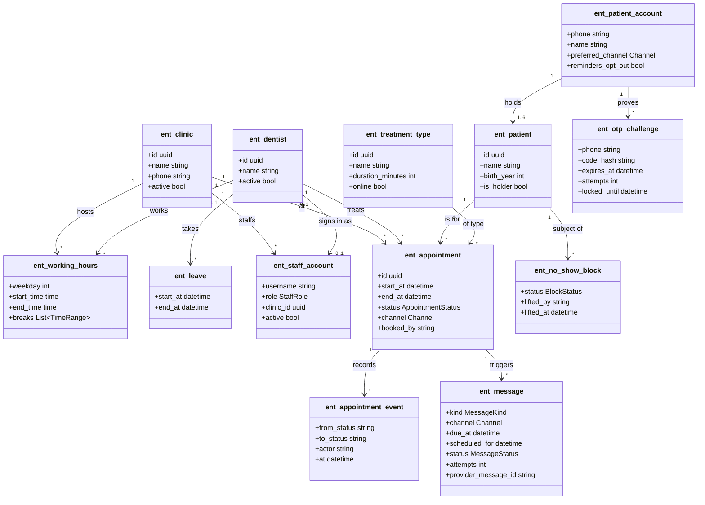

Lifecycles:

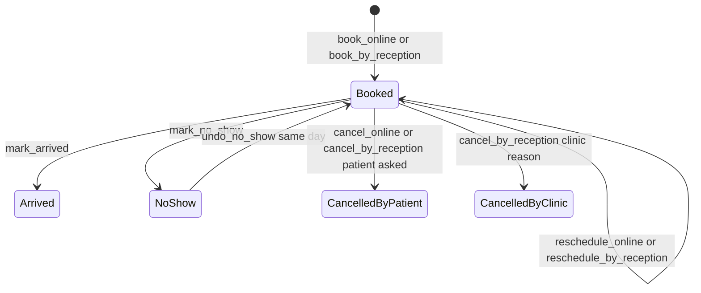

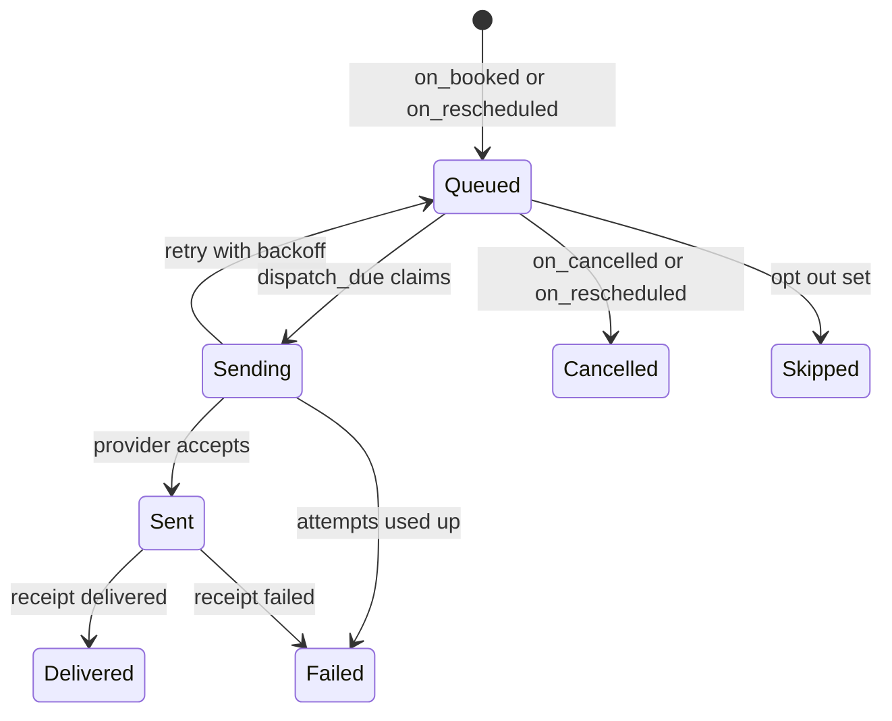

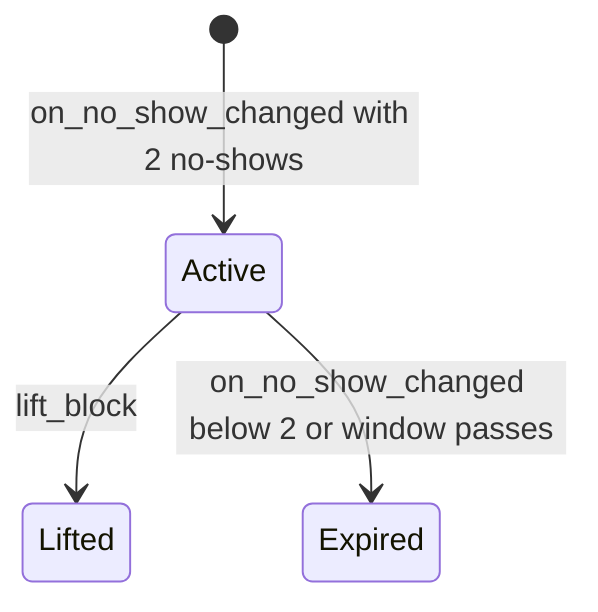

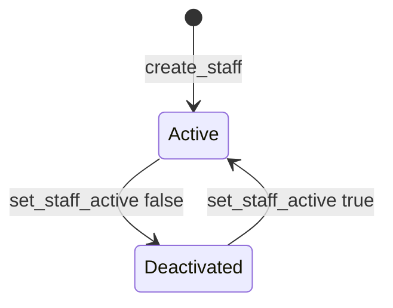

Business rules:
| ID | Rule | Enforced in (cmp id) | Source (FR / QA id) |
|---|---|---|---|
| BR-001 | A sign-in code is 6 digits, valid 10 minutes, stored hashed; 5 wrong tries lock the phone for 15 minutes; a new code replaces the old | cmp-identity | FR-002, QA-007 |
| BR-002 | One account per phone number (E.164); a new number creates the account and its first person (the holder) after the code is verified and a name is given | cmp-identity | FR-002 |
| BR-003 | An account has at most 5 family members besides the holder | cmp-identity | FR-006 |
| BR-004 | A staff password has at least 10 characters, is hashed with argon2id; 5 wrong tries lock the username for 15 minutes; a deactivated account can never sign in, and live sessions stop at the next request | cmp-identity | FR-003, FR-005, QA-007 |
| BR-005 | Role scope: a patient reaches only their account's persons; a receptionist only appointments of their assigned clinic; a dentist only their own appointments, read only; a manager everything. The role and clinic come from the database, not the token | cmp-identity (AccessContext), every module | FR-004, QA-007 |
| BR-006 | Free slots = working hours at that clinic on that weekday minus breaks, leave and active appointments (booked or arrived) of the dentist, on a 30-minute grid; a slot is free only if the whole treatment duration fits | cmp-scheduling | FR-010 |
| BR-007 | Online booking offers only treatment types flagged online (30 minutes); reception may book any type (60 or 90 minutes included); a longer appointment blocks the dentist for its whole length | cmp-scheduling, cmp-booking | FR-009, FR-020 |
| BR-008 | Online booking is allowed from now to 30 days ahead (ASM-010), for a future start; "first available" returns the earliest 10 free slots across the clinic's dentists, with the dentist's name | cmp-scheduling, cmp-booking | FR-011 |
| BR-009 | An appointment's (dentist, time range) never overlaps another active appointment; the database constraint is final, the service turns a violation into SLOT_TAKEN with the next free slots | cmp-booking, ctr-db | FR-012, QA-003 |
| BR-010 | A patient may book, reschedule or cancel online only until 4 hours before the start; after that the API refuses with CUTOFF_PASSED and the screen shows the clinic's phone number. Reception has no cut-off | cmp-booking | FR-016, FR-017, FR-020 |
| BR-011 | An online reschedule keeps the clinic and treatment and may change dentist and time; the old slot is free in the same transaction | cmp-booking | FR-016, FR-018 |
| BR-012 | Every status change or move writes an `ent-appointment-event` row with actor (account or staff id) and time, in the same transaction | cmp-booking | FR-024 |
| BR-013 | Arrived may be set on a booked appointment; no-show only on a booked appointment from 15 minutes after its start until 23:59 IST of that day; undo (to booked) only the same IST day | cmp-booking, cmp-reception | FR-021, FR-022 |
| BR-014 | A reception cancel is "cancelled by the patient" when the receptionist says the patient asked, otherwise "cancelled by the clinic" (ASM-014) | cmp-booking | FR-020, FR-024 |
| BR-015 | Saving leave never changes appointments: those inside the leave are listed in "to move" until reception moves or cancels them; leave does not remove existing bookings from the day view | cmp-scheduling | FR-008 |
| BR-016 | A person with 2 no-shows within the last 6 months (counted only after the latest lift) cannot book or reschedule online; existing appointments stay; reception booking is not stopped; no-shows count against the person the appointment was for | cmp-noshow-policy, cmp-booking | FR-025 |
| BR-017 | Lifting a block records who and when, and later counting starts from that moment | cmp-noshow-policy | FR-026 |
| BR-018 | The patient's channel (SMS or WhatsApp) is chosen at booking, defaults to SMS the first time and then to the last choice, and is stored on the account and on the appointment | cmp-identity, cmp-booking | FR-013 |
| BR-019 | Booking creates a confirmation at once; a reschedule or cancel creates a notice at once; all in the chosen channel with the clinic, dentist, treatment, date, time and appointment link | cmp-messaging | FR-014, FR-018 |
| BR-020 | A reminder row is created at booking or reschedule with `due_at` = start − 24 hours, only when at least 24 hours remain (booked less than 24 hours ahead gets none); a reschedule cancels the old reminder and creates one for the new time; a cancel cancels it | cmp-messaging | FR-027, FR-028 |
| BR-021 | `scheduled_for` = `due_at`, except: due 21:00–24:00 IST goes at 20:00 the same evening; due 00:00–08:00 goes at 20:00 the evening before; if that time has already passed, it goes now outside quiet hours, otherwise at 08:00 (ASM-003) | cmp-messaging | FR-027 |
| BR-022 | Before sending, the dispatcher re-checks the appointment is still booked and the person's account has not opted out; otherwise the row is Cancelled or Skipped and nothing is sent | cmp-messaging | FR-028, FR-031 |
| BR-023 | If a WhatsApp reminder fails (provider error after 3 attempts, or a failed receipt) and the fallback switch is on, one SMS reminder is created, linked to the first by a unique key; if the SMS fails too, the chain ends Failed and the appointment shows as "reminder failed" | cmp-messaging | FR-029 |
| BR-024 | STOP from a phone sets the account's reminders opt-out at once (inside 1 hour); queued reminders become Skipped; confirmations, notices and sign-in codes are still sent; reception can set or clear the flag | cmp-messaging, cmp-identity | FR-031, QA-009 |
| BR-025 | Only registered templates are sent: each kind and channel has a configured template id; free text is never sent | cmp-channel-adapters, cmp-messaging | QA-009 |
| BR-026 | "Reminders failed" for a day lists appointments starting that day (tomorrow by default) whose reminder chain ended Failed, with the patient name and the account holder's phone | cmp-messaging, cmp-reception | FR-033 |
| BR-027 | The no-show rate for a clinic and month = no-show appointments ÷ appointments that month whose status is not cancelled (booked, arrived, no-show); the report covers the last 12 months, on screen only | cmp-reporting | FR-032 |
| BR-028 | A receptionist finds patients by phone or name across all patients and gets name, phone and block flag; appointments shown are those at their clinic; a new patient needs name and phone only | cmp-identity, cmp-reception | FR-020, ASM-011 |
| BR-029 | Reception may book the slot that is running now (start up to 30 minutes ago) so a walk-in is a normal appointment, then marked arrived | cmp-booking | FR-020 |
| BR-030 | Erasure on request: future appointments must first be cancelled; the person's name, birth year and the account's phone are replaced by anonymous values, messages are deleted; appointment and history rows stay without personal link (RSK-007) | cmp-identity | QA-008 |

Errors:
| Error code | Meaning | HTTP status | Retryable | Raised by |
|---|---|---|---|---|
| VALIDATION_ERROR | A field is missing or malformed | 422 | no | all |
| AUTH_REQUIRED | No valid session | 401 | no | cmp-identity |
| AUTH_CODE_INVALID | The code is wrong | 401 | no (up to the limit) | cmp-identity |
| AUTH_CODE_EXPIRED | The code is older than 10 minutes | 401 | no (ask for a new code) | cmp-identity |
| AUTH_BAD_CREDENTIALS | Username or password wrong | 401 | no | cmp-identity |
| AUTH_LOCKED | Too many wrong tries, wait 15 minutes | 429 | after the wait | cmp-identity |
| AUTH_ACCOUNT_INACTIVE | The staff account is deactivated | 403 | no | cmp-identity |
| FORBIDDEN | The role may not do this or the record is not theirs | 403 | no | all |
| CSRF_FAILED | Missing or wrong CSRF header or origin | 403 | no | core |
| NOT_FOUND | No such record, or one the caller may not know exists | 404 | no | all |
| CONFLICT | A unique value (username, phone) already exists | 409 | no | cmp-identity, cmp-scheduling |
| RATE_LIMITED | Too many code requests for this phone or address | 429 | after the wait | cmp-identity |
| FAMILY_LIMIT | The account already has 5 family members | 409 | no | cmp-identity |
| HOURS_OVERLAP | Hours or breaks overlap | 422 | no | cmp-scheduling |
| TREATMENT_NOT_ONLINE | The type can only be booked by reception | 422 | no | cmp-scheduling |
| OUTSIDE_HORIZON | The date is past or more than 30 days ahead | 422 | no | cmp-scheduling |
| SLOT_UNAVAILABLE | The slot is outside hours, in a break or leave | 409 | no | cmp-scheduling |
| SLOT_TAKEN | Another appointment holds the slot; body lists next free slots | 409 | no (choose another slot) | cmp-booking |
| ONLINE_BOOKING_BLOCKED | The person has 2 no-shows in 6 months; body carries the clinic phone | 403 | no | cmp-booking |
| CUTOFF_PASSED | Less than 4 hours to the start; body carries the clinic phone | 409 | no | cmp-booking |
| NOSHOW_TOO_EARLY | Less than 15 minutes since the start | 409 | later | cmp-booking |
| NOSHOW_UNDO_EXPIRED | The no-show is from an earlier day | 409 | no | cmp-booking |
| INVALID_TRANSITION | The status change is not allowed from the current status | 409 | no | cmp-booking |
| WEBHOOK_SIGNATURE_INVALID | Provider webhook signature failed | 401 | no | cmp-channel-adapters |
| PROVIDER_UNAVAILABLE | A message provider did not answer (sign-in code only; reminders are queued) | 503 | yes | cmp-channel-adapters |
| INTERNAL_ERROR | Unexpected fault | 500 | yes | core |

## 3. Detailed flows

### Flow 1: Patient signs in (FR-002)

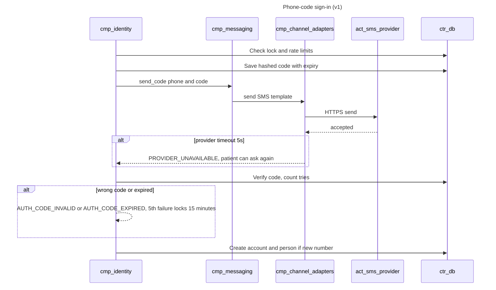

### Flow 2: Patient books online (FR-011, FR-012, FR-013, FR-014, FR-025)

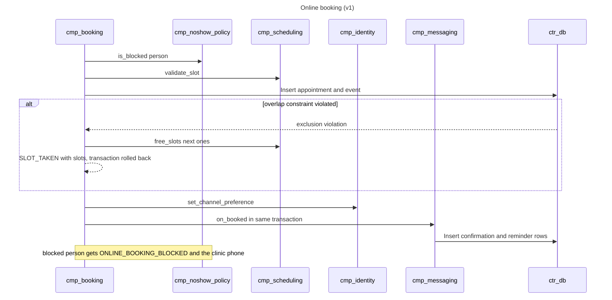

### Flow 3: Patient reschedules or cancels (FR-016, FR-017, FR-018)

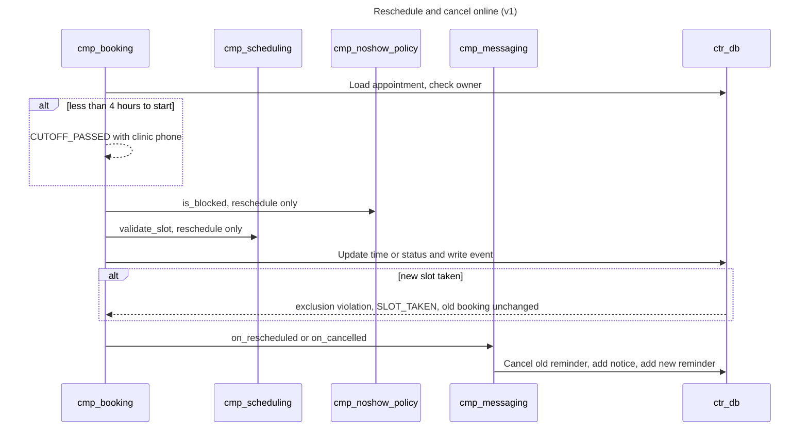

### Flow 4: Reception runs the day (FR-019 to FR-024, FR-026)

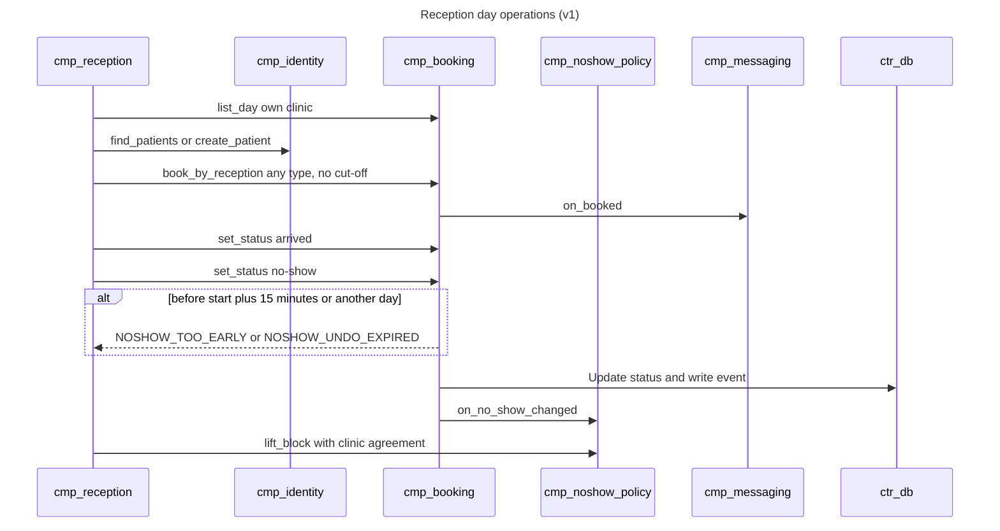

### Flow 5: Reminder dispatch, receipts and STOP (FR-027 to FR-031, FR-033)

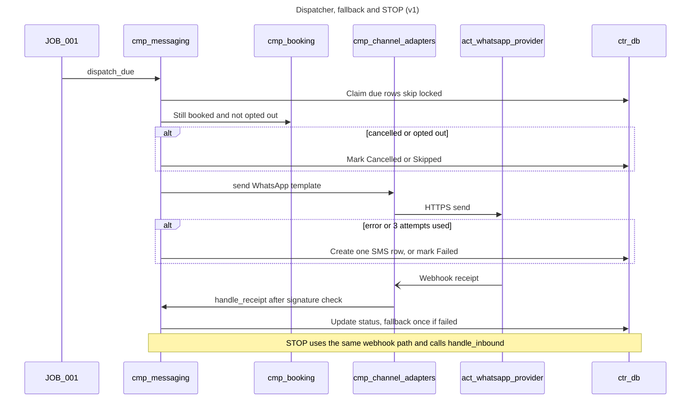

### Flow 6: Manager sets up the week (FR-005, FR-007, FR-008, FR-009, FR-032)

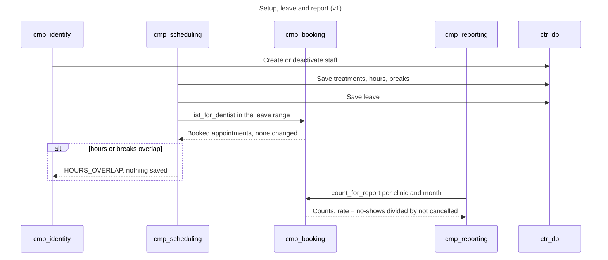

## 4. Background jobs and schedules

| ID | Trigger (cron / event / queue) | What it does | Idempotency | On failure |
|---|---|---|---|---|
| JOB-001 | Every 30 seconds in each API replica | `dispatch_due`: claims up to 50 `Queued` rows with `scheduled_for` ≤ now using skip locked, applies BR-022, sends through the adapter, records result, retries with backoff 5 s then 30 s (3 attempts), applies BR-023 | A row is claimed by one replica at a time; the provider call carries the row id as client reference, a unique key on the fallback row stops a second SMS | Row returns to Queued with the next attempt time; after 3 attempts Failed; lag over 10 minutes alerts |
| JOB-002 | Daily 03:00 IST | Deletes expired and old `ent-otp-challenge` rows (over 24 hours) | Deleting by age is safe to repeat | Logged, runs again next day |
| JOB-003 | Daily 03:30 IST | Deletes `ent-message` rows older than 90 days (ASM-012) | Safe to repeat | Logged, alert after 2 failed days |
| JOB-004 | Monthly, 1st at 04:00 IST | Anonymises personal data of persons and staff with nothing booked in 24 months (ASM-012) and drops the link from old appointments | Anonymised rows are skipped | Logged, alert |
| JOB-005 | Nightly 02:00 IST | Reconciles: every booked appointment starting in 24 hours or more has exactly one pending reminder unless opted out, and no cancelled appointment has one; repairs differences and logs the count | Creating only missing rows, cancelling only stray ones | Alert if more than 3 repairs in a night (signals a bug) |

## 5. Cross-cutting design

### Configuration
| Key | Purpose | Default | Secret (yes/no) | Container |
|---|---|---|---|---|
| DATABASE_URL | PostgreSQL connection | none | yes | ctr-clinic-api |
| TOKEN_SIGNING_KEY | Signs session tokens | none | yes | ctr-clinic-api |
| PATIENT_SESSION_DAYS | Patient session length (ASM-008) | 7 | no | ctr-clinic-api |
| STAFF_SESSION_HOURS | Staff session length | 8 | no | ctr-clinic-api |
| SMS_PROVIDER_URL / SMS_API_KEY | SMS provider endpoint and key | none | yes (key) | ctr-clinic-api |
| WHATSAPP_PROVIDER_URL / WHATSAPP_API_KEY | WhatsApp provider endpoint and key | none | yes (key) | ctr-clinic-api |
| WEBHOOK_SECRET_SMS / WEBHOOK_SECRET_WHATSAPP | HMAC secrets for webhooks | none | yes | ctr-clinic-api |
| TEMPLATE_IDS | DLT and WhatsApp template ids per kind and channel | none | no | ctr-clinic-api |
| FALLBACK_WHATSAPP_TO_SMS | WhatsApp-to-SMS fallback switch (ADR-0006) | true | no | ctr-clinic-api |
| BOOKING_HORIZON_DAYS | Online booking horizon (ASM-010) | 30 | no | ctr-clinic-api |
| CUTOFF_HOURS | Online change cut-off | 4 | no | ctr-clinic-api |
| QUIET_HOURS_START / QUIET_HOURS_END / QUIET_SEND_TIME | Quiet hours and send time (ASM-003) | 21:00 / 08:00 / 20:00 | no | ctr-clinic-api |
| CODE_TTL_MINUTES / CODE_MAX_TRIES / CODE_LOCK_MINUTES | Sign-in code limits (PD-006) | 10 / 5 / 15 | no | ctr-clinic-api |
| OTP_DAILY_CAP_PER_PHONE / OTP_PER_IP_PER_HOUR | Code flood limits (thr-008) | 10 / 30 | no | ctr-clinic-api |
| NOSHOW_MIN_MINUTES / NOSHOW_BLOCK_COUNT / NOSHOW_WINDOW_MONTHS | No-show window and block (PD-003, FR-025) | 15 / 2 / 6 | no | ctr-clinic-api |
| FEATURE_R2_ENABLED | Shows R2 screens and applies the block, fallback list, family and report | false until R2 | no | ctr-clinic-api |
| CORS_ORIGIN | Allowed origin for the one site | none | no | ctr-clinic-api |

### Authorization matrix
| Operation | Patient | Receptionist | Dentist | Practice manager |
|---|---|---|---|---|
| request_code, verify_code | allowed (public) | denied | denied | denied |
| staff_login | denied | allowed (public) | allowed (public) | allowed (public) |
| create_staff, set_staff_active, list_staff | denied | denied | denied | allowed |
| list_family, add_family_member | own account only | denied | denied | denied |
| set_channel_preference (at booking) | own account only | denied | denied | denied |
| set_reminders_opt_out | denied | allowed | denied | allowed |
| find_patients, create_patient | denied | allowed | denied | allowed |
| erase_patient_data | denied | denied | denied | allowed |
| list_clinics, list_treatments, free_slots | allowed (online types only) | allowed (all types) | denied | allowed |
| save_clinic, save_dentist, save_treatment, set_working_hours, add_leave | denied | denied | denied | allowed |
| list_to_move | denied | own clinic only | denied | allowed |
| book_online, reschedule_online, cancel_online | own persons only, subject to block and cut-off | denied | denied | denied |
| list_my_appointments, get_appointment | own persons only | own clinic only | own appointments only | allowed |
| book_by_reception, reschedule_by_reception, cancel_by_reception | denied | own clinic only | denied | allowed |
| mark_arrived, mark_no_show, undo_no_show | denied | own clinic only | denied | denied |
| day_view | denied | own clinic only | denied | allowed |
| my_day | denied | denied | own appointments only (read only) | denied |
| failed_reminders_tomorrow | denied | own clinic only | denied | allowed |
| list_history | denied | denied | denied | allowed |
| lift_block, block status | denied | allowed | denied | allowed |
| no_show_report | denied | denied | denied | allowed |
| provider webhooks | denied | denied | denied | signature only (provider), not a user role |

### Caching
No caching. Free slots and day views are read live from PostgreSQL (QA-001 is met by indexed queries at this volume, see HLD capacity). The browser may keep static files for the CDN's TTL; static files are versioned by file name.

### Observability
| Container | Logs (events, never PII) | Metrics (name, type) | Traces (spans) | Alerts |
|---|---|---|---|---|
| ctr-clinic-api | `request` (route, status, duration, role), `booking_conflict`, `block_applied`, `message_sent`, `message_failed`, `fallback_created`, `webhook_rejected`, `job_run` (id, count, duration); all carry correlation id | `http_requests_total` and `http_request_seconds` (counter, histogram, by route), `booking_conflicts_total` (counter), `messages_sent_total` and `messages_failed_total` (counters by kind, channel), `reminder_lag_seconds` (histogram: sent − scheduled_for), `dispatcher_heartbeat` (gauge), `otp_requests_total` (counter), `db_pool_in_use` (gauge) | One span per request, per module call, per SQL statement and per provider call | Probe fails 3 minutes (page); 5xx above 2% for 5 minutes; `reminder_lag_seconds` p99 above 10 minutes; no dispatcher heartbeat for 5 minutes; JOB-005 repairs above 3; OTP requests above 3× the daily norm; database failover |

## 6. Traceability

| Requirement | Component(s) | Operation(s) |
|---|---|---|
| FR-001 | cmp-scheduling | `list_clinics`, `save_clinic`, `save_dentist`, `set_working_hours` |
| FR-002 | cmp-identity, cmp-messaging | `request_code`, `verify_code`, `send_code` |
| FR-003 | cmp-identity | `staff_login`, `authorize` |
| FR-004 | cmp-identity, all modules | `authorize` (AccessContext), per-operation checks in the Authorization matrix |
| FR-005 | cmp-identity | `create_staff`, `set_staff_active`, `list_staff` |
| FR-006 | cmp-identity | `list_family`, `add_family_member` |
| FR-007 | cmp-scheduling | `set_working_hours` |
| FR-008 | cmp-scheduling, cmp-booking | `add_leave`, `list_to_move`, `list_for_dentist` |
| FR-009 | cmp-scheduling | `list_treatments`, `save_treatment` |
| FR-010 | cmp-scheduling | `free_slots` |
| FR-011 | cmp-booking, cmp-scheduling | `book_online`, `free_slots`, `validate_slot` |
| FR-012 | cmp-booking | `book_online`, `reschedule_online` (exclusion constraint, BR-009) |
| FR-013 | cmp-identity, cmp-booking | `set_channel_preference`, `book_online` |
| FR-014 | cmp-messaging | `on_booked` |
| FR-015 | cmp-booking | `list_my_appointments`, `get_appointment` |
| FR-016 | cmp-booking | `reschedule_online` |
| FR-017 | cmp-booking | `cancel_online` |
| FR-018 | cmp-booking, cmp-messaging | `reschedule_online`, `cancel_online`, `on_rescheduled`, `on_cancelled` |
| FR-019 | cmp-reception, cmp-booking | `day_view`, `list_day` |
| FR-020 | cmp-reception, cmp-booking, cmp-identity | `book_by_reception`, `reschedule_by_reception`, `cancel_by_reception`, `find_patients`, `create_patient` |
| FR-021 | cmp-reception, cmp-booking | `mark_arrived`, `set_status` |
| FR-022 | cmp-reception, cmp-booking | `mark_no_show`, `undo_no_show`, `set_status` |
| FR-023 | cmp-reception, cmp-booking | `my_day`, `list_dentist_day` |
| FR-024 | cmp-booking | `set_status`, `list_history` (BR-012) |
| FR-025 | cmp-noshow-policy, cmp-booking | `is_blocked`, `on_no_show_changed` |
| FR-026 | cmp-noshow-policy, cmp-reception | `lift_block` |
| FR-027 | cmp-messaging | `on_booked`, `on_rescheduled`, `dispatch_due` (BR-020, BR-021) |
| FR-028 | cmp-messaging | `on_cancelled`, `on_rescheduled`, `dispatch_due` (BR-020, BR-022) |
| FR-029 | cmp-messaging, cmp-channel-adapters | `dispatch_due`, `handle_receipt`, `send` (BR-023) |
| FR-030 | cmp-messaging | template rendering in `on_booked` (BR-019, BR-025) |
| FR-031 | cmp-messaging, cmp-identity | `handle_inbound`, `opt_out_by_phone`, `set_reminders_opt_out` |
| FR-032 | cmp-reporting, cmp-booking | `no_show_report`, `count_for_report` |
| FR-033 | cmp-reception, cmp-messaging | `failed_reminders_tomorrow`, `list_failed_reminders` |
