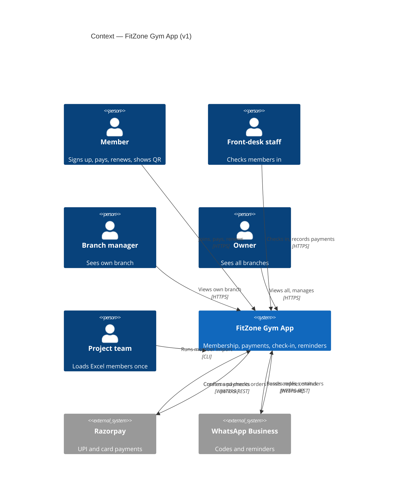
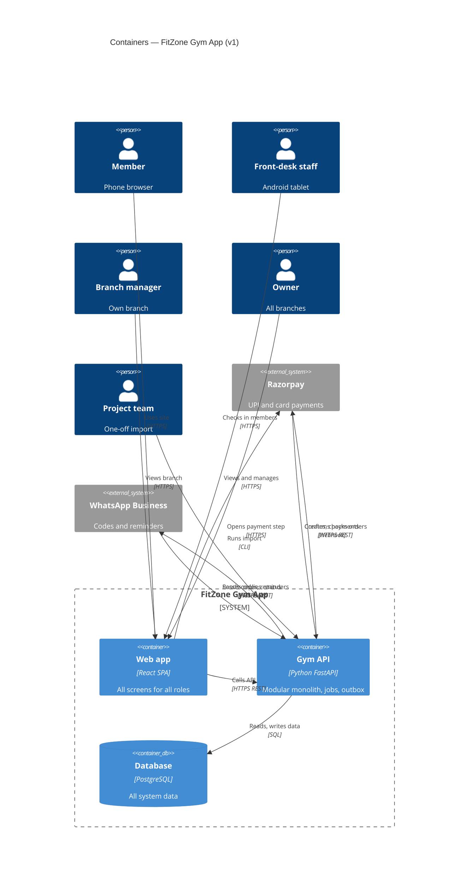
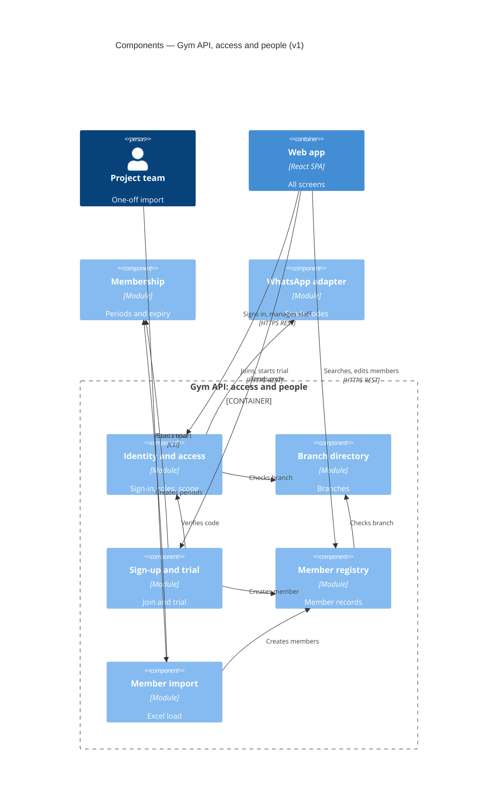
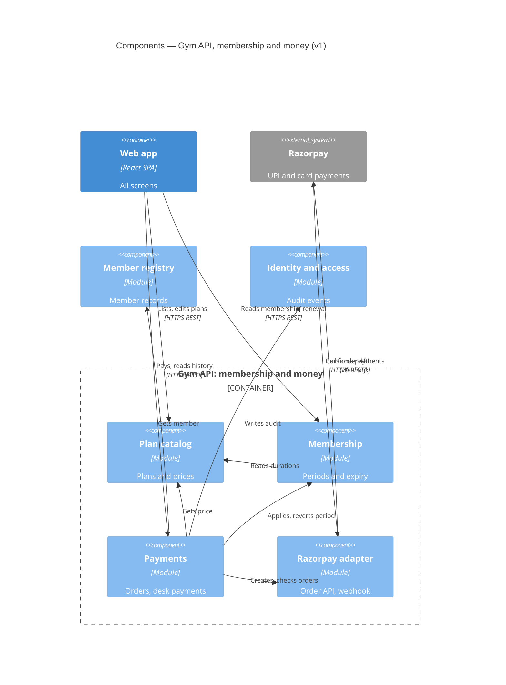
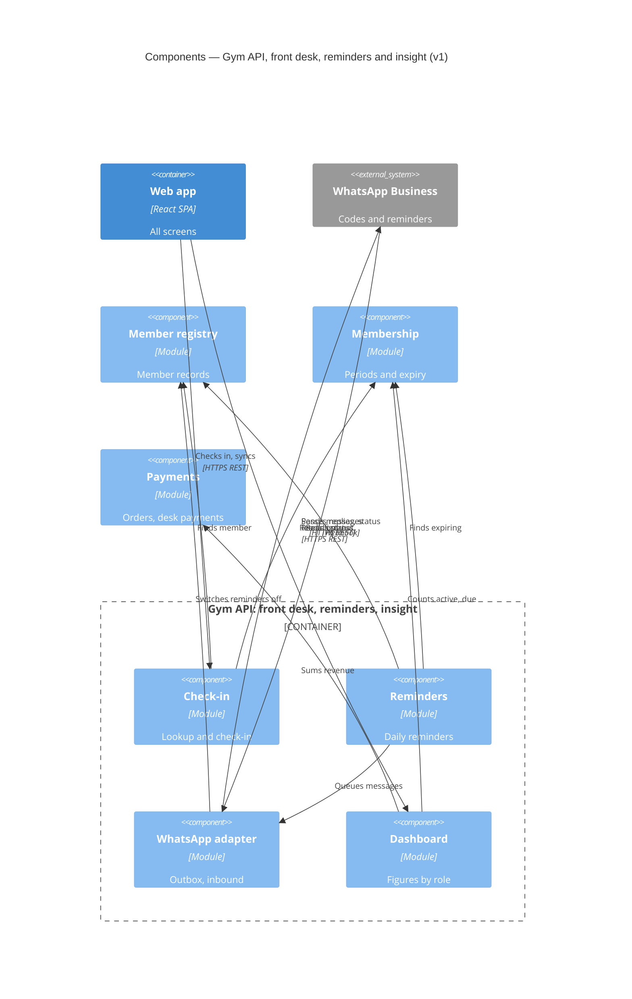
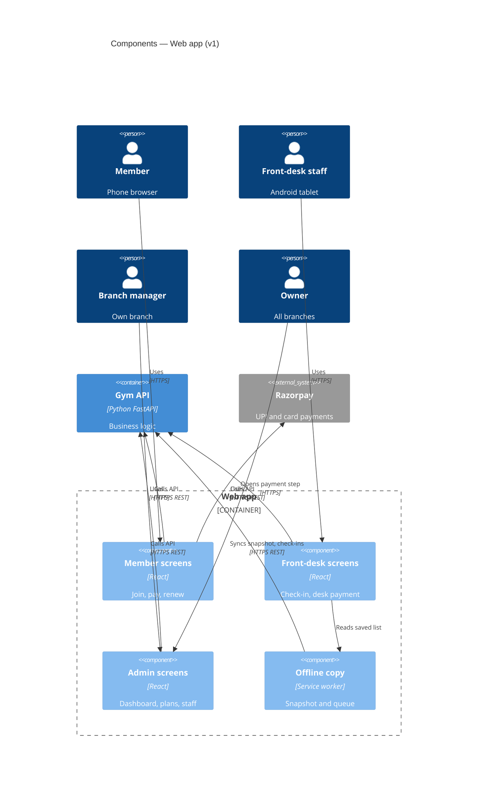
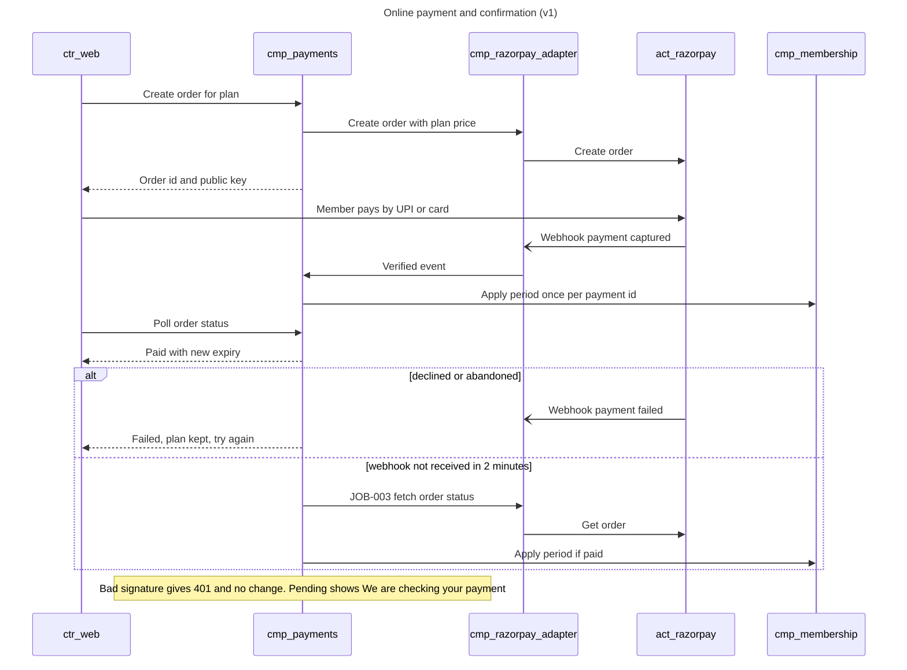
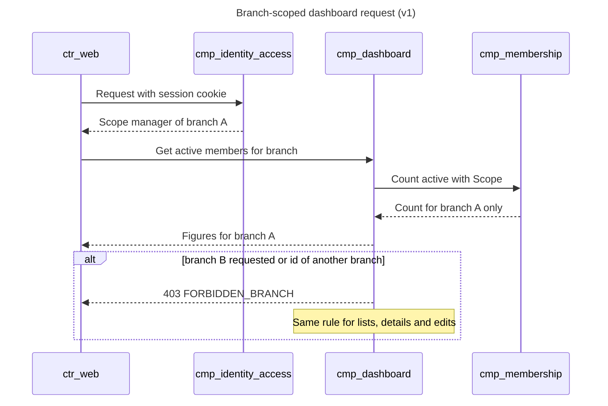
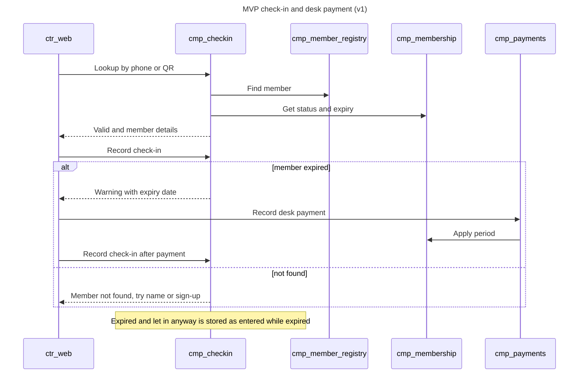
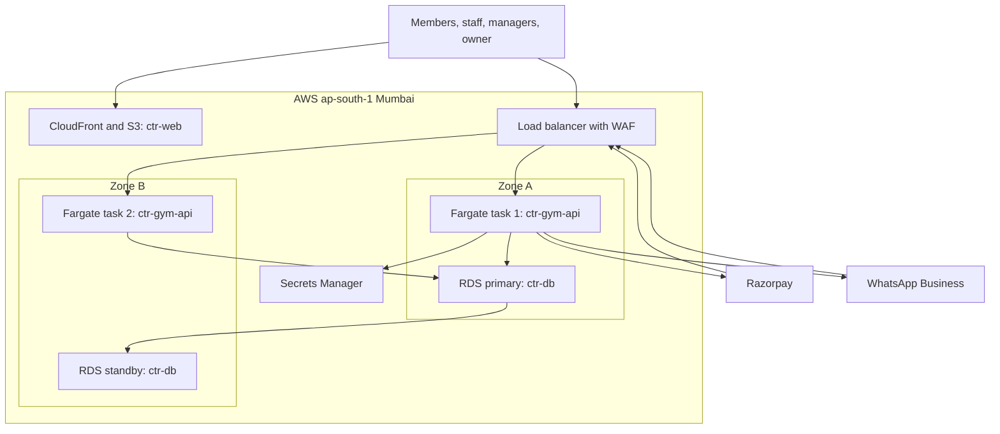

# FitZone Gym App — Architecture (HLD)

Version: v1 (initial design; the project has no requests.md and no inputs/ folder) · Style: Modular monolith (ADR-0001) · Status: proposed

Based on: prd.md v1.0, user-stories.md, backlog.md, review-report.md, scope.md, estimate.md, register.md, clarifications.md. The Source cells below name `prd.md` (FR-, NFR-, PD-, SA- ids) unless they say otherwise; there are no request-level needs because no request file exists.

## 1. Context and scope

FitZone is a chain of 3 gyms in Pune (about 1,200 members now, about 3,000 within a year). The system is a mobile-friendly website that replaces paper sign-up and the Excel expiry sheet: online sign-up and Razorpay payment, a 7-day free trial, member self-service and renewal, front-desk check-in on an Android tablet with an expiry warning, WhatsApp expiry reminders, loading of the existing Excel members, and an owner and branch-manager dashboard. It is released in three steps (MVP on 1 January 2027, then R2 and R3, per the backlog).

Out of scope (non-goals, from scope.md and prd.md section 3): refunds in the app (REQ-027); a native mobile app (REQ-038); GST invoices; pausing a membership or switching plan part-way; trainer role, class booking, diet or workout plans; shop or point-of-sale and accounting links; door or turnstile control; Marathi or Hindi screens; marketing messages, messages after expiry, and sign-up or payment confirmation messages on WhatsApp; export of dashboard figures; typing in paper records and automatic merging of duplicates; automatic recurring payments; an uptime guarantee (SLA), post-launch support, formal accessibility certification and load testing.

| Actor | Kind (person / external system) | Interaction |
|---|---|---|
| act-member | person | New, trial and existing members sign up, pay, renew, see their plan and show a QR code (P-01) |
| act-front-desk | person | Checks members in, fixes member details and records desk payments on the Android tablet (P-02) |
| act-branch-manager | person | Sees members, check-ins, payments and figures of their own branch (P-03) |
| act-owner | person | Sees all branches, manages plans, prices and staff accounts (P-04) |
| act-project-team | person | Loads the client's Excel member file once before launch |
| act-razorpay | external system | Takes UPI and card payments in the client's account and confirms them by webhook |
| act-whatsapp | external system | Delivers sign-in codes and reminders from the client's WhatsApp Business number; passes back replies |

## 2. Requirements and drivers

### Functional requirements
Priority is the story priority in `backlog.md` (a requirement with Must and Should stories is Must). Release (MVP, R2, R3) is in brackets.

| ID | Requirement | Priority (Must/Should/Could/Won't) | Source (request N / prd.md) |
|---|---|---|---|
| FR-001 | Hold the 3 branches; every member has a home branch; every sign-up, payment and check-in records its branch [MVP] | Must | prd.md FR-001; US-001 |
| FR-002 | Member signs in with phone number and a WhatsApp one-time code (10 minutes, 5 tries, 15-minute wait) [MVP] | Must | prd.md FR-002; US-002, US-003 |
| FR-003 | Front-desk staff, branch managers and owner sign in with username and password [MVP; manager R2] | Must | prd.md FR-003; US-004, US-051, US-052 |
| FR-004 | Each role sees only what its role needs [MVP] | Must | prd.md FR-004; US-005 |
| FR-005 | A branch manager sees only their own branch's data [R2] | Should | prd.md FR-005; US-006 |
| FR-006 | Only the owner sees all branches together and each separately [R2] | Should | prd.md FR-006; US-007 |
| FR-007 | Owner creates, deactivates and assigns staff and manager accounts [MVP] | Must | prd.md FR-007; US-008 |
| FR-008 | New member signs up with name, phone, home branch after a code check [MVP] | Must | prd.md FR-008; US-009, US-053, US-054 |
| FR-009 | A phone number that already has an account gets no second account; sign-in is offered [MVP] | Must | prd.md FR-009; US-010 |
| FR-010 | Show monthly, quarterly, yearly plans; member picks one before paying; expiry is the last valid day [MVP] | Must | prd.md FR-010; US-011 |
| FR-011 | Owner edits plan names, durations and prices; changes apply to future purchases only [R2] | Should | prd.md FR-011; US-012 |
| FR-012 | Member pays online by UPI or card through Razorpay; membership starts only on confirmation [MVP] | Must | prd.md FR-012; US-013 |
| FR-013 | Declined, abandoned or unconfirmed payment starts nothing; plain message; "We are checking your payment" [MVP] | Must | prd.md FR-013; US-014 |
| FR-014 | Each successful online payment is stored with date, amount, plan, method, branch, Razorpay reference [MVP] | Must | prd.md FR-014; US-015 |
| FR-015 | Staff record a desk payment (cash or UPI); manager or owner cancels a wrong one with a reason [MVP record; R2 cancel] | Must | prd.md FR-015; US-016, US-017 |
| FR-016 | Member sees current plan and whether active, expired or trial [R2] | Should | prd.md FR-016; US-018 |
| FR-017 | Member sees expiry date and days left [R2] | Should | prd.md FR-017; US-019 |
| FR-018 | Member sees payment history with a simple receipt [R2] | Should | prd.md FR-018; US-020 |
| FR-019 | Member with an active plan renews online; new period added after current expiry [R2] | Should | prd.md FR-019; US-022 |
| FR-020 | Member with an expired plan renews online; new period starts on payment date [R2] | Should | prd.md FR-020; US-023 |
| FR-021 | New person starts a 7-day free trial after a code check [R2] | Should | prd.md FR-021; US-024 |
| FR-022 | One free trial per phone number; loaded numbers cannot start one [R2] | Should | prd.md FR-022; US-025 |
| FR-023 | Trial member gets an account and QR code, checks in for 7 days, then shows as expired [R2] | Should | prd.md FR-023; US-026 |
| FR-024 | Member sees a personal QR code on their phone [MVP] | Must | prd.md FR-024; US-021 |
| FR-025 | Staff check in a member by typing the phone number [MVP] | Must | prd.md FR-025; US-028 |
| FR-026 | Staff check in a member by scanning the QR code with the tablet camera [MVP] | Must | prd.md FR-026; US-029 |
| FR-027 | Staff find a member by name [MVP] | Must | prd.md FR-027; US-030 |
| FR-028 | Expired member: clear warning with expiry date; staff may record "entered while expired" [MVP] | Must | prd.md FR-028; US-031 |
| FR-029 | No match: "member not found", suggestions, link to sign-up or trial [MVP] | Must | prd.md FR-029; US-032 |
| FR-030 | Every check-in stored with member, branch, time, staff user, result; other-branch members accepted [MVP] | Must | prd.md FR-030; US-033 |
| FR-031 | Check-in works up to 15 minutes without internet from a saved list; check-ins sent later [R3] | Could | prd.md FR-031; US-034, US-035 |
| FR-032 | Project team loads the Excel members as they are (rows without phone and duplicates included) [MVP] | Must | prd.md FR-032; US-036 |
| FR-033 | Load report with counts; per-branch "needs attention" list [MVP report; R2 list] | Must | prd.md FR-033; US-037, US-038 |
| FR-034 | Staff and managers edit name, phone, home branch of own-branch members, owner of all; phone conflicts refused [MVP] | Must | prd.md FR-034; US-039 |
| FR-035 | Staff remove a duplicate member by archiving; never merge automatically [R2] | Should | prd.md FR-035; US-040 |
| FR-036 | WhatsApp reminder 7 days before expiry [R2] | Should | prd.md FR-036; US-041 |
| FR-037 | WhatsApp reminder 1 day before expiry [R2] | Should | prd.md FR-037; US-042 |
| FR-038 | Reminder at 09:00 India time; skip rules; up to 3 retries that day, then mark failed [R2; failed marking R3] | Should | prd.md FR-038; US-043, US-044 |
| FR-039 | Reminders by WhatsApp only, from one number for all branches [R2] | Should | prd.md FR-039; US-045 |
| FR-040 | Free-trial member gets one reminder 1 day before the trial ends [R3] | Could | prd.md FR-040; US-027 |
| FR-041 | Member stops reminders via staff or by replying; staff see and re-enable [R2 stop; R3 re-enable] | Should | prd.md FR-041; US-046, US-047 |
| FR-042 | Dashboard: active members per branch [R2] | Should | prd.md FR-042; US-048 |
| FR-043 | Dashboard: renewals due this week with list [R2] | Should | prd.md FR-043; US-049 |
| FR-044 | Dashboard: revenue per month per branch (online and desk), on screen only [R2] | Should | prd.md FR-044; US-050 |

### Quality-attribute scenarios
| ID | Attribute | Priority (H/M/L importance / difficulty) | Source | Stimulus | Environment | Artifact | Response | Measure |
|---|---|---|---|---|---|---|---|---|
| QA-001 | Performance | H/M | Front-desk staff (NFR-006, PD-012) | Check a member in by phone, QR or name | Early-morning and evening rush, internet up | cmp-checkin, ctr-db | Member name, plan, status and expiry shown, check-in stored | p95 ≤ 2 s over 95% of check-ins (server time p95 ≤ 500 ms) |
| QA-002 | Performance | M/L | Member on a phone (NFR-006, PD-012) | Opens any member page | Normal 4G connection | ctr-web, cmp-membership | Page usable | Load ≤ 3 s at p95; API reads p95 ≤ 500 ms |
| QA-003 | Reliability | H/H | Member paying (NFR-010, FR-012, FR-013) | Pays online or the payment fails, is abandoned or confirmed late | Live Razorpay account, browser may close, webhook may be lost or repeated | cmp-payments, cmp-razorpay-adapter, cmp-membership | Membership starts once, only after verified confirmation; failure starts nothing; late confirmation is found | 0 memberships without a confirmed payment; 0 duplicate periods per payment id; 99% of captured payments reflected within 2 minutes of capture |
| QA-004 | Security | H/H | Branch manager (NFR-015, FR-005, FR-006) | Opens any list, detail or figure, or edits an id in a request | Signed in as a manager of branch A | cmp-identity-access scope, every module interface | Only branch A data returned; other ids refused | 0 screens or lists showing another branch; tested with a manager account of each branch |
| QA-005 | Availability | M/H | Front-desk staff (NFR-013, REQ-032) | Internet drops | Gym internet down up to 15 minutes, R3 | cmp-web-offline, cmp-checkin | Check-in continues from the saved list with an offline banner; queue sent on return | Works while the saved list is ≤ 20 minutes old; 100% of queued check-ins stored once after reconnect |
| QA-006 | Modifiability | H/H | Project team and client (NFR-008, NFR-009, NFR-010, NFR-011, NFR-012) | Launch date reached; R2 and R3 capabilities added later | 1 January 2027, 58 days from the request, MVP 104–179 person-days | Whole system: one deployable plus one SPA | Sign-up, payment and check-in live at all 3 branches with members loaded; later capabilities added as modules without redeploying other products | Live 1 January 2027; adding an R2 module changes no MVP module's tables; dashboard (R2) live within 28 days of launch (ASM-013) |
| QA-007 | Reliability | H/M | System clock (PD-002, FR-036–FR-041) | Reminder due day arrives | 09:00 India time, API restart or WhatsApp error possible | cmp-reminders, cmp-whatsapp-adapter | Each due reminder sent once, retried up to 3 times that day | ≥ 95% of due reminders sent on the due day; 0 duplicates per (member, kind, expiry) |
| QA-008 | Scalability | M/L | Gym members (NFR-005) | Members grow from 1,200 to 3,000 | Peak gym hours | ctr-gym-api, ctr-db | No slowdown, no redesign | Meets QA-001 and QA-002 at 3× the 3,000-member estimate (9,000 members) |
| QA-009 | Security | M/M | Attacker or curious person (NFR-014, PD-008) | Guesses codes, floods code requests, tries a second trial | Public internet | cmp-identity-access, cmp-onboarding | Codes limited; one trial per verified number | 0 trials on an unverified or repeated number; ≤ 5 wrong tries per code; ≤ 3 code sends per number per 10 minutes |
| QA-010 | Security | H/M | Auditor (NFR-016, CON-009) | Inspects stored data and logs | Production | ctr-db, ctr-web, cmp-razorpay-adapter | No card or UPI details stored or logged; passwords and codes stored as hashes | 0 card or UPI fields stored; 0 plain codes or passwords stored; 0 PII in logs |
| QA-011 | Privacy | M/M | Owner asks for deletion (NFR-017, ASM-019) | Member data deletion request | Production | cmp-member-registry, ctr-db | Member's personal data removed or anonymised; payment amounts and dates kept | Deletion completed within 7 days of the owner's request; 0 health data stored |
| QA-012 | Availability | M/L | Members and staff (NFR-018, ASM-018) | Use the app | 06:00–22:00 India time | ctr-gym-api, ctr-db | Available during gym hours | 99.5% monthly in gym hours, a design objective with no SLA |
| QA-013 | Compatibility | M/L | Members and staff (NFR-001, NFR-002, NFR-007) | Use screens on phone, tablet or desktop | Current Chrome and Safari on Android and iPhone; Android tablet | ctr-web | All screens usable, English only | 0 member screens needing sideways scrolling; check-in works on 1 tablet per desk (3 total); 100% English text |
| QA-014 | Usability | M/L | Member with low digital skills (NFR-003, NFR-004, PD-014) | Signs up, pays or renews | Phone | cmp-web-member | Few screens, large buttons, labelled fields | Sign-up to payment ≤ 5 screens; renewal ≤ 3 screens after sign-in; a label on every field |
| QA-015 | Durability | H/M | Operations (ASM-018) | Database fails or data is damaged | Production | ctr-db | Restored to a point in time | RPO ≤ 15 minutes, RTO ≤ 1 hour |
| QA-016 | Correctness | H/M | Front-desk staff (PD-002, FR-028) | Checks in an expired member | Online (and offline in R3) | cmp-membership, cmp-checkin | Expiry warning shown with the expiry date | 100% of check-ins of expired members show the warning |

Architectural drivers: QA-003, QA-004, QA-006.

### Constraints
| ID | Constraint | Kind (technical / regulatory / organizational / budget) |
|---|---|---|
| CON-001 | A mobile-friendly website only, no native app (REQ-038, NFR-001) | technical |
| CON-002 | Online payments use the client's existing Razorpay account (REQ-026, DEP-001) | technical |
| CON-003 | Reminders and codes go by WhatsApp only, never SMS, from FitZone's Business number (REQ-018, REQ-025, DEP-002) | technical |
| CON-004 | Launch on 1 January (2027 assumed); sign-up, payment and check-in live on day one (REQ-021, REQ-039, REQ-040, REQ-041) | organizational |
| CON-005 | English only (REQ-037, NFR-007) | organizational |
| CON-006 | Check-in runs in the browser on one client-provided Android tablet per front desk (REQ-031, DEP-005) | technical |
| CON-007 | The scope baseline's out-of-scope list stays out (section 1) | organizational |
| CON-008 | Normal Indian data-protection practice (DPDP Act); no health data; legal check not done here (NFR-017) | regulatory |
| CON-009 | The app never sees or stores card or UPI details (NFR-016) | technical |
| CON-010 | One phone number belongs to one member (PD-015) | technical |
| CON-011 | MVP effort 104–179 person-days against about 8.3 weeks available (backlog) | budget |

### Assumptions (to confirm with the client)
| ID | Assumption | Affects |
|---|---|---|
| ASM-001 | Launch is 1 January 2027 (SA-001, Q-004 open) | CON-004, QA-006 |
| ASM-002 | Staff can record desk payments (SA-002, Q-005 open); if no, FR-015, cmp-payments desk operations and the desk part of FR-044 are withdrawn | FR-015, FR-044, cmp-payments |
| ASM-003 | A membership is valid at all 3 gyms (SA-003, Q-006 open) | FR-001, FR-030, cmp-checkin |
| ASM-004 | Members sign in by phone plus WhatsApp code; staff by username and password (SA-006, Q-011 open) | FR-002, ADR-0007 |
| ASM-005 | The Kothrud WhatsApp number can send automated template messages; if not, the client registers another (SA-012, Q-019 open) | rel-010, RSK-001 |
| ASM-006 | The owner edits plans on an admin screen; prices are the same at all gyms (SA-004, A-014, Q-008 open) | FR-011, cmp-plan-catalog |
| ASM-007 | A renewal before expiry starts after the current expiry; after expiry it starts on the payment date (SA-005, A-015, Q-009 open) | FR-019, FR-020, BR-003 |
| ASM-008 | The receipt is an on-screen page (name, plan, amount, date, reference) the member can print; no GST invoice, no stored PDF (SA-007, Q-013 open) | FR-018 |
| ASM-009 | Hosting is AWS in Mumbai on managed services; the client provides a domain or subdomain (SA-008, Q-014 open) | ADR-0006, section 8 |
| ASM-010 | Members with no phone number are loaded, found by name, and get no reminders (SA-009, Q-016 open) | FR-027, FR-032, FR-038 |
| ASM-011 | A trial member can check in for 7 days and gets one reminder before the trial ends (SA-010, Q-017 open) | FR-023, FR-040 |
| ASM-012 | Offline check-in uses a saved copy refreshed every 5 minutes, usable while at most 20 minutes old (SA-011, PD-013, Q-018 open) | FR-031, ADR-0009 |
| ASM-013 | The release order is the backlog's: MVP, R2, R3 (SA-013, Q-020 open); "a few weeks after launch" for the dashboard (REQ-042) is read as 28 days | QA-006 |
| ASM-014 | "Own branch" means the member's home branch for members, memberships, payments and revenue (PD-011); check-ins are scoped to the branch where they happened, showing only name and result (review ISS-010 open) | FR-005, NFR-015, ADR-0008 |
| ASM-015 | Loaded members already have a member record (so an account): at Join the number is "already registered, sign in"; at trial "trial not available" with an offer to sign in and buy a plan (review ISS-001 open) | FR-009, FR-022 |
| ASM-016 | Imported rows sharing a phone number are loaded and flagged; sign-in for a shared number is refused with "ask at the front desk"; check-in by phone lists all matches for staff to choose (review ISS-006 open) | FR-025, FR-032, FR-002 |
| ASM-017 | At most 3 code sends per number per 10 minutes; a new code cancels the earlier one; member sessions last 30 days, staff sessions 12 hours; 10 wrong staff passwords lock the account for 15 minutes | FR-002, FR-003 |
| ASM-018 | Gym hours are 06:00–22:00 India time; availability objective 99.5% monthly in those hours; RPO 15 minutes and RTO 1 hour (customer-facing defaults) | QA-012, QA-015 |
| ASM-019 | Payments and check-ins are kept while the member exists and 3 years after; a deletion request anonymises the member's name and phone and keeps amounts and dates; audit events are kept 2 years | NFR-017, QA-011 |
| ASM-020 | The Razorpay account and WhatsApp number belong to FitZone, which provides keys and approved templates (A-025, DEP-001, DEP-002) | rel-007, rel-010 |
| ASM-021 | Peak: 3,000 members, 60% visit on a day, 40% of those arrive in two peak hours, at 3× headroom; 6,000 reminders per cycle (A-008, A-024) | section 10 |
| ASM-022 | The third branch name is supplied by the client; branches are data entered by the owner, not code (prd.md Questions to raise 4) | FR-001 |
| ASM-023 | A registered member with no membership is shown and checked in as "expired, no plan" | FR-028 |
| ASM-024 | Phone numbers are Indian mobile numbers stored as +91 followed by 10 digits | FR-002, FR-009 |
| ASM-025 | A cancelled desk payment stays in the history marked cancelled and is excluded from revenue (PD-016; review ISS-002 open) | FR-015, FR-044 |

## 3. Solution strategy

A modular monolith (ADR-0001): one backend deployable `ctr-gym-api`, one React single-page application `ctr-web`, one PostgreSQL `ctr-db`. It is the simplest style that meets the three drivers; the next simpler style, a plain monolith, cannot enforce branch isolation in one place (QA-004) or add R2 and R3 capabilities without disturbing the MVP (QA-006). The backend is split by business capability into 13 modules, each owning its tables.

Key patterns, each with its driver:
- **Webhook-confirmed payment with reconciliation and idempotency keys** (ADR-0004): QA-003.
- **Central branch scope object required by every module query** (ADR-0008): QA-004.
- **Anti-corruption adapters** `cmp-razorpay-adapter` and `cmp-whatsapp-adapter` around the two external systems the client owns: QA-003, QA-007, CON-002, CON-003.
- **Database-backed jobs and outbox with leases** instead of a broker (ADR-0005): QA-007.
- **Derived membership status** computed from the expiry date and today in India time, never stored: QA-016.
- **Browser snapshot and queue for offline check-in** (ADR-0009): QA-005.
- **Layers** (API, domain, data) inside the backend, and a single PostgreSQL store (ADR-0002).
- **Release slicing:** MVP modules first; R2 and R3 modules are added without changing MVP tables (QA-006).

## 4. Building blocks

Views: container view (below); component views for `ctr-web` and for `ctr-gym-api` in three module groups (access and people; membership and money; front desk, reminders and insight).

### Containers
| ID | Name | Kind | Technology | Responsibilities | Owns data | Buildable by backend agent |
|---|---|---|---|---|---|---|
| ctr-web | Web app | Browser application (static files on a CDN) | React, TypeScript, service worker | All screens for members, front desk, managers and owner; QR scanning with the tablet camera; offline snapshot and queue (R3); never handles card data | None (browser-side offline copy only, R3) | No |
| ctr-gym-api | Gym API | Modular monolith service | Python 3.12, FastAPI, SQLAlchemy, Alembic | All business logic, authorization, Razorpay and WhatsApp adapters, jobs and outbox, Excel import command | Via its modules: all entities in section 5 | Yes |
| ctr-db | Database | Data store | PostgreSQL 16 (managed) | Stores all entities; holds job leases and the message outbox; point-in-time recovery | All entities (physical store; logical owners are the modules) | No |

### Components

**ctr-gym-api** (13 components, shown in three views):

| ID | Container | Name | Responsibility |
|---|---|---|---|
| cmp-identity-access | ctr-gym-api | Identity and access | Member sign-in by WhatsApp code, staff sign-in, sessions, roles, branch scope, staff accounts, audit events. FR-002, FR-003, FR-004, FR-005, FR-006, FR-007 |
| cmp-branch-directory | ctr-gym-api | Branch directory | The branches and their ids; branch checks for other modules. FR-001 |
| cmp-onboarding | ctr-gym-api | Sign-up and trial | Phone-verified sign-up and free-trial start; duplicate and eligibility rules. FR-008, FR-009, FR-021, FR-022 |
| cmp-member-registry | ctr-gym-api | Member registry | Member records, phone uniqueness, name search, member list for managers, edits, archive, needs-attention list, reminder opt-out flag, QR token derivation and replacement, deletion. FR-027, FR-033, FR-034, FR-035, FR-041, FR-024 |
| cmp-import | ctr-gym-api | Member import | Loads the Excel file as it is, produces the load report. FR-032, FR-033 |
| cmp-plan-catalog | ctr-gym-api | Plan catalog | Plans, durations, prices, owner edits. FR-010, FR-011 |
| cmp-membership | ctr-gym-api | Membership | Membership periods, expiry rules, derived status, renewal quote, trial periods, member home view. FR-016, FR-017, FR-019, FR-020, FR-023 |
| cmp-payments | ctr-gym-api | Payments | Online orders, webhook handling, desk payments and their cancellation, payment history and receipt, revenue query. FR-012, FR-013, FR-014, FR-015, FR-018 |
| cmp-razorpay-adapter | ctr-gym-api | Razorpay adapter | Anti-corruption layer: create and fetch orders, verify webhook signatures. FR-012, FR-013 |
| cmp-checkin | ctr-gym-api | Check-in | Lookup by phone, QR or name; check-in record with result; list of check-ins by scope; QR display data and replacement; offline snapshot and upload (R3). FR-024, FR-025, FR-026, FR-027, FR-028, FR-029, FR-030, FR-031 |
| cmp-reminders | ctr-gym-api | Reminders | Daily reminder generation, skip rules, retries, status; trial reminder. FR-036, FR-037, FR-038, FR-040, FR-041 |
| cmp-whatsapp-adapter | ctr-gym-api | WhatsApp adapter | Anti-corruption layer: sends sign-in codes and template messages, outbox sender, inbound replies and delivery status. FR-002, FR-039, FR-041 |
| cmp-dashboard | ctr-gym-api | Dashboard | Active members, renewals due, monthly revenue, scoped by role. FR-042, FR-043, FR-044 |

All components use `ctr-db` through their own tables only; that relationship (rel-006) is not repeated in the component views.

**ctr-web** (4 components):

| ID | Container | Name | Responsibility |
|---|---|---|---|
| cmp-web-member | ctr-web | Member screens | Join, free trial, sign-in, plans, order summary, payment result, membership home with QR, renewal, payment history and receipt. FR-002, FR-008, FR-009, FR-010, FR-012, FR-013, FR-016, FR-017, FR-018, FR-019, FR-020, FR-021, FR-022, FR-023, FR-024 |
| cmp-web-frontdesk | ctr-web | Front-desk screens | Staff sign-in, check-in by QR, phone or name, member result and warning, desk payment, member fixes, reminders on or off. FR-003, FR-025, FR-026, FR-027, FR-028, FR-029, FR-030, FR-015, FR-034, FR-041 |
| cmp-web-admin | ctr-web | Admin and manager screens | Dashboard, renewals due, plans, staff accounts, needs-attention list, load report, duplicate removal, cancel desk payment. FR-004, FR-005, FR-006, FR-007, FR-011, FR-015, FR-033, FR-035, FR-042, FR-043, FR-044 |
| cmp-web-offline | ctr-web | Offline copy (R3) | Service worker, IndexedDB snapshot refreshed every 5 minutes, queue of offline check-ins, offline banner. FR-031 |

## 5. Data

Every entity has one owning component; other components read it through the owner's interface. All entities are stored in `ctr-db` (ADR-0002). Tables, columns and indexes are in `data-model.md`.

| ID | Entity | Owner (container or component) | Key attributes (mark PII / sensitive) | Store | Retention |
|---|---|---|---|---|---|
| ent-branch | Branch | cmp-branch-directory | name, code | ctr-db | Permanent |
| ent-staff-user | Staff user (front desk, manager, owner) | cmp-identity-access | username (PII), display name (PII), role, branch, password hash (sensitive), active flag | ctr-db | While employed plus 2 years (audit) |
| ent-otp-challenge | One-time code challenge | cmp-identity-access | phone (PII), code hash (sensitive), purpose, expires at, wrong tries, locked until | ctr-db | Purged 7 days after expiry (JOB-004) |
| ent-audit-event | Audit event | cmp-identity-access | actor, action, entity reference, reason, time | ctr-db | 2 years (ASM-019) |
| ent-plan | Plan | cmp-plan-catalog | name, duration in months, price, active | ctr-db | Permanent |
| ent-member | Member (incl. trial, imported, archived) | cmp-member-registry | name (PII), phone (PII), home branch, source, status, reminders flag, QR version counter (sensitive: with the QR signing key it derives the member's QR token), shared-phone flag | ctr-db | While member plus 3 years; deletion on owner request anonymises name and phone (ASM-019) |
| ent-membership | Membership period | cmp-membership | member, plan, kind (paid or trial), start date, expiry date, payment link | ctr-db | While member plus 3 years |
| ent-payment-order | Online payment attempt | cmp-payments | member, plan, amount, Razorpay order id, status, branch | ctr-db | While member plus 3 years |
| ent-payment | Payment record (online and desk) | cmp-payments | member, plan, amount, method, channel, branch, Razorpay payment id, status, cancel reason, staff user | ctr-db | While member plus 3 years; kept after anonymisation |
| ent-checkin | Check-in | cmp-checkin | member, branch, time, staff user, result, client id, offline flag | ctr-db | While member plus 3 years |
| ent-import-batch | Import batch and report | cmp-import | file name, row counts, rows without phone, rows sharing phone, time | ctr-db | 2 years |
| ent-reminder | Reminder | cmp-reminders | member, kind, expiry date, due date, status, attempts | ctr-db | 1 year |
| ent-whatsapp-message | WhatsApp message (outbox and log) | cmp-whatsapp-adapter | recipient phone (PII), template, status, provider message id, attempts; never the code text | ctr-db | 90 days |

Consistency: calls between modules are in-process and run inside one database transaction (strong): for example a confirmed payment, its membership period and the member's status change commit together. Across ownership boundaries outside the system: Razorpay confirmation is eventual, normally within seconds and at most about 2 minutes (webhook plus JOB-003 reconciliation). WhatsApp delivery is eventual (outbox sent within about 1 minute; delivery status updates later). The offline snapshot (R3) is eventual: at most 5 minutes behind while online and at most 20 minutes when usable offline.

Backup / RPO / RTO: `ctr-db`: automated daily snapshot plus continuous log backup (point-in-time recovery), encrypted; RPO ≤ 15 minutes, RTO ≤ 1 hour (ASM-018). `ctr-web`: static files rebuilt from the pipeline artefact, nothing to restore; RTO ≤ 30 minutes. `ctr-gym-api` holds no state.

## 6. Integration and APIs

| ID | From | To | Purpose | Protocol | Sync/async | Contract | Auth | Resilience (timeout, retry, breaker, fallback) |
|---|---|---|---|---|---|---|---|---|
| rel-001 | act-member | ctr-web | Load the site and use member screens | HTTPS | sync | None (static site) | None (public pages); session after sign-in | CDN caching; fallback: none needed |
| rel-002 | act-front-desk | ctr-web | Check-in and desk screens on the tablet | HTTPS | sync | None (static site) | Session after sign-in | CDN; offline copy (R3) |
| rel-003 | act-branch-manager | ctr-web | Manager screens | HTTPS | sync | None (static site) | Session after sign-in | CDN |
| rel-004 | act-owner | ctr-web | Owner screens | HTTPS | sync | None (static site) | Session after sign-in | CDN |
| rel-005 | ctr-web | ctr-gym-api | All business operations | HTTPS REST/JSON | sync | api-gym-api-v1 | jwt (HttpOnly cookie); public only for sign-in, sign-up, plan list, health | Browser timeout 10 s; GET retried twice with backoff, writes never auto-retried except offline check-ins (idempotent by client id); WAF rate limit; fallback: error message, offline copy for check-in (R3) |
| rel-006 | ctr-gym-api | ctr-db | Read and write all data | SQL over TLS | sync | None (internal) | Database credentials from secret store | Connection pool, query timeout 5 s, retry once on connection error; Multi-AZ failover |
| rel-007 | ctr-gym-api | act-razorpay | Create orders, fetch order status | HTTPS REST/JSON | sync | Razorpay Orders API (external) | apikey (key id and secret) | Timeout 5 s; creation not retried (the member retries); fetch retried 3 times with backoff; circuit breaker opens after 5 failures in 1 minute; fallback: "payment unavailable, try later" and desk payment |
| rel-008 | act-razorpay | ctr-gym-api | Payment captured or failed events | HTTPS webhook | async | api-gym-api-v1 (webhook operation) | HMAC signature with webhook secret | Respond 200 after the event is stored; duplicates ignored on payment id; Razorpay retries; JOB-003 reconciles lost events |
| rel-009 | ctr-web | act-razorpay | Member enters UPI or card details on Razorpay's step | HTTPS (Checkout script) | sync | Razorpay Checkout (external) | Public key id and server-created order id; no secret in the browser | If the step fails to load: message and retry; no app data is lost |
| rel-010 | ctr-gym-api | act-whatsapp | Send sign-in codes and template messages | HTTPS REST/JSON | sync (codes), async via outbox (reminders) | WhatsApp Business API (external) | apikey (access token) | Timeout 5 s; codes not retried (member asks for a new code); reminders retried up to 3 times that day; circuit breaker after 5 failures in 1 minute; fallback: "ask at the front desk" for sign-in |
| rel-011 | act-whatsapp | ctr-gym-api | Replies (stop reminders) and delivery status | HTTPS webhook | async | api-gym-api-v1 (webhook operation) | HMAC signature with app secret and verify token | Respond 200 after the event is stored; idempotent on provider message id |
| rel-012 | act-project-team | ctr-gym-api | One-off Excel import | CLI run as a one-off container task | sync | None (command line, JOB-005) | Cloud IAM role of the operator; database credentials from secret store | Whole file in one transaction, rolled back on error; safe to run again on a clean database only |

### Contracts
| ID | Owner | File | Version |
|---|---|---|---|
| api-gym-api-v1 | ctr-gym-api | contracts/gym-api-v1.openapi.yaml | 1.0.0 |

### Events
No asynchronous messaging. Reminders and WhatsApp messages use a database outbox inside `ctr-gym-api` (ADR-0005); there are no events between containers.

## 7. Runtime scenarios

Scenario 1: online payment and its failure paths (QA-003, FR-012, FR-013, FR-014).

Scenario 2: a manager asks for data (QA-004, FR-005, FR-006, NFR-015).

Scenario 3: day-one check-in with expiry warning and desk payment (QA-006, QA-001, QA-016, FR-025 to FR-030, FR-015).

## 8. Deployment

| Environment | Node | Kind | Hosts (container ids) | Replicas / scaling |
|---|---|---|---|---|
| prod | CloudFront with S3 bucket | CDN and object storage | ctr-web | Managed, global edge |
| prod | Application Load Balancer with WAF | Load balancer (edge) | none (routes /api to ctr-gym-api) | 2 zones |
| prod | ECS Fargate service gym-api | Container service | ctr-gym-api | 2 tasks of 0.5 vCPU and 1 GB across 2 zones; scale to 4 when CPU is above 60% for 5 minutes |
| prod | RDS PostgreSQL | Managed database | ctr-db | Multi-AZ primary and standby, 2 vCPU and 8 GB, 50 GB storage with growth |
| staging | CloudFront with S3, ECS Fargate, RDS | Same shape as prod | ctr-web, ctr-gym-api, ctr-db | 1 task, single-zone database, small tier |
| dev | CloudFront with S3, ECS Fargate, RDS | Same shape as prod | ctr-web, ctr-gym-api, ctr-db | 1 task, single-zone database, smallest tier |

CI/CD: for `ctr-gym-api`: build → unit tests (including the branch-scope tests for each role) → contract tests against `contracts/gym-api-v1.openapi.yaml` → image scan → deploy to staging → smoke test (`GET /health`, sign-in, check-in lookup, test-mode payment) → deploy to prod by rolling replacement of the 2 tasks. For `ctr-web`: build → unit tests → deploy to staging bucket → smoke test → upload to prod bucket and invalidate the CDN. Database changes are additive first, then cleaned up later, so the old version still runs during a roll. Rollback trigger: failed health check, smoke test failure, or more than 2% of API responses 5xx over 5 minutes; roll back to the previous image or previous web build.

## 9. Security

### Trust boundaries
| ID | Boundary | Members |
|---|---|---|
| tb-internet | Public internet | act-member, act-front-desk, act-branch-manager, act-owner, act-project-team, act-razorpay, act-whatsapp |
| tb-dmz | Edge | ctr-web (served from the CDN), the load balancer and WAF in front of ctr-gym-api |
| tb-internal | Application | ctr-gym-api |
| tb-data | Data | ctr-db |

Identity and access: members sign in with phone and WhatsApp code (ADR-0007); staff, managers and the owner with username and password. The session is a signed JWT in an HttpOnly, Secure, SameSite=Strict cookie, carrying user id and role; the account status and branch are read from the database on every request. Roles are member, front desk, branch manager, owner; authorization is done in the API (RBAC plus the branch `Scope`, ADR-0008). Machine clients: Razorpay and WhatsApp call webhooks signed with a shared secret; there are no other machine clients. Service-to-service: none (one deployable). The import runs under the operator's cloud role.

Data protection and secrets: TLS on every edge (CDN, load balancer, database connection). Encryption at rest for `ctr-db`, its backups and the S3 bucket. Passwords hashed with Argon2id; sign-in codes stored only as hashes. A QR token is not stored: it is a signed token (member id, QR version counter, HMAC signature with a key in Secrets Manager) derived on demand, so the member sees the same QR at every visit; staff replace it by raising the member's counter. Razorpay keys, WhatsApp token, webhook secrets, JWT signing key and database credentials are in Secrets Manager and given to the task as environment variables, never in images or documents. Logs carry ids and event names, never names, phone numbers, codes or passwords. The app never receives card or UPI details: the member types them on Razorpay's step (CON-009).

### Threats (STRIDE)
| ID | STRIDE | Target (rel or container id) | Threat | Mitigation | Status (mitigated / accepted + RSK id) |
|---|---|---|---|---|---|
| thr-001 | Spoofing | rel-005 | Attacker guesses a member's sign-in code | 6-digit code, hashed, valid 10 minutes, 5 wrong tries then 15-minute lock, per-IP limit at the WAF (cmp-identity-access) | mitigated |
| thr-002 | Spoofing | rel-005 | Password guessing against staff accounts | Argon2id, lock for 15 minutes after 10 failures, WAF rate limit (cmp-identity-access) | mitigated |
| thr-003 | Spoofing | rel-008 | Forged Razorpay webhook marks an order paid | HMAC signature check before any change; payment amount and order id compared with the stored order (cmp-razorpay-adapter) | mitigated |
| thr-004 | Tampering | rel-005 | Browser changes the plan or amount to pay less | The server creates the Razorpay order from the stored plan price; the browser sends only a plan id (cmp-payments) | mitigated |
| thr-005 | Repudiation | rel-005 | Staff deny recording or cancelling a desk payment, or letting an expired member in | Audit events with actor, time and reason for desk payments, cancellations, overrides, staff changes (cmp-identity-access) | mitigated |
| thr-006 | Information disclosure | rel-005 | A branch manager reads another branch's data by changing an id or branch parameter | `Scope` required by every module query, tested per role and branch (ADR-0008) | mitigated |
| thr-007 | Denial of service | rel-010 | Flooding code requests exhausts WhatsApp budget or blocks real members | 3 sends per number per 10 minutes, per-IP limit at the WAF, circuit breaker (cmp-identity-access, cmp-whatsapp-adapter) | mitigated |
| thr-008 | Elevation of privilege | rel-005 | A user edits their role or branch in a request or token | Role and branch read from the database, never from the request body; token signed (cmp-identity-access) | mitigated |
| thr-009 | Information disclosure | ctr-db | Personal data read from storage or backups | Encryption at rest, private subnet, least-privilege database role, no public endpoint | mitigated |
| thr-010 | Tampering | ctr-db | Direct changes to payment or expiry rows | Application uses one limited database role; production access only by named operators; audit events for business changes | mitigated |
| thr-011 | Spoofing | rel-011 | Forged WhatsApp reply switches a member's reminders off | Signature and verify-token check on the webhook; only the sender's own phone matched (cmp-whatsapp-adapter) | mitigated |
| thr-012 | Information disclosure | rel-010 | WhatsApp provider sees member phone numbers and sign-in codes in transit to the member | Inherent to the channel the client chose; codes are never stored in plain text or logged; short validity | accepted (RSK-011) |
| thr-013 | Information disclosure | rel-005 | The offline snapshot (R3) leaves member names and phones on a tablet that is lost or shared | Snapshot cleared at sign-out and after 20 minutes without refresh, staff-only sessions, no payments in it; tablet screen lock is the client's responsibility | accepted (RSK-004) |
| thr-014 | Spoofing | rel-005 | A member shares or screenshots a QR code so another person checks in | Staff see the member's name on every check-in and can compare; staff, managers or the owner replace the token with `regenerate_qr_token`, which invalidates the old code at once | accepted (RSK-007) |
| thr-015 | Denial of service | rel-008 | Webhook endpoint flooded | WAF rate limit; signature checked before any database work; Razorpay sources only where allowed | mitigated |
| thr-016 | Tampering | rel-012 | A changed Excel file or a wrong run corrupts member data | Operator-only IAM role; one transaction; load report with counts checked by staff before launch (cmp-import) | mitigated |
| thr-017 | Elevation of privilege | rel-005 | Script injected into a page steals a session | HttpOnly cookie (not readable by scripts), strict Content-Security-Policy, output escaping, no third-party scripts except Razorpay Checkout | mitigated |
| thr-018 | Tampering | rel-001 | The static bundle in the bucket is altered or defaced so members get a malicious page | Bucket private behind CloudFront origin access, write only by the pipeline role, CSP, bundle built and scanned in CI | mitigated |
| thr-019 | Spoofing | rel-002 | A look-alike site tricks front-desk staff into typing their password | Tablet uses the client's own domain only over HTTPS with HSTS; staff told the address; sign-in locks after 10 failures | mitigated |
| thr-020 | Denial of service | rel-003 | Traffic flood stops managers reaching the site | CloudFront absorbs static traffic; WAF rate limits in front of the API | mitigated |
| thr-021 | Information disclosure | rel-004 | The owner's session or figures are left open on a shared desktop | 12-hour staff session, explicit sign-out, `Cache-Control: no-store` on API responses, HttpOnly Secure cookie | mitigated |
| thr-022 | Tampering | rel-006 | SQL injection or a compromised task changes payment or expiry rows | Parameterised queries through the ORM, one least-privilege database role, TLS to the database, private subnet | mitigated |
| thr-023 | Spoofing | rel-007 | A stolen Razorpay key id and secret creates orders or reads payments | Secret only in Secrets Manager, never in images or logs; key rotation on staff change or suspicion; orders carry our receipt id and are reconciled against stored orders | mitigated |
| thr-024 | Denial of service | rel-007 | Razorpay is down or slow, so payments cannot start | 5 s timeout, circuit breaker, plain message to the member, desk payment as fallback (cmp-payments) | mitigated |
| thr-025 | Tampering | rel-009 | A compromised or substituted Checkout script captures card or UPI details | CSP `script-src` allows only our own files and Razorpay's Checkout address; script loaded from the official address over HTTPS; the app has no other third-party scripts, and card data never reaches our servers | mitigated |

## 10. Quality tactics and capacity

| Scenario | Tactic | Applied to (element ids) |
|---|---|---|
| QA-001 | Indexed lookups by phone, QR hash and name (trigram); connection pooling; check-in record written in one insert; pagination on name search | cmp-checkin, cmp-member-registry, ctr-db |
| QA-002 | CDN for static files; small bundles; paginated lists | ctr-web, rel-001 |
| QA-003 | Server-side order; verified webhook; idempotency key on Razorpay payment id; reconciliation job JOB-003; timeouts and breaker on Razorpay; one transaction for payment and period | cmp-payments, cmp-razorpay-adapter, cmp-membership, rel-007, rel-008 |
| QA-004 | `Scope` parameter on every module query; role checks in the API; per-role tests in CI | cmp-identity-access, cmp-dashboard, cmp-member-registry, cmp-payments, cmp-checkin, rel-005 |
| QA-005 | Snapshot and queue in the browser; idempotent upload by client id; staleness limit | cmp-web-offline, cmp-checkin, rel-005 |
| QA-006 | One deployable; module per capability with own tables; MVP modules first; feature flags per release (R2 and R3 screens off until released); managed services | ctr-gym-api, ctr-web, ctr-db |
| QA-007 | Outbox with lease; job loop every 5 minutes after 09:00 with unique key; retries up to 3 per day; circuit breaker | cmp-reminders, cmp-whatsapp-adapter, rel-010 |
| QA-008 | Stateless API tasks behind the load balancer; autoscaling on CPU above 60%; database upgrade path: larger instance, then read replica | ctr-gym-api, ctr-db |
| QA-009 | Code limits; send limit; verified-phone requirement for trial; WAF rate limits | cmp-identity-access, cmp-onboarding |
| QA-010 | Hosted payment step (no card data in the app); hashing; log redaction; secrets in Secrets Manager | ctr-web, cmp-razorpay-adapter, ctr-gym-api |
| QA-011 | Anonymise operation on the member record; retention rules | cmp-member-registry, ctr-db |
| QA-012 | 2 tasks in 2 zones; health check on `/health` with auto-restart; Multi-AZ database | ctr-gym-api, ctr-db |
| QA-013 | Responsive layout; browser support tests on Chrome and Safari; English text only | ctr-web |
| QA-014 | Short flows with large buttons, labels on every field | cmp-web-member |
| QA-015 | Automated snapshot and point-in-time recovery; encrypted backups; restore drill before launch | ctr-db |
| QA-016 | Status derived from expiry date and today in India time; one function used by check-in, member pages and snapshot | cmp-membership, cmp-checkin, cmp-web-offline |

Capacity estimate (ASM-021):
- Members: 3,000. Visits: 60% on a day = 1,800 check-ins per day. Peak: 40% in two hours = 720 check-ins in 7,200 s = 0.1 per second. A check-in is about 3 requests (lookup, record, optional payment) = 0.3 requests per second. With 3× headroom, about 1 request per second. Member page loads, sign-ins and payments add well under 1 per second at the New Year peak.
- Payload: check-in lookup response about 1 KB; dashboard about 5 KB; full offline snapshot 3,000 × about 200 B = about 600 KB (R3).
- Data growth: check-ins 1,800 per day × 365 = about 660,000 rows per year × about 200 B = about 130 MB; payments (3,000 members, about 1 payment per member per 2 months) = about 18,000 rows per year, under 10 MB. Total with indexes: about 0.5 GB at 1 year and about 1.5 GB at 3 years. The 50 GB database leaves wide room.
- Messages: about 6,000 reminders per cycle = about 200 per day; sent in minutes at 09:00.
- Instances: 1 task would carry the load; 2 tasks are for availability (QA-012), not capacity.

SLOs (customer-facing, targets without an SLA, NFR-018):
- Check-in lookup: p95 server response ≤ 500 ms and p95 screen result ≤ 2 s, measured over 30 days, gym hours.
- Member pages: p95 load ≤ 3 s on 4G, 30 days.
- Availability: 99.5% of minutes per month in gym hours (06:00–22:00 India time).
- Payment confirmation: 99% of captured payments reflected within 2 minutes, 30 days.
- Reminders: ≥ 95% of due reminders sent on the due day, per month.

## 11. Traceability

| Requirement / scenario | Satisfied by (element ids) |
|---|---|
| FR-001 | cmp-branch-directory, ent-branch, cmp-identity-access |
| FR-002 | cmp-identity-access, cmp-whatsapp-adapter, cmp-web-member, ent-otp-challenge, rel-010, ADR-0007 |
| FR-003 | cmp-identity-access, cmp-web-frontdesk, ent-staff-user |
| FR-004 | cmp-identity-access, cmp-member-registry, cmp-checkin, cmp-web-admin, cmp-web-member, cmp-web-frontdesk |
| FR-005 | cmp-identity-access, cmp-dashboard, cmp-member-registry, cmp-checkin, ADR-0008 |
| FR-006 | cmp-identity-access, cmp-dashboard, cmp-web-admin |
| FR-007 | cmp-identity-access, cmp-web-admin, ent-staff-user |
| FR-008 | cmp-onboarding, cmp-identity-access, cmp-member-registry, cmp-web-member |
| FR-009 | cmp-onboarding, cmp-member-registry |
| FR-010 | cmp-plan-catalog, cmp-membership, cmp-web-member |
| FR-011 | cmp-plan-catalog, cmp-web-admin, ent-plan |
| FR-012 | cmp-payments, cmp-razorpay-adapter, cmp-membership, rel-007, rel-008, rel-009, ADR-0004 |
| FR-013 | cmp-payments, cmp-web-member, ADR-0004 |
| FR-014 | cmp-payments, ent-payment |
| FR-015 | cmp-payments, cmp-web-frontdesk, cmp-web-admin, cmp-identity-access |
| FR-016 | cmp-membership, cmp-web-member |
| FR-017 | cmp-membership, cmp-web-member |
| FR-018 | cmp-payments, cmp-web-member |
| FR-019 | cmp-membership, cmp-payments, cmp-web-member |
| FR-020 | cmp-membership, cmp-payments, cmp-web-member |
| FR-021 | cmp-onboarding, cmp-membership, cmp-web-member |
| FR-022 | cmp-onboarding, cmp-member-registry |
| FR-023 | cmp-membership, cmp-checkin, cmp-web-member |
| FR-024 | cmp-checkin, cmp-member-registry, cmp-web-member |
| FR-025 | cmp-checkin, cmp-member-registry, cmp-web-frontdesk |
| FR-026 | cmp-checkin, cmp-web-frontdesk |
| FR-027 | cmp-checkin, cmp-member-registry, cmp-web-frontdesk |
| FR-028 | cmp-checkin, cmp-membership, cmp-web-frontdesk |
| FR-029 | cmp-checkin, cmp-web-frontdesk |
| FR-030 | cmp-checkin, ent-checkin |
| FR-031 | cmp-web-offline, cmp-checkin, ADR-0009 |
| FR-032 | cmp-import, cmp-member-registry, cmp-membership, rel-012 |
| FR-033 | cmp-import, cmp-member-registry, cmp-web-admin, ent-import-batch |
| FR-034 | cmp-member-registry, cmp-web-frontdesk |
| FR-035 | cmp-member-registry, cmp-web-admin |
| FR-036 | cmp-reminders, cmp-whatsapp-adapter |
| FR-037 | cmp-reminders, cmp-whatsapp-adapter |
| FR-038 | cmp-reminders, cmp-whatsapp-adapter, ent-reminder |
| FR-039 | cmp-whatsapp-adapter, rel-010 |
| FR-040 | cmp-reminders, cmp-membership |
| FR-041 | cmp-member-registry, cmp-whatsapp-adapter, cmp-web-frontdesk, rel-011 |
| FR-042 | cmp-dashboard, cmp-membership, cmp-web-admin |
| FR-043 | cmp-dashboard, cmp-membership, cmp-web-admin |
| FR-044 | cmp-dashboard, cmp-payments, cmp-web-admin |
| NFR-001 | ctr-web, QA-013, CON-001 |
| NFR-002 | ctr-web, cmp-web-frontdesk, QA-013, CON-006 |
| NFR-003 | cmp-web-member, QA-014 |
| NFR-004 | cmp-web-member, QA-014 |
| NFR-005 | ctr-gym-api, ctr-db, QA-008 |
| NFR-006 | cmp-checkin, ctr-web, QA-001, QA-002 |
| NFR-007 | ctr-web, QA-013, CON-005 |
| NFR-008 | ctr-gym-api, ctr-web, QA-006, ADR-0001 |
| NFR-009 | cmp-onboarding, cmp-web-member, QA-006 |
| NFR-010 | cmp-payments, cmp-razorpay-adapter, QA-003, QA-006 |
| NFR-011 | cmp-checkin, cmp-import, QA-006 |
| NFR-012 | cmp-dashboard, cmp-web-admin, QA-006 |
| NFR-013 | cmp-web-offline, cmp-checkin, QA-005, ADR-0009 |
| NFR-014 | cmp-onboarding, cmp-identity-access, QA-009 |
| NFR-015 | cmp-identity-access, QA-004, ADR-0008 |
| NFR-016 | cmp-razorpay-adapter, ctr-web, QA-010, CON-009 |
| NFR-017 | cmp-member-registry, QA-011, CON-008 |
| NFR-018 | ctr-gym-api, ctr-db, QA-012 |
| QA-001 | cmp-checkin, cmp-member-registry, ctr-db |
| QA-002 | ctr-web, rel-001 |
| QA-003 | cmp-payments, cmp-razorpay-adapter, rel-007, rel-008 |
| QA-004 | cmp-identity-access, rel-005, ADR-0008 |
| QA-005 | cmp-web-offline, cmp-checkin |
| QA-006 | ctr-gym-api, ctr-web, ctr-db, ADR-0001 |
| QA-007 | cmp-reminders, cmp-whatsapp-adapter, rel-010 |
| QA-008 | ctr-gym-api, ctr-db |
| QA-009 | cmp-identity-access, cmp-onboarding |
| QA-010 | ctr-web, cmp-razorpay-adapter |
| QA-011 | cmp-member-registry |
| QA-012 | ctr-gym-api, ctr-db |
| QA-013 | ctr-web |
| QA-014 | cmp-web-member |
| QA-015 | ctr-db |
| QA-016 | cmp-membership, cmp-checkin |

## 12. Risks and technical debt

| ID | Risk | Likelihood | Impact | Mitigation |
|---|---|---|---|---|
| RSK-001 | The Kothrud WhatsApp number cannot send automated messages or its templates are not approved before 1 January, so sign-in and sign-up codes cannot be sent (Q-019, DEP-002, ASM-005) | Medium | High | Start number and template approval in week 1; keep the sender behind `cmp-whatsapp-adapter`; ask the client early whether another channel for the code is acceptable (Q-011) |
| RSK-002 | The MVP effort (104–179 person-days) does not fit the 58 days before launch at the high end (backlog Decisions needed 1, Q-004, ASM-001) | High | High | One deployable and managed services to save effort; build MVP modules in backlog order; the client is told before anything moves (SA-013) |
| RSK-003 | Open questions Q-005 (desk payments) and Q-009 (renewal start) change rules already designed: FR-015, BR-003, FR-044 (ASM-002, ASM-007) | Medium | Medium | Keep desk payment and period calculation in `cmp-payments` and `cmp-membership` only, with the date rule in one function |
| RSK-004 | The offline snapshot (R3) leaves member names and phones on tablets (thr-013, accepted) | Medium | Medium | Staff-only, cleared at sign-out and when 20 minutes old; no payments; the client locks the tablets; accepted by ADR-0010 |
| RSK-005 | Offline check-in is in R3, so an internet outage during the New Year rush stops check-in until then (backlog Decisions needed 5, Q-018, ASM-012) | Medium | High | Staff fall back to recording on paper; client to confirm R3; ADR-0009 design is ready to move earlier |
| RSK-006 | Imported rows sharing a phone number clash with the one-number-one-member rule (PD-015, FR-032): a wrong person may be found or signed in (ASM-016) | High | Medium | Flag shared numbers at import; check-in by phone lists all matches; sign-in refused for a shared number; the needs-attention list (R2) and edits (MVP) to fix them |
| RSK-007 | A member's QR code can be shared or screenshotted (thr-014, accepted) | Medium | Low | Staff see the member's name at each check-in; staff, managers or the owner replace the token with `regenerate_qr_token`; accepted by ADR-0010 |
| RSK-008 | Razorpay or WhatsApp is down or slow (rel-007, rel-010) | Medium | High | Timeouts, circuit breakers, reconciliation job, desk payment as fallback for payment, "ask at the front desk" for sign-in |
| RSK-009 | The legal check of the DPDP Act is not done, and hosting in AWS Mumbai is assumed (CON-008, ASM-009, Q-014) | Medium | Medium | Store only name, phone, plan, payments, check-ins; deletion path (QA-011); the client confirms hosting; a legal review is recommended before launch |
| RSK-010 | Jobs run inside the API replicas: a restart at 09:00 or a lease bug could miss or double-send reminders (ADR-0001, ADR-0005) | Low | Medium | Lease with `SKIP LOCKED`, catch-up loop every 5 minutes, unique key per (member, kind, expiry), alert when the day's batch has not run by 09:30 |
| RSK-011 | The WhatsApp provider processes member phone numbers and message content (thr-012, accepted) | High | Low | Never send more than name, expiry date and renewal link; tell the client in the privacy notice they must provide (CON-008); accepted by ADR-0010 |
| RSK-012 | "Own branch" has two meanings (home branch versus where it happened), and the client may disagree with ASM-014, so a manager could see too much or too little (review ISS-010, NFR-015) | Medium | Medium | One rule per list and figure, written in LLD BR-009; tests per role; confirm with the client before the manager role ships in R2 |

Technical debt accepted: no row-level security (ADR-0008); no cache (ADR-0002); jobs inside the API (ADR-0005).

## 13. Backend handoff

| Container | Backend mode | Language / framework | Database | Auth method | Contract file |
|---|---|---|---|---|---|
| ctr-gym-api | fastapi_greenfield | Python 3.12 / FastAPI | PostgreSQL | JWT in an HttpOnly cookie (members by WhatsApp code, staff by password); webhooks by HMAC signature | contracts/gym-api-v1.openapi.yaml |

Not built by the backend agent: `ctr-web` (React single-page application: a web front end, so not a backend stack); `ctr-db` (managed PostgreSQL: managed infrastructure); the CDN, load balancer, WAF and Secrets Manager (managed infrastructure, set up by the infrastructure pipeline).

## 14. Change log

| Version | Request | Change | Impact (element ids) | Compatibility / migration |
|---|---|---|---|---|
| v1 | initial design | First architecture from prd.md v1.0 | All | New system; no migration. The existing Excel members are loaded once by JOB-005 before launch |
